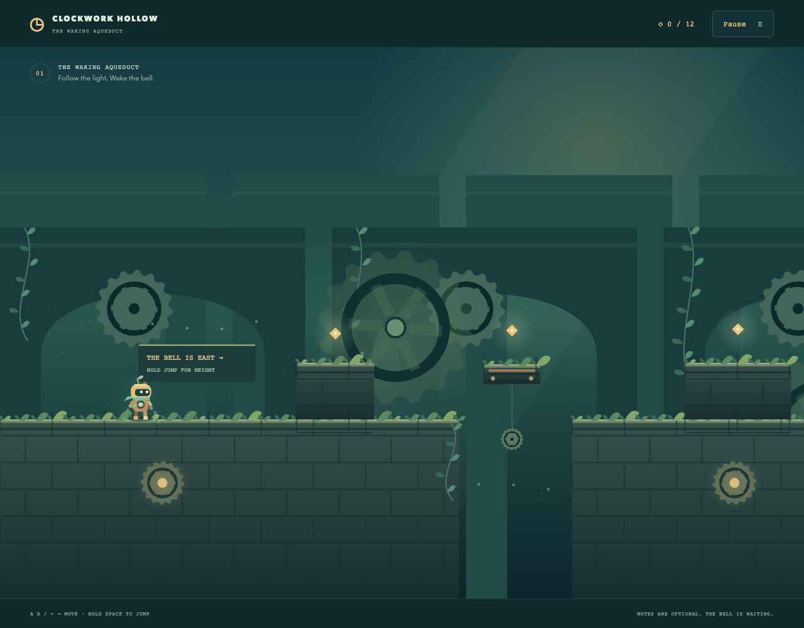
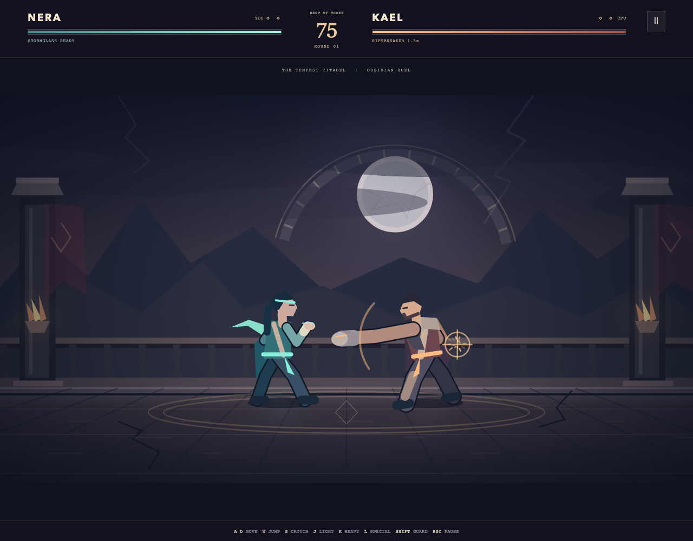

# Game catalog

Choose a game from the collection screen. **Game selection** in its title, pause or result menu returns to the collection; each visit starts a fresh session. The application fills the browser viewport, with menus scrolling inside the game.

## Last Light Clearing

**Fullscreen** includes the arena, HUD and menus when supported by the browser.

Move the Keeper through a crowded forest, collect XP gems and choose upgrades while weapons fire automatically. Spark, Halo, Pulse and Shard offer different ways to survive, with a Spark evolution and a late elite encounter. Survive **Until dawn** for three minutes or try the 90-second **Brief dusk** round.

Choose SVG, animated pixel, sculpted Three.js or procedural WebGPU appearances with the same gameplay rules. Appearance, interface, accent, Close/Whole arena view and sound settings are available at title or pause; round selection is at title. Settings persist through retries until reload. Appearance changes retain the paused run and require Resume. Failed artwork/audio can fall back to silhouettes/silence; unavailable graphics retain a working appearance or restore Canvas.

| Control | Action |
| --- | --- |
| WASD / arrow keys | Move |
| Hold and drag in the arena | Move with mouse, touch or pen; release to stop |
| Escape / P / Pause | Pause; use Resume to continue |
| Click / tap, or arrows + Enter / Space | Choose an upgrade, then release to continue |
| Tab / Shift+Tab | Focus menu controls |
| Fullscreen / Exit fullscreen | Change display mode |

See [game rules and implementation](docs/last-light-clearing.md) and [art setup and provenance](src/art/README.md), including the optional development-only Mosslight appearance.

## Skybreak

Fly a 2–3 minute ocean sortie through fifteen formations to **Iron Tempest**, an armored flying fortress with three telegraphed attack patterns. Collect Power, temporary Spread and Repair supplies. Three lives and a rechargeable evasive roll help you reach the boss and earn a survival bonus. Original procedural Canvas artwork and synthesized sound require no downloaded art or audio.

| Control | Action |
| --- | --- |
| WASD / arrow keys | Steer |
| Space / J | Hold to fire |
| Shift / K / Roll button | Evade; recharges between rolls |
| Hold and drag on the playfield | Steer and fire with touch, mouse or pen; release to stop |
| Escape / Pause | Pause; use Resume flight to continue |

The portrait playfield scales uniformly and stays centered. Roll supports a second touch while steering. Focus loss or display changes pause play and clear held input. Restart creates fresh gameplay state. Sound can be muted, and unavailable audio never prevents play. See [game rules and implementation](docs/skybreak.md) for pickups, boss patterns, tuning and source ownership.

## Clockwork Hollow

Guide a little brass keeper through **The Waking Aqueduct**, **The Emberworks** and **The Starlit Belfry**. Three authored districts progress from mossy spans to pressure-powered machinery and moonlit climbs. Leap over copper thorns, stomp wind-up beetles, read vent warnings, collect optional motes and wake all three bells. The intended first-play pace is 3–6 minutes. Responsive acceleration, variable jump height, coyote time and buffered jumps help you find a comfortable rhythm. There is no time limit.

| Control | Action |
| --- | --- |
| A/D / left and right arrows | Move |
| Space / W / Up / Z | Jump; hold for height, release for a short hop |
| Touch arrows + Jump | Move and jump with independent buttons |
| Escape / P / Pause | Pause; use Resume journey to continue |
| Fullscreen / Exit fullscreen | Change display mode from the menus |

Six checkpoint lanterns shorten retries. Falling or touching danger ends the attempt; retry returns to the latest lantern and keeps motes, time and missed steps. District bells lead to explicit transitions, then a final result with score and collection/clean-run distinctions. Restart journey creates a fresh adventure. Focus loss and display changes pause and clear input. Original procedural Canvas artwork and AudioBits sound have no downloaded asset dependencies. See [gameplay, source ownership and architecture evaluation](docs/clockwork-hollow.md).

## Midnight Circuit

The grid is dead. The streets aren't. Fight as **Rook** through **Neon Backstreets** and **The Power Station**, then break the blackout by defeating the **Circuit Warden**. Align in the ground-depth lane, chain a three-hit combo, clear crowds with a heavy strike and jump into a flying kick. Authored encounters mix fast Strikers and committed Bruisers before the Warden's charge and ground-impact patterns. Three lives, repair cells and a station health refill support the roughly 4–6 minute first-run pace.

| Control | Action |
| --- | --- |
| WASD / arrows | Move and align in depth |
| J | Light combo; press again to chain |
| K | Heavy strike |
| Space, then J / K | Jump, then flying kick |
| Touch arrows + Strike / Heavy / Jump | Independent movement and action buttons |
| Escape / P / Pause | Pause; use Resume fight to continue |
| Fullscreen / Exit fullscreen | Change display mode from the menus |

Original articulated Canvas artwork, parallax facades, wet reflections, bright impacts and procedural AudioBits sound give the streets their identity. Encounter gates keep enemies reachable, the camera frames the arena, and depth sorting follows feet rather than jump height. Results record score, hits, best chain, time and lives. Restart creates a fresh run. Focus loss and display changes pause play and clear input. See [gameplay, source ownership and the fourth-genre architecture evaluation](docs/midnight-circuit.md).

## Obsidian Duel

Two warriors. One eye of the storm. Choose agile **Nera**, with fast palms and a Stormglass energy bolt, or powerful **Kael**, with crushing blows and an advancing Riftbreaker. Read the CPU's telegraphs, guard high or low, jump over sweeps and punish missed heavy strikes. Win two rounds to claim the citadel. A visible timer, round countdowns, KO and time-out decisions keep matches quick and replayable.

| Control | Action |
| --- | --- |
| A/D / left and right arrows | Move; face the opponent automatically |
| W / Up / Space | Jump |
| S / Down | Crouch |
| J / K / L | Light / heavy / special |
| Crouch + J / airborne J or K | Low sweep / overhead jump attack |
| Shift | Guard; hold crouch as well to stop sweeps |
| Touch directions + Light / Heavy / Special / Guard | Independent held controls and attack presses |
| Escape / P / Pause | Pause; use Resume duel to continue |
| Fullscreen / Exit fullscreen | Change display mode from the menus |

Original articulated Canvas fighters, citadel scenery, bounded impact effects and AudioBits sound distinguish misses, contact and guard. The entire fixed arena scales uniformly on narrower screens. Rematch starts fresh; Game selection returns to the collection. See [fighting rules, source ownership and the fifth-genre architecture review](docs/obsidian-duel.md).

See the [three-game architecture review](docs/three-game-review.md) for shared-system decisions.

See [README](README.md) for local setup.
