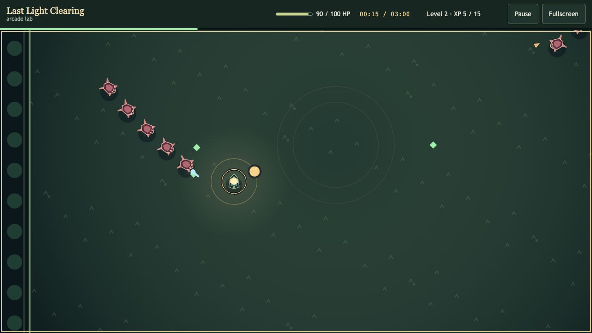
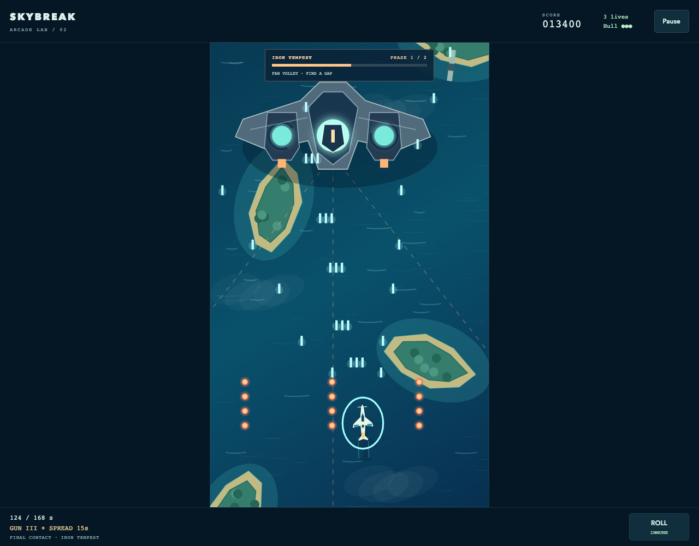
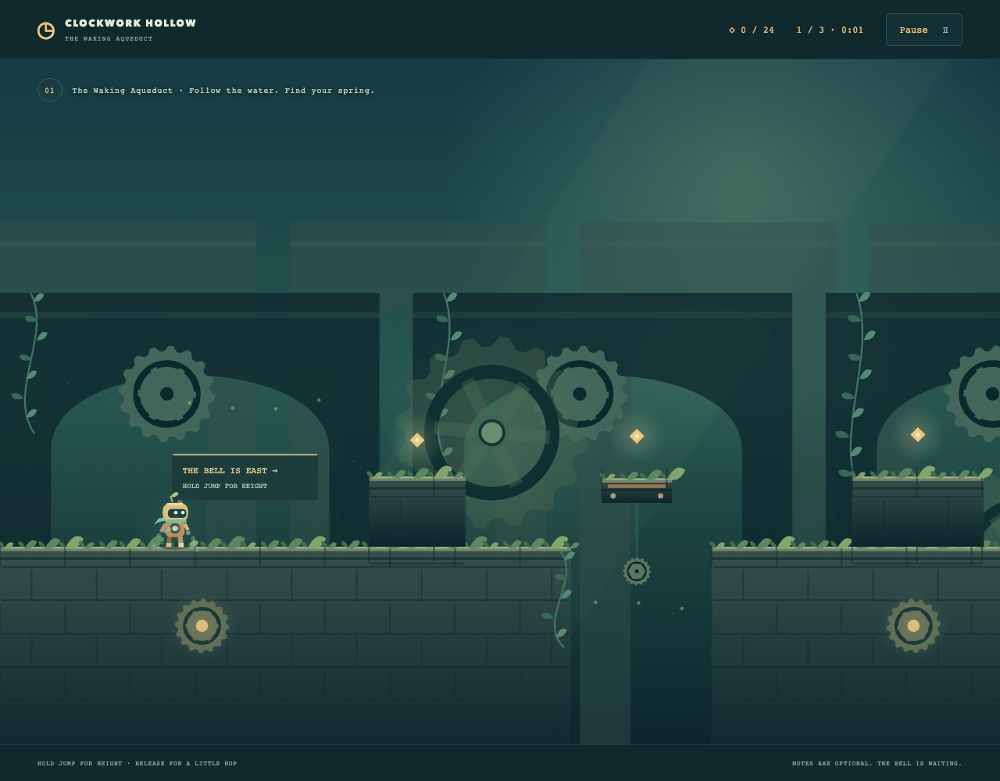
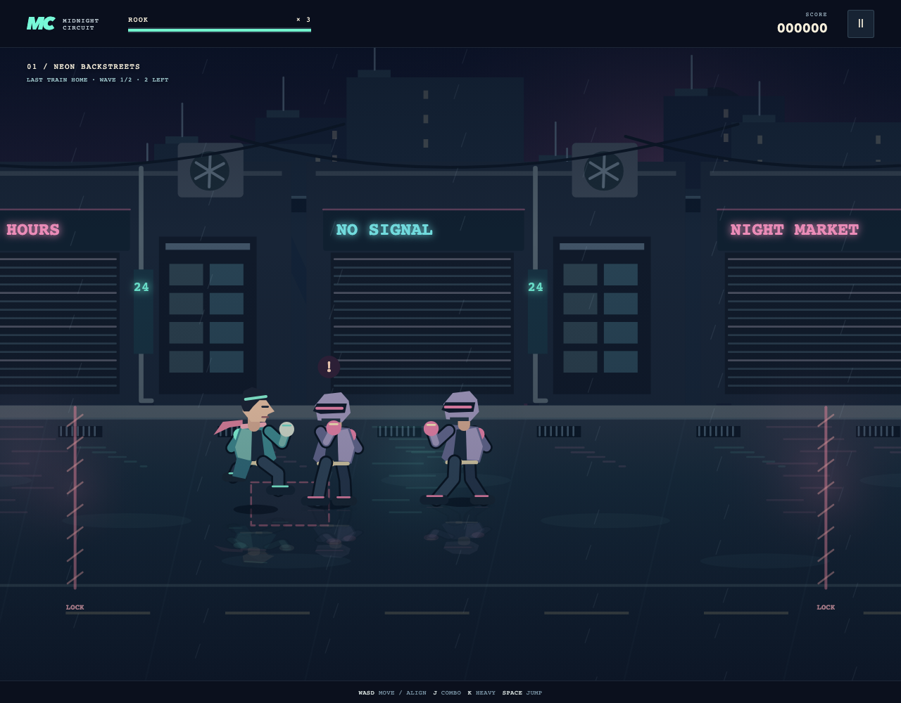
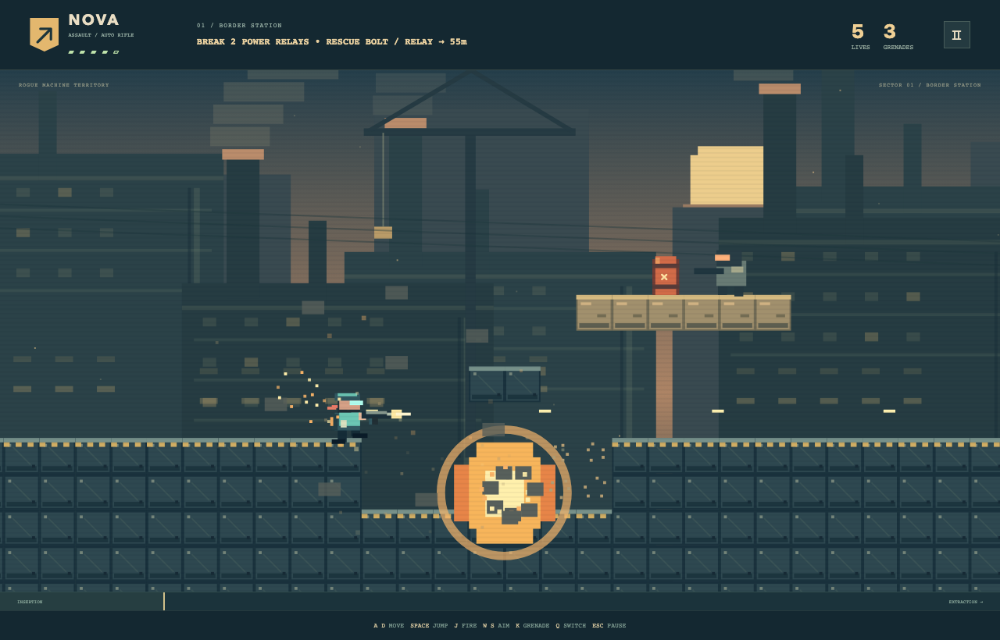

# Game catalog

Choose a game from the collection screen. **Game selection** in its title, pause or result menu returns to the collection; each visit starts a fresh session. The application fills the browser viewport. Each menu has one **Theme** selector, sound/fullscreen controls and expandable control instructions. Theme changes retain the paused run; Resume continues it. Missing modes are visible as disabled options.

| Game | Normal | Assets | Quality |
| --- | --- | --- | --- |
| Last Light Clearing | Procedural clearing | Bundled CC0 Ember Ruins | Prism Garden, sculpted and lit in 3D |
| Skybreak | Pacific Run | Bundled original Aurora Fleet | Not available |
| Clockwork Hollow | Verdant clockwork | Not available | Not available |
| Midnight Circuit | Illustrated arcade | Not available | Neon 3D scene, with WebGPU finish when supported |
| Obsidian Duel | Tempest citadel | Not available | Not available |
| Blastline | Iron coast | Not available | Not available |

All games start in Normal. Normal, Assets and Quality are the three standard modes. Custom is optional and appears only for explicitly requested, implemented experiments. Last Light Clearing offers Abyssal Bloom as Custom. See the [mode contract](docs/architecture.md#mode-contract) for development guidance.

All artwork required by enabled presentations is committed. The six covers, procedural visuals and [Aurora Fleet](src/games/skybreak/art/README.md) are original artwork under the repository's MIT license. The only bundled third-party artwork is [Ember Ruins' CC0 atlas](src/games/last-light-clearing/art/ember-ruins/PROVENANCE.md), retained with its upstream metadata and provenance. Documentation screenshots capture these original or CC0 presentations.

## Last Light Clearing

**Fullscreen** includes the arena, HUD and menus when supported by the browser.

Move the Keeper through a crowded forest, collect XP gems and choose upgrades while weapons fire automatically. Spark, Halo, Pulse and Shard offer different ways to survive, with a Spark evolution and a late elite encounter. Survive **Until dawn** for three minutes or try the 90-second **Brief dusk** round.

Normal uses procedural Canvas art without image loads. Assets supplies animated pixel characters and scenery, while Quality uses Prism Garden. The optional Custom presentation, Abyssal Bloom, uses a procedural luminous field and shader-rendered organisms and requires WebGPU. Each mode includes matching HUD styling. The camera follows the Keeper consistently across modes. Round selection stays available before starting; theme selection survives restarts within the session. Failed replacements retain the working presentation; graphics loss restores Normal.

| Control | Action |
| --- | --- |
| WASD / arrow keys | Move |
| Hold and drag in the arena | Move with mouse, touch or pen; release to stop |
| Escape / P / Pause | Pause; use Resume to continue |
| Click / tap, or arrows + Enter / Space | Choose an upgrade, then release to continue |
| Tab / Shift+Tab | Focus menu controls |
| Fullscreen / Exit fullscreen | Change display mode |

See [game rules and implementation](docs/games/last-light-clearing/README.md) and [artwork definitions and provenance](src/games/last-light-clearing/art/README.md).

## Skybreak

Fly a 2–3 minute sortie through fifteen formations to **Iron Tempest**, an armored flying fortress with three telegraphed attack patterns. Collect Power, temporary Spread and Repair supplies. Three lives and a rechargeable evasive roll help you reach the boss and earn a survival bonus. Normal uses the original Pacific Run. Assets uses the bundled original Aurora Fleet in development and production; see [artwork definitions and provenance](src/games/skybreak/art/README.md). Quality is not yet available. All artwork and synthesized sound require no additional downloads.

| Control | Action |
| --- | --- |
| WASD / arrow keys | Steer |
| Space / J | Hold to fire |
| Shift / K / Roll button | Evade; recharges between rolls |
| Hold and drag on the playfield | Steer and fire with touch, mouse or pen; release to stop |
| Escape / Pause | Pause; use Resume to continue |
| Fullscreen / Exit fullscreen | Change display mode from the menus |

The portrait playfield scales uniformly and stays centered. Roll supports a second touch while steering. Focus loss or display changes pause play and clear held input. Restart creates fresh gameplay state. Sound can be muted, and unavailable audio never prevents play. See [game rules and implementation](docs/games/skybreak/README.md) for pickups, boss patterns, tuning and source ownership.

## Clockwork Hollow

Guide a little brass keeper through **The Waking Aqueduct**, **The Emberworks** and **The Starlit Belfry**. Three authored districts progress from mossy spans to pressure-powered machinery and moonlit climbs. Leap over copper thorns, stomp wind-up beetles, read vent warnings, collect optional motes and wake all three bells. The intended first-play pace is 3–6 minutes. Responsive acceleration, variable jump height, coyote time and buffered jumps help you find a comfortable rhythm. There is no time limit.

| Control | Action |
| --- | --- |
| A/D / left and right arrows | Move |
| Space / W / Up / Z | Jump; hold for height, release for a short hop |
| Touch arrows + Jump | Move and jump with independent buttons |
| Escape / P / Pause | Pause; use Resume to continue |
| Fullscreen / Exit fullscreen | Change display mode from the menus |

Normal retains Verdant clockwork; Assets and Quality are not yet available. Six checkpoint lanterns shorten retries. Falling or touching danger ends the attempt; retry returns to the latest lantern and keeps motes, time and missed steps. District bells lead to explicit transitions, then a final result with score and collection/clean-run distinctions. Restart creates a fresh adventure. Focus loss and display changes pause and clear input. Original procedural Canvas artwork and AudioBits sound have no downloaded asset dependencies. See [gameplay and source ownership](docs/games/clockwork-hollow/README.md).

## Midnight Circuit

The grid is dead. The streets aren't. Fight as **Rook** through **Neon Backstreets** and **The Power Station**, then break the blackout by defeating the **Circuit Warden**. Align in the ground-depth lane, chain a three-hit combo, clear crowds with a heavy strike and jump into a flying kick. Authored encounters mix fast Strikers and committed Bruisers before the Warden's charge and ground-impact patterns. Three lives, repair cells and a station health refill support the roughly 4–6 minute first-run pace.

| Control | Action |
| --- | --- |
| WASD / arrows | Move and align in depth |
| J | Light combo; press again to chain |
| K | Heavy strike |
| Space, then J / K | Jump, then flying kick |
| Touch arrows + Strike / Heavy / Jump | Independent movement and action buttons |
| Escape / P / Pause | Pause; use Resume to continue |
| Fullscreen / Exit fullscreen | Change display mode from the menus |

Normal uses the original illustrated Canvas presentation. Quality combines the modeled Neon diorama scene with the Neon cinema finish when WebGPU is supported. Modeled fighters, neon facades, rain, shadows and bright impacts bring the streets to life, with distance-driven walking across both modes and procedural AudioBits sound. Assets is not yet available. Theme changes preserve the paused run; unavailable graphics retain a working presentation or restore Normal. Encounter gates keep enemies reachable, the camera frames the arena, and depth sorting follows feet rather than jump height. Results record score, hits, best chain, time and lives. Restart creates a fresh run. Focus loss and display changes pause play and clear input. See [gameplay and source ownership](docs/games/midnight-circuit/README.md).

## Obsidian Duel

Two warriors. One eye of the storm. Choose agile **Nera**, with fast palms and a Stormglass energy bolt, or powerful **Kael**, with crushing blows and an advancing Riftbreaker. Read the CPU's telegraphs, guard high or low, jump over sweeps and punish missed heavy strikes. Win two rounds to claim the citadel. A visible timer, round countdowns, KO and time-out decisions keep matches quick and replayable.

| Control | Action |
| --- | --- |
| A/D / left and right arrows | Move; face the opponent automatically |
| W / Up / Space | Jump |
| S / Down | Crouch |
| J / K / L | Light / heavy / special |
| Crouch + J / airborne J or K | Low sweep / overhead jump attack |
| Shift | Guard; hold crouch as well to stop sweeps |
| Touch directions + Light / Heavy / Special / Guard | Independent held controls and attack presses |
| Escape / P / Pause | Pause; use Resume to continue |
| Fullscreen / Exit fullscreen | Change display mode from the menus |

Normal retains Tempest citadel and its original fighter costumes. Assets and Quality are not yet available. Original articulated Canvas fighters, citadel scenery, bounded impact effects and AudioBits sound distinguish misses, contact and guard. The entire fixed arena scales uniformly on narrower screens. Restart starts fresh; Game setup returns to fighter selection. See [fighting rules and source ownership](docs/games/obsidian-duel/README.md).

## Blastline

Make an entrance. Catch the last ride out. Run, jump and blast through **Border Station** and **Foundry Run**, breaking cover, dropping elevated defenses and setting off explosive barrel chains. Start with **Nova** and her automatic rifle, rescue **Bolt** to unlock a slower rocket launcher, then swap between both weapon styles. Disable power relays, break the fortified **Bastion** and extract before each facility collapses. The intended first-play pace is 3–5 minutes.

| Control | Action |
| --- | --- |
| A/D / left and right arrows | Run |
| Space | Jump; release for a short hop |
| J | Hold to fire |
| W/S / up and down arrows | Aim vertically; combine with movement for diagonals |
| K | Throw a fused grenade |
| Q | Switch operator after rescuing Bolt |
| Touch directions + Jump / Fire / Grenade / Switch | Independent simultaneous controls |
| Escape / P / Pause | Pause; use Resume to continue |
| Fullscreen / Exit fullscreen | Change display mode from the menus |

Normal retains Iron coast. Assets and Quality are not yet available. Five lives and green supply checkpoints support the operation. Brick and armored cover break, while structural routes keep required objectives accessible. Death preserves destruction and mission progress; Restart restores the complete world. Original Canvas pixel artwork, bounded debris and procedural AudioBits sounds power the action. See [gameplay and source ownership](docs/games/blastline/README.md).

See the [shared architecture](docs/architecture.md) for repository layout and common ownership.

See [README](README.md) for local setup.
