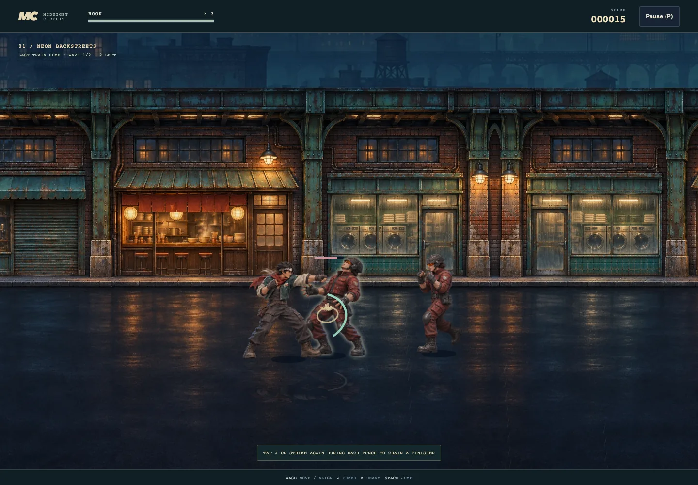
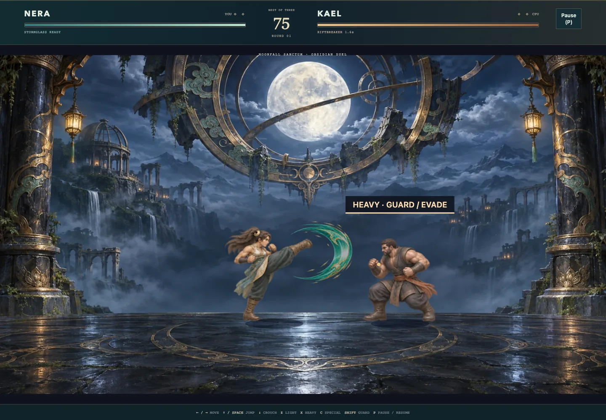
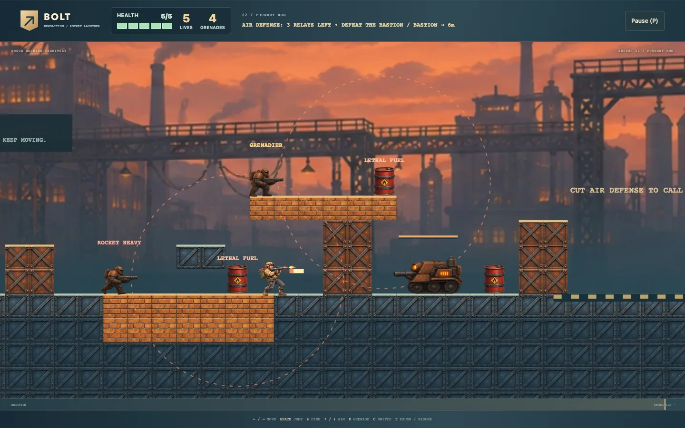

# Game catalog

Choose a game from the collection screen. **Game selection** returns there; each visit starts a fresh session. Games fill the viewport, with fullscreen including the arena, HUD and menus where supported.

Main and pause menus provide available theme choices and sound/fullscreen controls. **Settings** holds keyboard layouts where available and How to play; **Back** returns to the menu you came from without changing your run. **P** pauses/resumes, **F** toggles fullscreen, and **Tab / Shift+Tab** moves through menu controls. Escape pauses when delivered; browsers may use it to leave fullscreen. Focus loss, hidden pages and display transitions pause play and clear held input; use Resume to continue. Unavailable audio leaves play usable. Play waits for required artwork; if loading fails, use **Retry artwork**, choose another theme or return to Game selection.

Every game offers on-screen movement and action controls on touch devices and narrow screens. Slide the circular direction pad to change direction or combine diagonals while holding action buttons with another finger. Clockwork Hollow uses left/right arrows and a separate Jump button. Last Light Clearing and Skybreak also support dragging in the playfield.

Theme changes retain the paused run. **Restart** immediately creates a fresh run with the current choices, retaining the theme and keyboard layout for this visit. To choose a different round or fighter, return to **Game selection** and reopen the game. A failed replacement keeps the working presentation. A Deluxe graphics failure pauses play and recovers to Arcade; an Arcade failure offers Retry artwork or navigation.

The table lists the presentations currently implemented; their artwork and renderers will evolve through dedicated game passes.

|  Game  |  Arcade  |  Deluxe  |
|  ---  |  ---  |  ---  |
|  Last Light Clearing  |  Ember Ruins  |  Ember Ruins · Rekindled, compact painted knight, goblins and demon in a cobbled ruin  |
|  Skybreak  |  Aurora Fleet, arcade fleet and pixel reefs  |  Tempest Coast, painted fleet and scrolling shoals  |
|  Clockwork Hollow  |  Porcelain Bellgarden, illustrated retro sanctuary  |  Lumen Conservatory, dimensional ceramic-and-brass cathedral gardens  |
|  Midnight Circuit  |  Signal / Rain, inked arcade shops and industrial bays  |  Afterglow, detailed modern fighters and painted city with wet-road reflections  |
|  Obsidian Duel  |  Eclipse Foundry, painted arcade fighters and forge-lit arena  |  Moonfall Sanctum, detailed fighters and jade-and-gold combat artwork  |
|  Blastline  |  Ember Coast, detailed arcade commandos and rusted harbor defenses  |  Ember Reforged, dimensional painted commandos and industrial coast  |

All current games start in **Arcade** and optionally switch to **Deluxe**. Arcade is the complete finished presentation. Deluxe enhances its artwork and effects through the same Canvas 2D gameplay presentation. Prototype is a temporary stage for new games and is removed once Arcade is complete. See the [mode contract](docs/architecture.md#mode-contract).

All artwork required by enabled presentations ships with the repository. Screenshots below show each game in **Deluxe**.

## Last Light Clearing

Move the Keeper through a crowded forest, collect XP gems and choose upgrades while weapons fire automatically. Spark, Halo, Pulse and Shard offer different ways to survive, with a Spark evolution, lane-charging briar creatures and a late elite ground-slam encounter. Survive **Until dawn** for three minutes or try the 90-second **Brief dusk** round.

The camera follows the Keeper. Round cards compare the two round lengths before starting.

|  Control  |
|  ---  |
|  WASD / arrow keys  |
|  Hold and drag in the arena  |
|  Touch direction pad to move; weapons fire automatically  |
|  Click / tap, or arrows + Enter / Space  |

See [game rules and implementation](docs/games/last-light-clearing/README.md) and [artwork guide](src/games/last-light-clearing/art/README.md).

## Skybreak

Fly a 2–3 minute sortie through fifteen formations to **Iron Tempest**, an armored flying fortress with three telegraphed attack patterns. Collect Power, temporary Spread and Repair supplies. Three lives and a rechargeable evasive roll help you reach the boss and earn a survival bonus.

|  Control  |
|  ---  |
|  WASD / arrow keys  |
|  Space / J  |
|  Shift / K / Roll button  |
|  Hold and drag on the playfield  |
|  Touch direction pad + Fire / Roll  |

The portrait playfield scales uniformly and stays centered. Roll supports a second touch while steering. See [game rules and implementation](docs/games/skybreak/README.md) for pickups, boss patterns, tuning and [artwork](src/games/skybreak/art/README.md).

## Clockwork Hollow

Guide a little brass keeper through **The Waking Aqueduct**, **The Emberworks** and **The Starlit Belfry**. Three authored districts progress from mossy spans to pressure-powered machinery and moonlit climbs. Leap over copper thorns, stomp wind-up beetles, read vent warnings, collect optional motes and wake all three bells. The intended first-play pace is 3–6 minutes. Responsive acceleration, variable jump height, coyote time and buffered jumps help you find a comfortable rhythm. There is no time limit.

|  Control  |
|  ---  |
|  A/D / left and right arrows  |
|  Space / W / Up / Z  |
|  Touch arrows + Jump  |

Six checkpoint lanterns shorten retries. Falling or touching danger ends the attempt; retry returns to the latest lantern and keeps motes, time and missed steps. District bells lead to explicit transitions, then a result with score and collection/clean-run distinctions. See [gameplay and source ownership](docs/games/clockwork-hollow/README.md) and the [artwork guide](src/games/clockwork-hollow/art/README.md).

## Midnight Circuit

The grid is dead. The streets aren't. Fight as **Rook** through **Neon Backstreets** and **The Power Station**, then break the blackout by defeating the **Circuit Warden**. Align in the ground-depth lane, tap through a three-hit combo, reposition during recovery, clear crowds with a heavy strike and jump into a flying kick. Contextual prompts help with alignment and chaining. Authored encounters mix fast Strikers and committed Bruisers before the Warden's charge and ground-impact patterns. Three lives, repair cells that wait until health is needed and a station health refill support the roughly 4–6 minute first-run pace.

|  Control  |
|  ---  |
|  Arrows  |
|  Z  |
|  X  |
|  Space, then Z / X  |
|  Touch direction pad + Strike / Heavy / Jump  |

**Keyboard layout** in Settings also offers WASD movement with J/K attacks and Space jump. The selection lasts for this visit, including restarts.

Encounter gates keep enemies reachable, the camera frames the arena, and depth sorting follows feet rather than jump height. Results record score, hits, best chain, time and lives. See [gameplay and source ownership](docs/games/midnight-circuit/README.md) and the [artwork guide](src/games/midnight-circuit/art/README.md).

## Obsidian Duel

Two warriors. One eye of the storm. Choose agile **Nera**, with fast palms and a Stormglass energy bolt, or powerful **Kael**, with crushing blows and an advancing Riftbreaker. Read the CPU's telegraphs, guard high or low, jump over sweeps or over your opponent to switch sides, and punish missed heavy strikes. Win two rounds to claim the citadel. A visible timer, round countdowns, KO and time-out decisions keep matches quick and replayable.

|  Action  |  WASD layout  |
|  ---  |  ---  |
|  Move; face the opponent automatically  |  A / D  |
|  Jump  |  W / Space  |
|  Crouch  |  S  |
|  Light / heavy / special  |  J / K / L  |
|  Low sweep / overhead jump attack  |  Crouch + J / airborne J or K  |
|  Guard; crouch as well to stop sweeps  |  Shift  |

**Keyboard layout** in Settings chooses right-hand movement with left-hand attacks, or left-hand movement with right-hand attacks. The selection lasts for this visit, including restarts and returning to fighter selection. Touch direction pad + Light / Heavy / Special / Guard support independent held controls and attack presses.

Action-specific poses and feedback distinguish misses, contact and guard. The fixed arena scales uniformly on narrower screens. See [fighting rules and source ownership](docs/games/obsidian-duel/README.md) and the [artwork guide](src/games/obsidian-duel/art/README.md).

## Blastline

Make an entrance. Catch the last ride out. Run, jump and blast through **Border Station** and **Foundry Run**, breaking cover, dropping elevated defenses and setting off explosive barrel chains. Start with **Nova** and her automatic rifle, rescue **Bolt** to unlock a slower rocket launcher, then swap between both weapon styles. Cut air-defense relays for health and ammunition, dodge rifle bursts and lobbed grenades, break the fortified **Bastion** and extract before each facility collapses. The intended first-play pace is 3–5 minutes.

|  Action  |  WASD layout  |
|  ---  |  ---  |
|  Run  |  A / D  |
|  Jump; release for a short hop  |  Space  |
|  Hold to fire  |  J  |
|  Aim vertically; combine with movement for diagonals  |  W / S  |
|  Throw a fused grenade  |  K  |
|  Switch operator after rescuing Bolt  |  L  |

**Keyboard layout** in Settings chooses right-hand movement with left-hand attacks, or left-hand movement with right-hand attacks. The selection lasts for this visit, including restarts and mission transitions. Touch direction pad + Jump / Fire / Grenade / Switch support independent simultaneous controls.

Health and lives are grouped in the HUD: bullets chip health, while hostile explosives and fuel blasts cost a life. Green supply checkpoints support retries. Brick and armored cover break, while structural routes keep required objectives accessible. Death preserves destruction and mission progress; Restart restores the complete world. Original complete sprites, bounded debris and procedural AudioBits sounds power the action. Deluxe adds painted commandos, machines, equipment and coastal scenery. See [gameplay and source ownership](docs/games/blastline/README.md).

See the [shared architecture](docs/architecture.md) for repository layout and common ownership.

See [README](README.md) for local setup.
