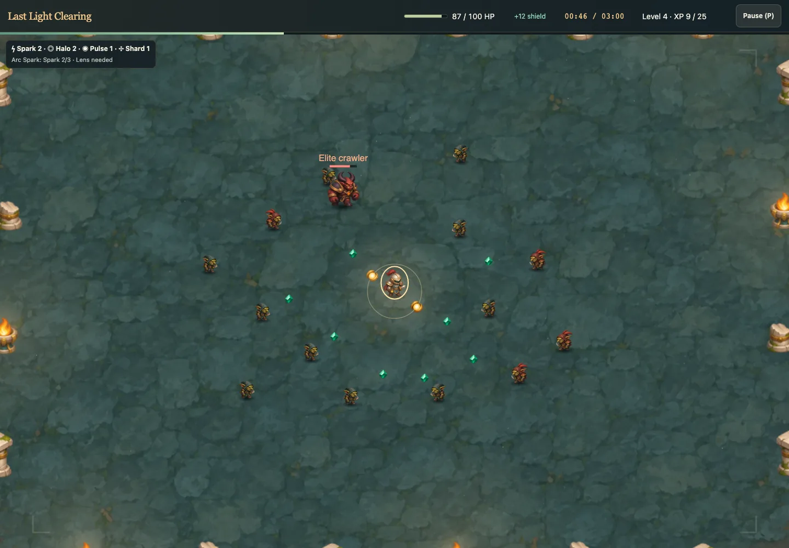
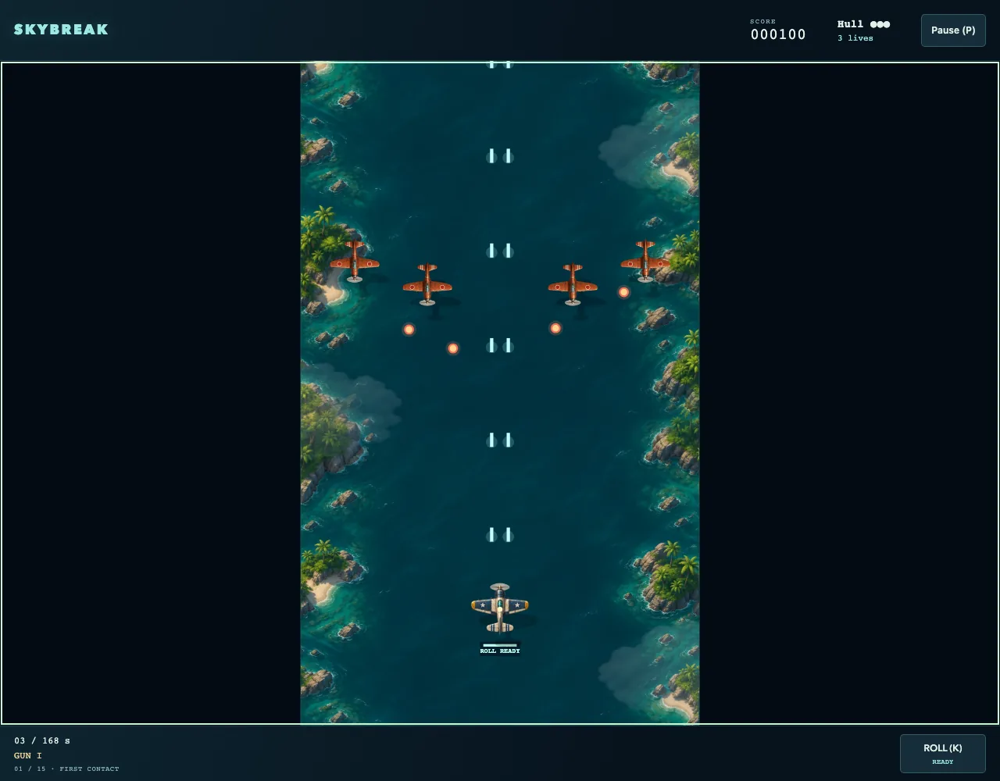
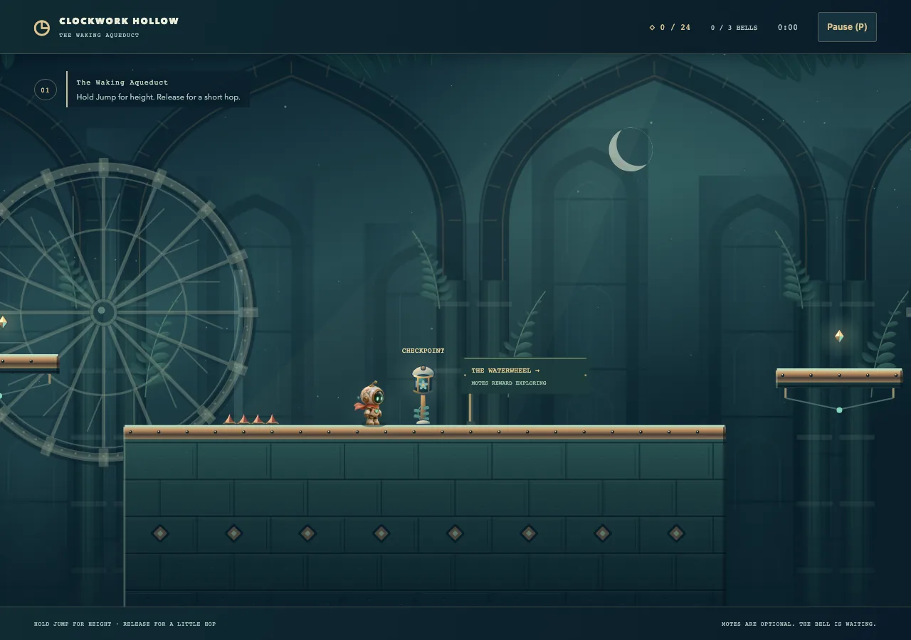
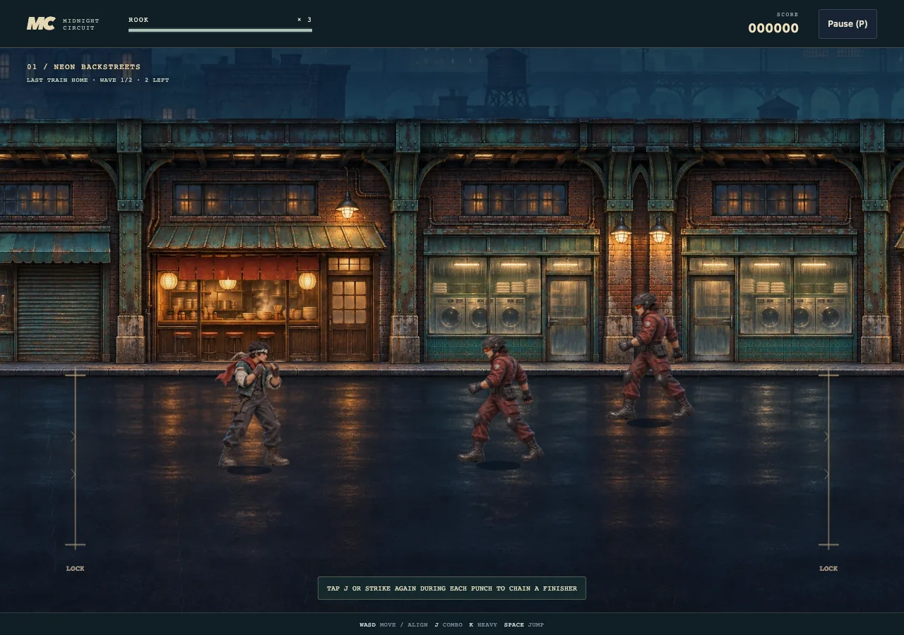
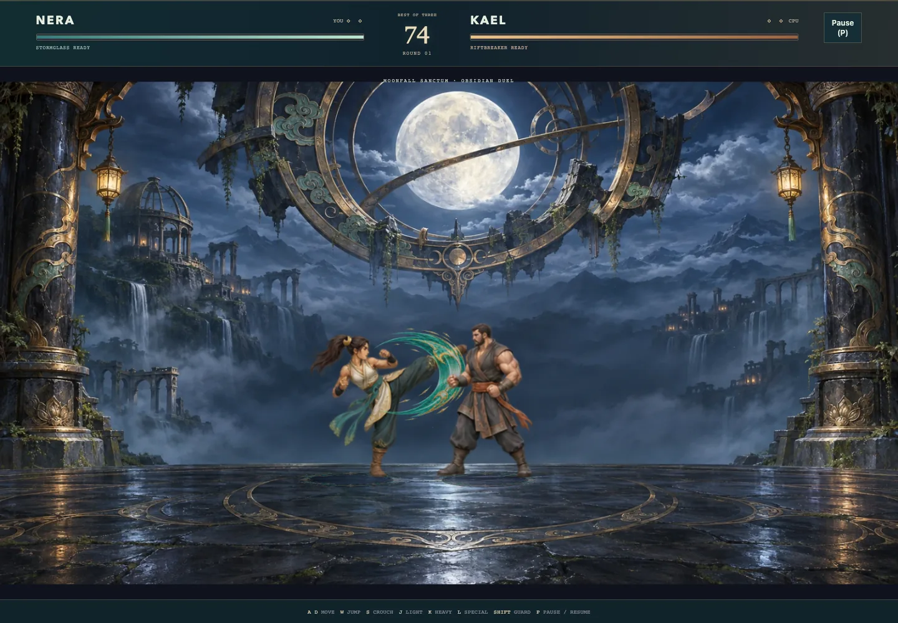
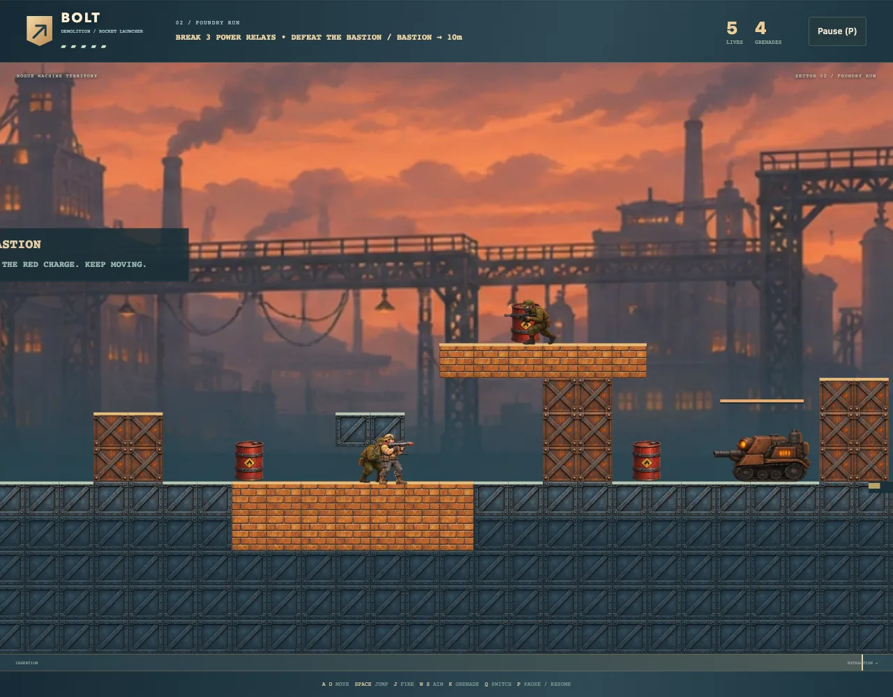

# Game catalog

Choose a game from the collection screen. **Game selection** returns there; each visit starts a fresh session. Games fill the viewport, with fullscreen including the arena, HUD and menus where supported.

Every game menu provides Theme, sound/fullscreen controls and expandable control instructions. **P** pauses/resumes, **F** toggles fullscreen, and **Tab / Shift+Tab** moves through menu controls. Escape pauses when delivered; browsers may use it to leave fullscreen. Focus loss, hidden pages and display transitions pause play and clear held input; use Resume to continue. Unavailable audio leaves play usable. Play waits for required artwork; if loading fails, use **Retry artwork**, choose another theme or return to Game selection.

Theme changes retain the paused run. Restart creates a fresh run while keeping the selected theme for this visit. Missing themes are disabled; a failed replacement keeps the working presentation, and a graphics failure pauses play and restores Normal.

The table lists the presentations currently implemented; their artwork and renderers will evolve through dedicated game passes.

| Game | Normal | Assets | Quality |
| --- | --- | --- | --- |
| Last Light Clearing | Forest clearing with complete sprites | Ember Ruins | Ember Ruins · Rekindled, compact painted knight, goblins and demon in a cobbled ruin |
| Skybreak | Pacific Run | Aurora Fleet, arcade fleet and pixel reefs | Tempest Coast, painted fleet and scrolling shoals |
| Clockwork Hollow | Verdant clockwork | Porcelain Bellgarden, illustrated retro sanctuary | Lumen Conservatory, dimensional ceramic-and-brass cathedral gardens |
| Midnight Circuit | Street sketch, simple flat cels | Signal / Rain, inked arcade shops and industrial bays | Afterglow, detailed modern fighters and painted city with wet-road reflections |
| Obsidian Duel | Tempest citadel, simple flat-color fighters | Eclipse Foundry, painted arcade fighters and forge-lit arena | Moonfall Sanctum, detailed fighters and jade-and-gold combat artwork |
| Blastline | Iron coast | Ember Coast, detailed arcade commandos and rusted harbor defenses | Ember Reforged, dimensional painted commandos and industrial coast |

All games start in **Assets**. **Normal** is a development-only gameplay baseline with simple, readable visuals that can already use image assets. **Assets** is the focused retro or pixel-inspired artistic pass. **Quality** reinterprets the Assets designs through new or substantially improved artwork and animation, with a coherent modern finish across characters, objects, scenery, effects and interface. Modern refers to visual finish, not a futuristic setting. All three modes use Canvas 2D and image assets. Existing standard presentations follow these roles while sharing their gameplay. See the [mode contract](docs/architecture.md#mode-contract) for development guidance.

All artwork required by enabled presentations ships with the repository. Screenshots below show each game in **Quality**.

## Last Light Clearing

Move the Keeper through a crowded forest, collect XP gems and choose upgrades while weapons fire automatically. Spark, Halo, Pulse and Shard offer different ways to survive, with a Spark evolution, lane-charging briar creatures and a late elite ground-slam encounter. Survive **Until dawn** for three minutes or try the 90-second **Brief dusk** round.

The camera follows the Keeper. Round cards compare the two round lengths before starting.

| Control | Action |
| --- | --- |
| WASD / arrow keys | Move |
| Hold and drag in the arena | Move with mouse, touch or pen; release to stop |
| Click / tap, or arrows + Enter / Space | Choose an upgrade, then release to continue |

See [game rules and implementation](docs/games/last-light-clearing/README.md) and [artwork guide](src/games/last-light-clearing/art/README.md).

## Skybreak

Fly a 2–3 minute sortie through fifteen formations to **Iron Tempest**, an armored flying fortress with three telegraphed attack patterns. Collect Power, temporary Spread and Repair supplies. Three lives and a rechargeable evasive roll help you reach the boss and earn a survival bonus.

| Control | Action |
| --- | --- |
| WASD / arrow keys | Steer |
| Space / J | Hold to fire |
| Shift / K / Roll button | Evade; recharges between rolls |
| Hold and drag on the playfield | Steer and fire with touch, mouse or pen; release to stop |

The portrait playfield scales uniformly and stays centered. Roll supports a second touch while steering. See [game rules and implementation](docs/games/skybreak/README.md) for pickups, boss patterns, tuning and [artwork](src/games/skybreak/art/README.md).

## Clockwork Hollow

Guide a little brass keeper through **The Waking Aqueduct**, **The Emberworks** and **The Starlit Belfry**. Three authored districts progress from mossy spans to pressure-powered machinery and moonlit climbs. Leap over copper thorns, stomp wind-up beetles, read vent warnings, collect optional motes and wake all three bells. The intended first-play pace is 3–6 minutes. Responsive acceleration, variable jump height, coyote time and buffered jumps help you find a comfortable rhythm. There is no time limit.

| Control | Action |
| --- | --- |
| A/D / left and right arrows | Move |
| Space / W / Up / Z | Jump; hold for height, release for a short hop |
| Touch arrows + Jump | Move and jump with independent buttons |

Six checkpoint lanterns shorten retries. Falling or touching danger ends the attempt; retry returns to the latest lantern and keeps motes, time and missed steps. District bells lead to explicit transitions, then a result with score and collection/clean-run distinctions. See [gameplay and source ownership](docs/games/clockwork-hollow/README.md) and the [artwork guide](src/games/clockwork-hollow/art/README.md).

## Midnight Circuit

The grid is dead. The streets aren't. Fight as **Rook** through **Neon Backstreets** and **The Power Station**, then break the blackout by defeating the **Circuit Warden**. Align in the ground-depth lane, tap through a three-hit combo, reposition during recovery, clear crowds with a heavy strike and jump into a flying kick. Contextual prompts help with alignment and chaining. Authored encounters mix fast Strikers and committed Bruisers before the Warden's charge and ground-impact patterns. Three lives, repair cells that wait until health is needed and a station health refill support the roughly 4–6 minute first-run pace.

| Control | Action |
| --- | --- |
| Arrows | Move and align in depth |
| Z | Light combo; press again to chain |
| X | Heavy strike |
| Space, then Z / X | Jump, then flying kick |
| Touch arrows + Strike / Heavy / Jump | Independent movement and action buttons |

**Keyboard layout** on title and pause menus also offers WASD movement with J/K attacks and Space jump. The selection lasts for this visit, including restarts.

Encounter gates keep enemies reachable, the camera frames the arena, and depth sorting follows feet rather than jump height. Results record score, hits, best chain, time and lives. See [gameplay and source ownership](docs/games/midnight-circuit/README.md) and the [artwork guide](src/games/midnight-circuit/art/README.md).

## Obsidian Duel

Two warriors. One eye of the storm. Choose agile **Nera**, with fast palms and a Stormglass energy bolt, or powerful **Kael**, with crushing blows and an advancing Riftbreaker. Read the CPU's telegraphs, guard high or low, jump over sweeps or over your opponent to switch sides, and punish missed heavy strikes. Win two rounds to claim the citadel. A visible timer, round countdowns, KO and time-out decisions keep matches quick and replayable.

| Action | Arrows layout (default) | WASD layout |
| --- | --- | --- |
| Move; face the opponent automatically | Left / right arrows | A / D |
| Jump | Up / Space | W / Space |
| Crouch | Down | S |
| Light / heavy / special | Z / X / C | J / K / L |
| Low sweep / overhead jump attack | Crouch + Z / airborne Z or X | Crouch + J / airborne J or K |
| Guard; crouch as well to stop sweeps | Shift | Shift |

**Keyboard layout** on title and pause menus chooses right-hand movement with left-hand attacks, or left-hand movement with right-hand attacks. The selection lasts for this visit, including restarts and returning to Game setup. Touch directions + Light / Heavy / Special / Guard support independent held controls and attack presses.

Action-specific poses and feedback distinguish misses, contact and guard. The fixed arena scales uniformly on narrower screens. **Game setup** returns to fighter selection. See [fighting rules and source ownership](docs/games/obsidian-duel/README.md) and the [artwork guide](src/games/obsidian-duel/art/README.md).

## Blastline

Make an entrance. Catch the last ride out. Run, jump and blast through **Border Station** and **Foundry Run**, breaking cover, dropping elevated defenses and setting off explosive barrel chains. Start with **Nova** and her automatic rifle, rescue **Bolt** to unlock a slower rocket launcher, then swap between both weapon styles. Disable power relays, break the fortified **Bastion** and extract before each facility collapses. The intended first-play pace is 3–5 minutes.

| Action | Arrows layout (default) | WASD layout |
| --- | --- | --- |
| Run | Left / right arrows | A / D |
| Jump; release for a short hop | Space | Space |
| Hold to fire | Z | J |
| Aim vertically; combine with movement for diagonals | Up / down arrows | W / S |
| Throw a fused grenade | X | K |
| Switch operator after rescuing Bolt | C | L |

**Keyboard layout** on title and pause menus chooses right-hand movement with left-hand attacks, or left-hand movement with right-hand attacks. The selection lasts for this visit, including restarts and mission transitions. Touch directions + Jump / Fire / Grenade / Switch support independent simultaneous controls.

Five lives and green supply checkpoints support the operation. Brick and armored cover break, while structural routes keep required objectives accessible. Death preserves destruction and mission progress; Restart restores the complete world. Original complete sprites, bounded debris and procedural AudioBits sounds power the action. Quality adds painted commandos, machines, equipment and coastal scenery. See [gameplay and source ownership](docs/games/blastline/README.md).

See the [shared architecture](docs/architecture.md) for repository layout and common ownership.

See [README](README.md) for local setup.
