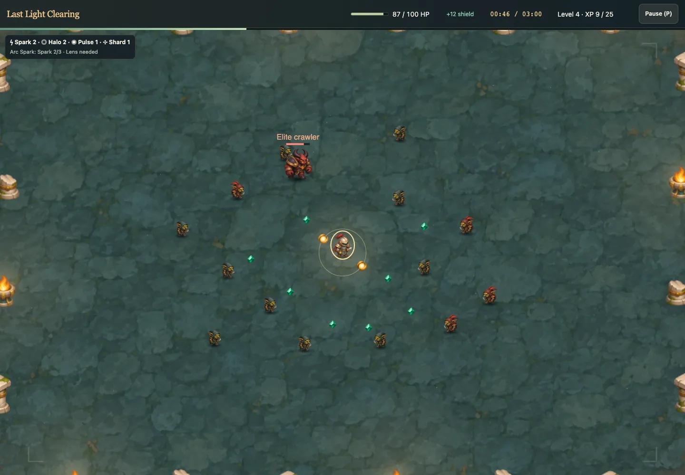
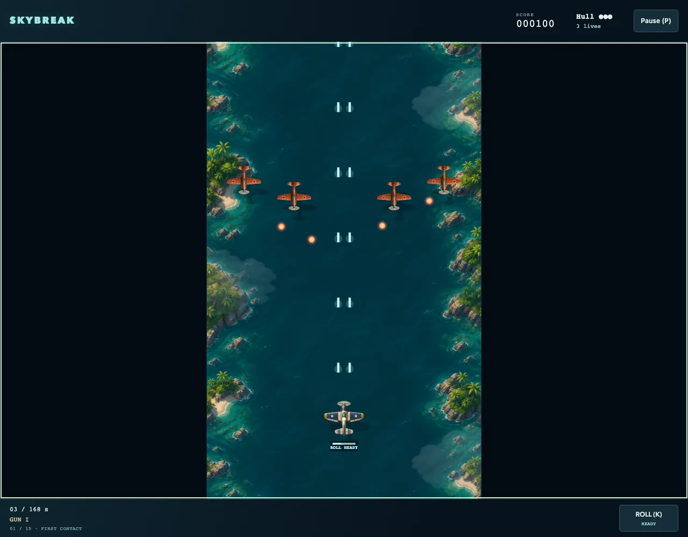
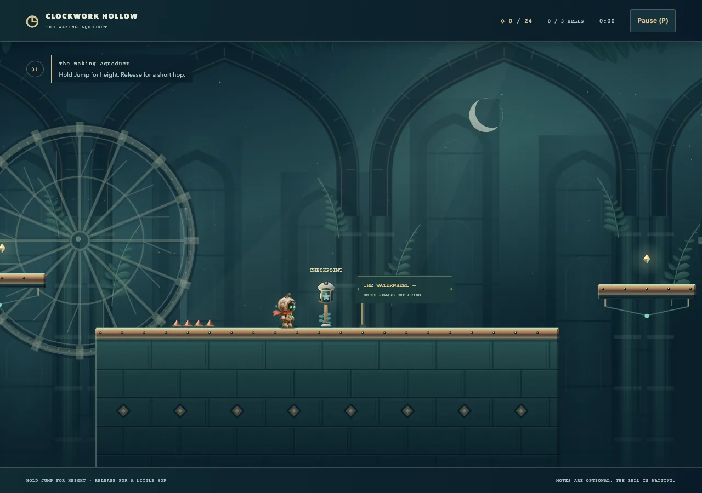
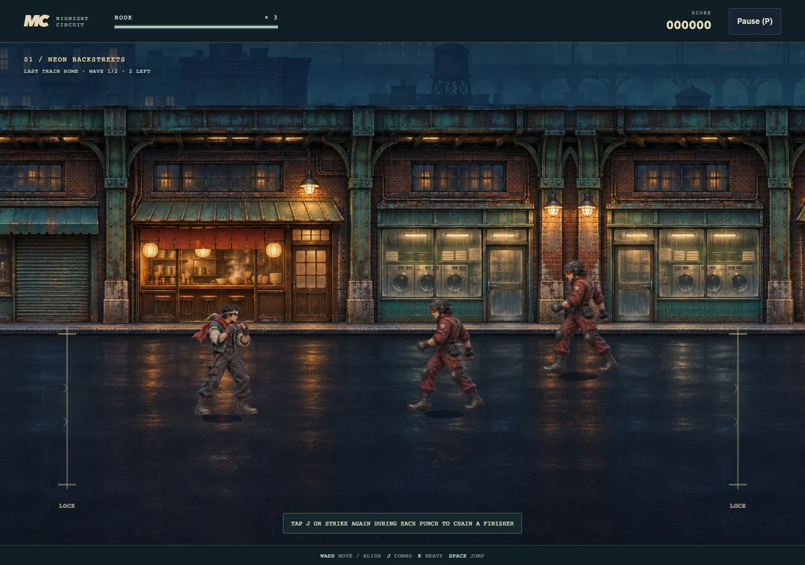
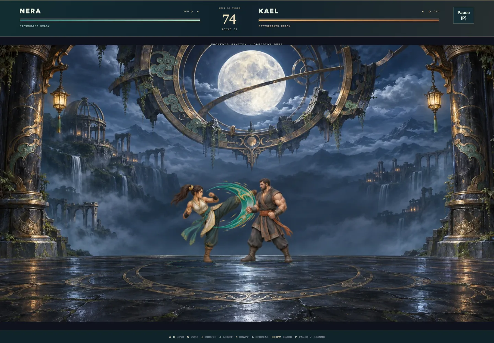
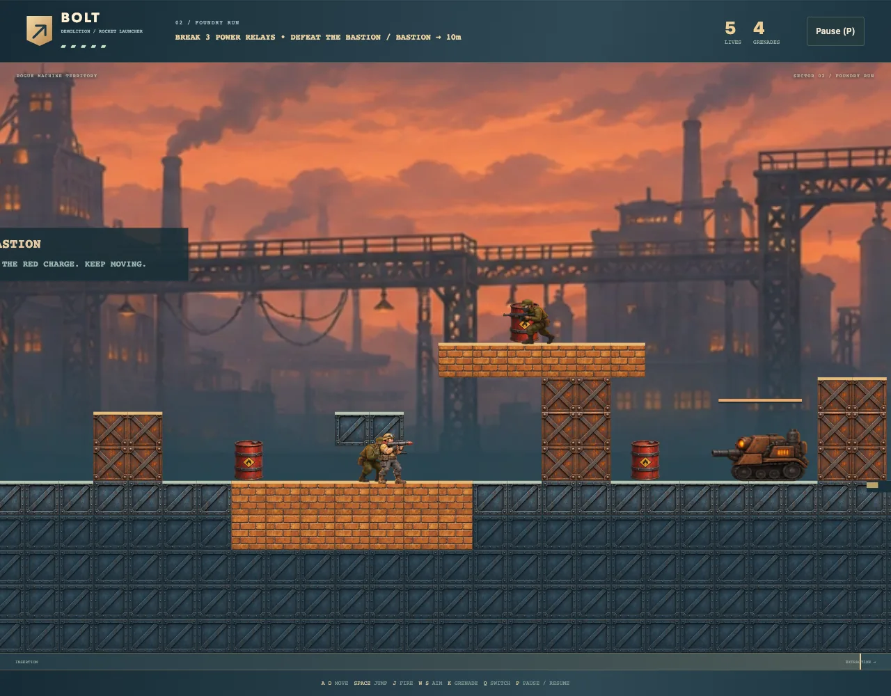

# Arcade Lab

A personal workshop for building complete, enjoyable browser games and evolving the shared engine behind them. Each game improves both the collection and the foundations for future games.

Built with TypeScript, Canvas 2D, original and bundled artwork, and procedural sound powered by [AudioBits](https://github.com/joacod/audiobits).

<table>
  <tr>
    <td align="center" width="33%"><a href="CATALOG.md#last-light-clearing"><br>Last Light Clearing</a></td>
    <td align="center" width="33%"><a href="CATALOG.md#skybreak"><br>Skybreak</a></td>
    <td align="center" width="33%"><a href="CATALOG.md#clockwork-hollow"><br>Clockwork Hollow</a></td>
  </tr>
  <tr>
    <td align="center" width="33%"><a href="CATALOG.md#midnight-circuit"><br>Midnight Circuit</a></td>
    <td align="center" width="33%"><a href="CATALOG.md#obsidian-duel"><br>Obsidian Duel</a></td>
    <td align="center" width="33%"><a href="CATALOG.md#blastline"><br>Blastline</a></td>
  </tr>
</table>

Screenshots show the **Quality** themes. See the [game catalog](CATALOG.md) for descriptions, controls and theme options.

## Play locally

```sh
git clone https://github.com/joacod/arcade-lab.git
cd arcade-lab
pnpm install
pnpm dev
```

Open the local URL printed in the terminal and choose a game. Keyboard and touch controls are available, with fullscreen where supported. All required artwork is included.

Development starts in Normal; production builds start in Assets and offer Assets / Quality. In title and pause menus, S toggles sound and T switches themes. P pauses or resumes and F toggles fullscreen, which stays active when returning to game selection.

[Architecture](docs/architecture.md) · [Development guidance](AGENTS.md) · [MIT license](LICENSE)
