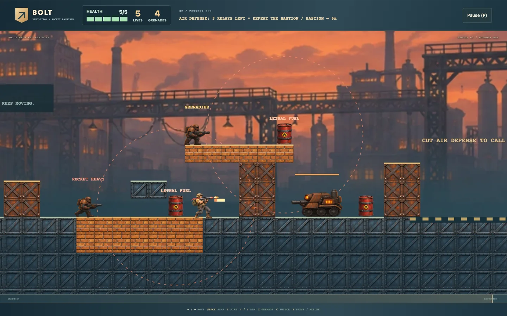

# Blastline

[Source](../../../src/games/blastline/) | [Controls](../../../CATALOG.md#blastline) | [Shared contracts](../../architecture.md)

An original Canvas 2D run-and-gun operation through **Border Station** and **Foundry Run**. The intended first-play pace is about 3–5 minutes. Disable the air-defense power relays to call the extraction helicopter, rescue Bolt at the border, break the foundry's Bastion and reach each extraction pad. Completing a mission's requirements starts the collapse countdown. Extraction includes a short departure before the mission result.

## Playing

Release Jump for a shorter hop. Reach Bolt to rescue him and switch automatically to his launcher; Switch then swaps operators. Touch movement and actions support simultaneous holds.

Nova's accurate automatic rifle opens small holes through sustained fire. Bolt's slower rockets damage groups of tiles and machines. A quick Fire tap just before weapon recovery ends is remembered briefly and fires once using the current aim. Holding Fire repeats normally; releasing a hold stops it. Pause, death and operator changes clear pending shots. Operator explosives are safe at close range; red fuel barrels and hostile explosives are lethal. Guards commit to rifle bursts, rocket heavies mark a direct firing line, and grenadiers lob over cover toward a marked blast zone. The Bastion fires an arcing barrage. Leave the marked zone before impact; thrown grenades keep their original destination. Enemies keep their facing and aim committed through a burst, check fuel and allies before each round, and cancel when falling or obstructed. Blocked units seek a firing lane within their local patrol area without walking off ledges. Shell users avoid close splash hazards. Barrels remain vulnerable to all projectiles.

Health and lives sit together in the HUD. Bullets and contact remove health; empty health costs one life. A hostile explosion or fuel blast empties health immediately, even during ordinary hit immunity. One chain explosion cannot consume several lives. Brief redeployment protection covers bullets and blasts; falling out of the world remains fatal. Death redeploys at the latest green supply post, preserving destruction, objectives and defeated machines. Each new supply post refills health and grenades once. Rescue and the next mission also resupply; redeployment guarantees a small grenade reserve. Restart creates intact terrain and clears all progress. Redeployment notices report the actual grenade reserve rather than promising a full supply-post refill.

Each relay powers the air defense that keeps the helicopter away. Destroying it grants points, restores some health and adds a grenade, up to the normal caps. Its health bar and reward label make progress visible; a distinct notice reports the remaining relays. All relays must be offline before the helicopter arrives. Rescue and the Bastion remain separate extraction requirements.

Brick cover and armored cover can break. Riveted structural steel stays solid. Destruction opens firing lanes, removes support and creates lower routes. Structural foundations, power decks and stairs preserve access to every required objective after all destructible tiles disappear. The final machine is required; ordinary guards can be bypassed. A locked extraction pad never advances the mission. The HUD points toward the nearest required objective, then toward extraction.

## Theme modes

Artwork must distinguish breakable brick and armored cover from structural steel, with aim, warnings and extraction cues visible through debris. The industrial coast is the starting setting for future art direction.

**Arcade / Ember Coast** gives that same operation detailed arcade commandos, armored security, a tracked Bastion, weathered cover, supply equipment and illustrated harbor/foundry panoramas. Teal Nova and ochre Bolt keep their identities. The [artwork guide](../../../src/games/blastline/art/README.md#ember-coast--arcade) owns its creative brief and atlas contracts.

**Deluxe / Ember Reforged** reinterprets the same cast and coast as smooth, dimensional painted illustrations. Nova retains her teal field jacket, dark hair and red scarf; Bolt keeps his ochre helmet, goggles and broad launcher. Olive security, rust-armored heavies and the orange-eyed tracked Bastion retain their silhouettes. New whole-character aim, recoil, airborne and six-cel running illustrations accompany new relay, supply, rescue, extraction and cover artwork. Steel, chipped ochre brick and X-braced rust armor stay distinct. Harbor cranes and furnace halls sit behind the action in quiet atmospheric layers; warm rim light and cool metal give volume without obscuring contacts. Amber relay glass, green supplies, sharp weapon flares and the extraction aircraft provide the scene's focal moments. A brushed navy-and-brass interface completes the treatment. Canvas 2D renders the image bundle. The [Deluxe artwork contract](../../../src/games/blastline/art/README.md#ember-reforged--quality) owns its sources, atlas layouts and exports.

## Source ownership

| Responsibility | Owner in `src/games/blastline/` |
| --- | --- |
| Mission layout, placements, geometry, materials and operator tuning | `content.ts` |
| Mutable terrain, swept tile contact, actor collision and radial geometry | `terrain.ts` |
| Run data and semantic damage notifications | `state.ts` |
| Acceleration, variable jump, coyote time, jump buffer and aiming | `movement.ts` |
| Fire cadence, projectiles, grenade fuses, explosions and barrel worklist | `combat.ts` |
| Local patrol, safe firing lanes, committed telegraphs and bursts | `enemies.ts` |
| Grenade launch velocity and the committed warning arc | `ballistics.ts` |
| Fresh runs, respawn, checkpoints, rescue and mission progression | `game.ts` |
| Action translation using shared button capture | `input.ts` |
| Uniform camera, complete sprite drawing, procedural scenery and bounded effects | `presentation.ts` |
| Grounded travel observations and continuous walking/running phase | `animation.ts` |
| Mission skies, material palettes, weather and operator/machine colors | `themes.ts` |
| Sprite roles, atlas layouts, draw footprints and operator frame selection | `sprite-art.ts` |
| Per-cel weapon attachment points and projectile visual lead-in | `weapon-art.ts` |
| Ember Coast image URLs, preparation and decoded-dimension validation | `assets.ts` |
| Ember Reforged image URLs, preparation and decoded-dimension validation | `deluxe.ts` |
| HUD, menus and announcements | `ui.ts`, `style.css` |
| Original AudioBits recipes and local cue admission | `sound-recipes.ts`, `sound.ts` |
| Browser composition, sound activation and disposal | `app.ts` |

Terrain copies authored materials and health into each run. Axis-separated leading-edge sweeps query the current grid. Projectile segments test the occupied tiles in their swept bounds and choose the earliest terrain or actor contact. Contact removes or damages tiles before subsequent shots query them. Explosions use circle/rectangle intersection and an iterative barrel queue. A barrel is marked before enqueue, preventing cycles and repeated detonation. The queue can hold the finite projectile limit plus every authored barrel; all work resolves in simulation before presentation events are consumed.

Projectiles, queued blasts, semantic events, visual rings and particles have explicit bounds. Terrain rendering visits the visible tile range. Debris can be discarded when full without changing gameplay. Audio prioritizes milestones and heavy impacts over routine fire.

The [artwork guide](../../../src/games/blastline/art/README.md) owns the complete sprite layouts and editable sources. Arcade and Deluxe each supply their own authored scenery and effects.

## Architecture decisions

`Mission.environment` selects harbor or foundry scenery independently of mission order. New or reordered missions can reuse either environment.

Mutable terrain and destructible cover belong to the simulation. The renderer reads the current grid, while movement and projectiles query it after every change. Strict rectangle overlap reuses `src/engine/collision.ts`; swept tile contact and explosion geometry stay in `terrain.ts` because they depend on the mutable grid.

Appearance changes use `presentation.ts`’s reversible `replaceTheme` on the existing camera and effects. `app.ts` owns candidate preparation and the active image bundle through the [shared replacement contract](../../architecture.md#replacement-and-recovery). `themes.ts` maps scenery materials; `sprite-art.ts` owns both presentations’ typed atlas layouts, role mappings, draw footprints and image validation, `assets.ts` owns Ember Coast's bundle, and `deluxe.ts` owns Ember Reforged's bundle. Character cels share aim/travel observations. Deluxe uses smooth image sampling, its own larger atlases and authored standing recoil cels, while pixel modes retain nearest-neighbor sampling and scanlines. Firing observations are separate from weapon recovery, so switching operators cannot trigger a false recoil or muzzle flash. Running fire retains the travel cel. Per-cel weapon sockets anchor flashes and the short projectile lead-in; swept collision remains authoritative and identical between themes. The extraction aircraft replaces baked main blades with animated main/tail rotors and bounded downwash. Cosmetic animation and camera easing freeze with the paused operation; reduced motion holds grounded idle poses and suppresses recoil, shake, muzzle flashes, hit glow and explosion motion.

Fuel sits behind authored firing positions instead of sealing approach lanes. Upper shelves preserve useful arcs over lower cover. Grenadiers use the existing complete armored launcher artwork with a distinct label and arcing attack cue. Safe-fire checks sweep the arc and reject fuel, allies, terrain and unsafe landing splash; the warning and projectile share ballistic tuning.

The local state contract connects movement, combat and objectives. Fixed populations and visible tile traversal bound the work.

## Local verification

The [game invariants](../../../tests/unit/games/blastline/game.test.mjs) protect destructive geometry, population limits, health/life distinctions, relay rewards, ballistic commitment and useful authored firing lanes. Short deterministic checks cover these contracts without requiring a fixed-input bot to complete the operation. [Animation and atlas checks](../../../tests/unit/games/blastline/animation.test.mjs) protect stride timing and role bounds. The collection [startup smoke](../../../tests/browser/app/startup.spec.ts) verifies Arcade readiness and starting play. Use the [shared verification guidance](../../architecture.md#local-verification).

## Design references

Mike Stout's [Enemy Attacks and Telegraphing](https://www.gamedeveloper.com/design/enemy-attacks-and-telegraphing) informs the readable warning and committed burst: movement should answer an attack the player can understand. Jiri Holba and Gael Huber's [Open-world Enemy AI in Mafia III](https://www.gameaipro.com/GameAIProOnlineEdition2021/GameAIProOnlineEdition2021_Chapter16_Open-world_Enemy_AI_in_Mafia_III.pdf), particularly shooting and position selection, informs separate visibility, safe-fire and repositioning decisions. These are design references, not imported AI frameworks.
