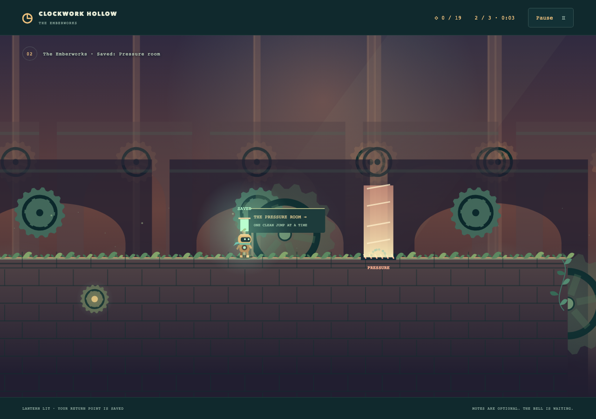
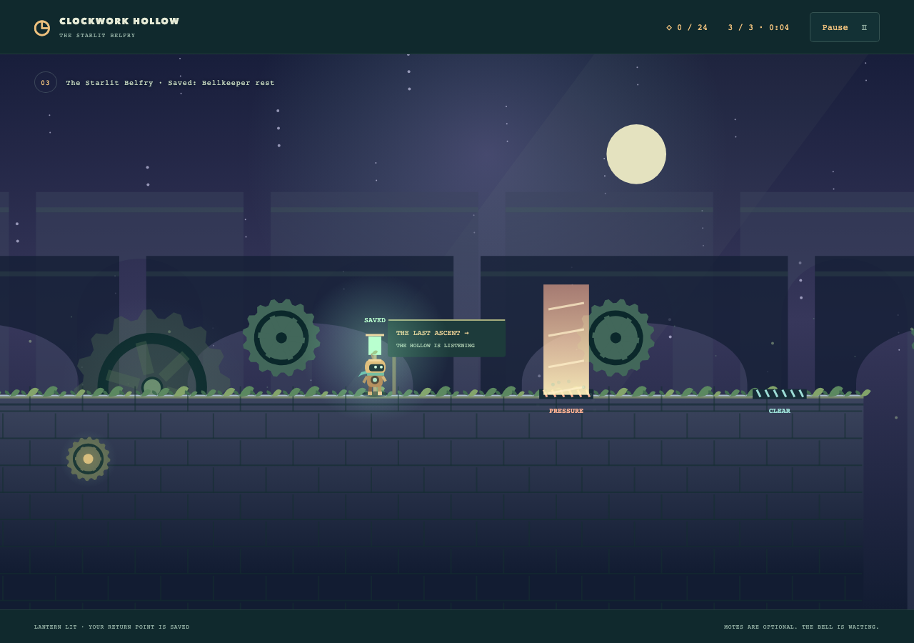
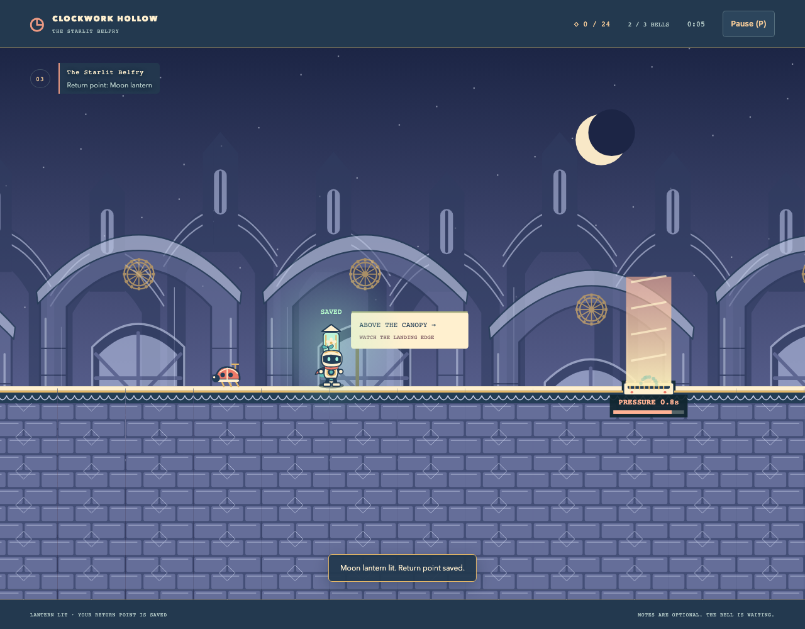
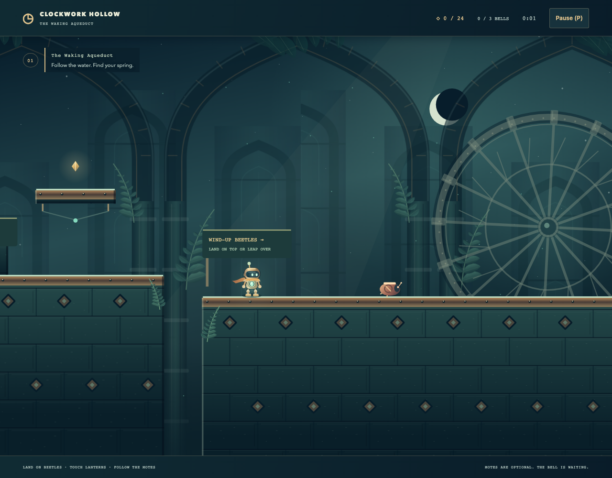

# Clockwork Hollow

[Source](../../../src/games/clockwork-hollow/) | [Catalog](../../../CATALOG.md)

A complete platform adventure with three Canvas 2D presentations through three mechanical ruins reclaimed by nature. A small brass keeper wakes three bells, climbing from the aqueduct through a pressure-powered foundry to the starlit belfry. The intended first-play pace is approximately 3–6 minutes, with no time limit.

## Playing

Move with A/D or left/right arrows. Jump with Space, W, Up or Z. Hold to jump higher and release for a short hop. Touch controls allow independent, simultaneous movement and jumping. P pauses/resumes; Pause opens the menu. Escape also pauses when delivered by the browser. Resume always requires an explicit gesture. There is no automatic repeat jump.

| District | Challenges and identity |
| --- | --- |
| The Waking Aqueduct | Moss-green arches, small steps, broken spans, copper thorns, beetles and a rising spillway. Broad recovery islands introduce the rhythm. |
| The Emberworks | Warm pipework and machinery. Pressure vents introduce waiting and reading warnings; upper ledges offer optional motes before the longer foundry crossings. |
| The Starlit Belfry | Cool stone, stars and moonlight. Successive narrow ascents combine beetles, thorns and staggered vents, ending at the bell above the canopy. |

Thin ledges are solid on every side. Wind-up beetles patrol between fixed endpoints, reversing at the ends. Landing on their shells disables them and bounces the keeper upward. Side contact is dangerous. Vents cycle through **CLEAR** (blue), a dashed amber warning, and a solid coral pressure column. Only the column's active phase is dangerous. Below each vent's mouth, a countdown and draining bar show the time until the next phase: **CLEAR**, **FIRE IN**, then **PRESSURE**. Cross early in the clear window. Text, silhouettes and boundaries supplement the colors; the timing display remains visible with reduced motion.

Falling, thorns, active pressure or beetle contact ends an attempt. The defeat menu identifies the cause, offers a relevant movement or timing tip and names the retry destination. Each district has two lantern checkpoints. Touching a lantern lights it, plays a chime and announces the saved return point. **Retry checkpoint** returns to the latest lantern, or the district start before reaching one. Retry resets velocity, jump buffers, enemies, vent phase, camera and cosmetics, while retaining collected motes, active journey time and missed steps. Checkpoints last only for this session.

The HUD shows collected motes and awakened bells, including on narrow screens. The district caption introduces jump height in the aqueduct and mirrors nearby vent countdowns, keeping those instructions readable above the scenery. Lighting a lantern shows a short return-point notice; its name remains in the district caption afterward.

Every bell ends its district and freezes simulation. An explicit **Continue to…** action starts the next district. The third bell completes the journey. Results show bells, motes, active time, missed steps, points and a completion distinction for full collection or a clean journey. Optional motes and bells award points; missed steps reduce them. Neither retrying enemies nor revisiting collected motes awards extra points. Scoring amounts live in `game.ts`.

**Restart** creates an entirely fresh adventure. Pause, menu time and suspended wall time do not count toward journey time. Focus loss, hiding the page, leaving the play controls and display changes pause play and clear input. Fullscreen is available in the menu when supported. Game selection releases the entire session. Unavailable or muted audio leaves play usable.

## Theme modes

**Normal** keeps Verdant clockwork, its district palettes, brass keeper and original foliage. **Assets** uses **Porcelain Bellgarden**, an original illustrated treatment with a porcelain keeper, coral ribbon, wind-up ladybird shells, glazed masonry, flower lanterns and decorated bells. Jade aqueducts, rose-glazed kilns and indigo leaded-glass towers give each district its own image scenery. The [artwork guide](../../../src/games/clockwork-hollow/art/README.md) records the direction, frame layouts, footprints and editable generator. All required images ship with the repository under MIT. **Quality** uses **Lumen Conservatory**, with mineral masonry, copper inlay, luminous glass, layered cathedral architecture and an articulated keeper.

Selecting a theme retains the journey, camera, gait and cosmetic effects. Theme preparation keeps the active presentation visible; failure restores the active selection with a notice. Selecting another mode, starting, resuming, retrying, continuing or leaving cancels pending preparation. Restart retains the selected theme, while Game selection releases its artwork and starts the next visit in Normal. Reduced motion freezes decorative motion in every theme and uses a still grounded keeper pose in Assets and Quality; pressure timing remains readable.

### Quality direction: Lumen Conservatory

A moonlit mechanical garden built from oxidized copper, cut jade and warm luminous glass. Layered cathedral ribs frame a monumental waterwheel in the aqueduct, furnace vessels in the Emberworks and an astronomical rose window in the belfry. Distant architecture stays low in contrast; continuous pale landing lips, the keeper's glass heart, rounded beetle crowns and coral thorn tips lead the eye through the physical route.

The keeper has a burnished helmet, inset glass face, articulated piston limbs and a trailing saffron scarf. Foot travel drives its stride, ascent opens its arms and descent braces its legs. Faceted motes, caged lanterns and engraved bells repeat the same copper-and-glass language. Saved lanterns and awakened bells brighten locally, with bounded semantic sparks. The interface uses dark mineral surfaces and fine brass rules.

Layered Canvas drawing supplies bevelled materials, soft local light and cached architecture without a graphics dependency or external artwork. Quality is loaded only when selected, keeps the existing camera and cosmetic state, and retains the active theme if preparation fails. Pause freezes decorative motion; reduced motion holds ornaments, scarf and ground gait still while preserving player positions and vent timing.

## Source ownership and customization

| Change | Owner |
| --- | --- |
| Authored routes, physical geometry, checkpoint positions, patrol bounds, vent timings, motes and bell placement | `src/games/clockwork-hollow/content.ts`: typed `Level` definitions and `journey` order |
| Movement and jump feel | `movement` in `content.ts`; explicit acceleration, collision and jump behavior in `game.ts` |
| Enemy and obstacle behaviors, vent cycle timing, failure causes, checkpoints, progression and scoring | `game.ts`; no generic AI or entity framework |
| Character drawing, animation, environment artwork, camera and effects | `presentation.ts`; `keeper`, `scenery`, `stone` and the local enemy/vent drawings are the artwork entry points |
| Distance-driven keeper gait and smoothed movement response | `animation.ts`; observes player displacement without changing simulation |
| District palettes, scenery style, foliage and costume colors | `themes.ts`, keyed by `Level.id`; `presentation.ts` consumes the selected theme |
| Assets frame layouts, validation, image footprints and artwork drawing | `asset-art.ts`, `assets.ts` and `asset-presentation.ts`; committed images and generator in `art/bellgarden/` |
| Quality architecture, bevelled materials, articulated actors, lanterns and bells | `quality-presentation.ts`, lazily imported on selection; district palettes in `themes.ts` |
| District captions and signs | `name`, `subtitle` and `signs` in `content.ts` |
| Menu narrative, HUD, result copy and accessible controls | `ui.ts` and scoped `style.css` |
| Procedural sound design and cue policy | `sound-recipes.ts` and `sound.ts` |
| Keyboard edges, holds and captured touch buttons | `input.ts` |
| Browser composition and transitions | `app.ts`, using the shared host, clock, interruption/focus binders and AudioBits lifecycle |

Character and enemy visual dimensions never define their collision bodies. All themes share simulation, content, input, the presentation camera and host ownership. `assets.ts` reuses `src/engine/browser/images.ts` with local decoded-dimension validation. The browser composition uses the shared preparation scope to cancel superseded work, draws candidates against the current run before committing them, and releases replaced or cancelled artwork. A local replacement transaction retains the previous drawing and its caches until the candidate draws successfully, rolling back on failure. Quality caches only the current district’s background layers and releases them on replacement or disposal. A Quality drawing failure pauses play and restores Normal with the journey intact. Normal requires no image loading.

Simulation uses top-left player positions and authored rectangles. Swept edge crossings resolve the nearest solid contact. Coyote time tolerates a late takeoff, a short press buffer catches landing, and release cuts ascent once. Stronger ground braking keeps small platforms controllable. Collision and jump rules use only fixed simulation steps. Content includes all physical dimensions independently of leaves, scarf, glow and animation poses.

The camera uses one uniform world transform, minimum horizontal visibility on narrow displays, bounded velocity anticipation and a vertical dead zone to avoid chasing every hop. It clamps to the district, centers oversized axes and resets on retry, restart and level change. Resize pauses play and resets framing. Reduced motion removes follow interpolation, particles, mote bobbing, flywheel rotation, pressure motion, landing squash and bell swinging.

Parallax arches, foreground canopy, drifting lights, foundry pipes and belfry stars give the districts distinct depth. Platform edges, thorns, shells and pressure columns render in front of scenery. Landing squash, jump dust, shell impacts, lantern sparks and bell celebrations consume semantic events. Particles are capped and viewport-admitted, with finite lifetimes. Cosmetic tails can finish after defeat or completion without advancing rules; pause freezes them and frame deltas are bounded. Artwork and the selection cover use editable geometry; sound uses procedural recipes.

The keeper's stride follows ground distance, settles when stopping and resets on retry. Lifted arms on ascent and braced arms on descent distinguish jump phases. Continuous landing lips remain visible above moss; broad beetle shell crowns contrast with pointed copper thorns. Pressure motion, scarf flutter and bell swings share presentation time, so pausing freezes the entire scene. Reduced motion also removes scarf flutter.

Sound uses a spring lift, soft stone/metal landing, descending unwinding damage, glass-like motes, shell clicks, filtered steam, rising lantern tones, district bells and a fuller final bell. Landing strength changes gain. Only nearby vents are audible. Routine cues are coalesced and throttled; outcomes replace lesser tails. The existing shared AudioBits owner provides lazy gesture activation, bounded voices, cancellation, suspension, mute and disposal.

## Local verification

Local checks cover movement, collision, checkpoints, scoring and a complete route through all three districts. Chromium checks cover controls, transitions, menu availability and the live run, and session cleanup. See [shared commands](../../architecture.md#local-verification).

See the [shared boundaries](../../architecture.md#boundaries-for-future-games) for common ownership decisions.
