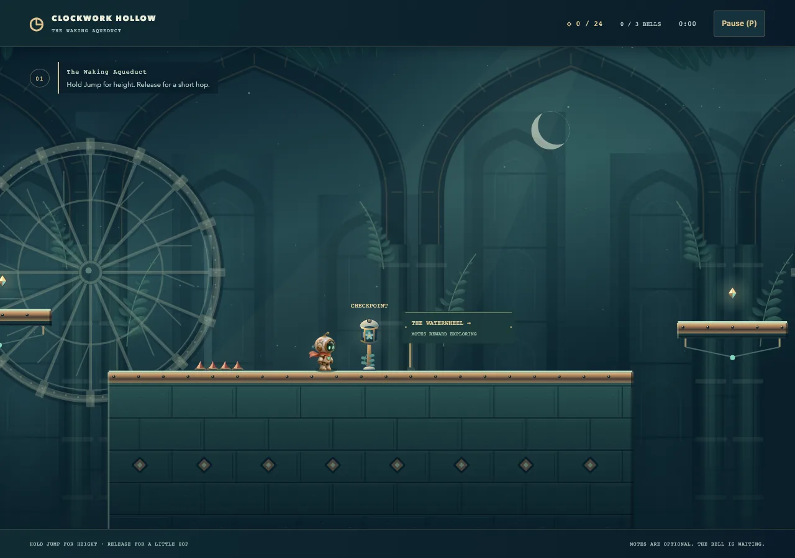

# Clockwork Hollow

[Source](../../../src/games/clockwork-hollow/) | [Controls](../../../CATALOG.md#clockwork-hollow) | [Shared contracts](../../architecture.md)

A complete platform adventure with two Canvas 2D presentations through three mechanical ruins reclaimed by nature. A small brass keeper wakes three bells, climbing from the aqueduct through a pressure-powered foundry to the starlit belfry. The intended first-play pace is approximately 3–6 minutes, with no time limit.

## Playing

Hold Jump for height and release for a short hop. Jump does not repeat automatically. Touch movement and jumping can be held simultaneously.

| District | Challenges and identity |
| --- | --- |
| The Waking Aqueduct | Moss-green arches, small steps, broken spans, copper thorns, beetles and a rising spillway. Broad recovery islands introduce the rhythm. |
| The Emberworks | Warm pipework and machinery. Pressure vents introduce waiting and reading warnings; upper ledges offer optional motes before the longer foundry crossings. |
| The Starlit Belfry | Cool stone, stars and moonlight. Successive narrow ascents combine beetles, thorns and staggered vents, ending at the bell above the canopy. |

Thin ledges are solid on every side. Wind-up beetles patrol between fixed endpoints, reversing at the ends. Landing on their shells disables them and bounces the keeper upward. Side contact is dangerous. Vents cycle through **CLEAR** (blue), a dashed amber warning, and a solid coral pressure column. Only the column's active phase is dangerous. Below each vent's mouth, a countdown and draining bar show the time until the next phase: **CLEAR**, **FIRE IN**, then **PRESSURE**. Cross early in the clear window. Text, silhouettes and boundaries supplement the colors; the timing display remains visible with reduced motion.

Falling, thorns, active pressure or beetle contact ends an attempt. The defeat menu identifies the cause, offers a relevant movement or timing tip and names the retry destination. Each district has two lantern checkpoints. Touching a lantern lights it, plays a chime and announces the saved return point. **Retry checkpoint** returns to the latest lantern, or the district start before reaching one. Retry resets velocity, jump buffers, enemies, vent phase, camera and cosmetics, while retaining collected motes, active journey time and missed steps. Checkpoints last only for this session.

The HUD shows collected motes and awakened bells, including on narrow screens. The district caption introduces jump height in the aqueduct and mirrors nearby vent countdowns, keeping those instructions readable above the scenery. Lighting a lantern shows a short return-point notice; its name remains in the district caption afterward.

Every bell ends its district and freezes simulation. An explicit **Continue to…** action starts the next district. The third bell completes the journey. Results show bells, motes, active time, missed steps, points and a completion distinction for full collection or a clean journey. Optional motes and bells award points; missed steps reduce them. Neither retrying enemies nor revisiting collected motes awards extra points. Scoring amounts live in `game.ts`.

## Theme modes

**Arcade · Porcelain Bellgarden** is an illustrated retro sanctuary with a porcelain keeper, coral scarf, tall ink-blue arches and glazed botanical machinery. **Deluxe · Lumen Conservatory** develops the same cast and setting into sculpted ceramic miniatures, reflective brass, luminous glass and layered cathedral gardens. The [artwork guide](../../../src/games/clockwork-hollow/art/README.md#creative-direction) owns the briefs, functional visual rules and sheet layouts.

Every mode uses complete keeper and beetle drawings. Deluxe’s AI-generated actor cels add spherical forms, painted botanical detail, inset glass and soft material shading. Eight stride cels follow ground travel in sequence; dedicated ascent and descent silhouettes communicate jumping. Foot anchors stay on the ground, velocity adds a small lean, and landing briefly compresses around the sole. Beetle steps follow patrol travel and stomped shells use their own spent drawing.

Deluxe uses Canvas 2D with shaded image assets, bevelled platform materials and cached architectural layers. A monumental waterwheel, foundry vessels and a belfry rose window distinguish the districts. Distant scenery stays quieter than landing lips, objectives and hazards. The interface uses dark mineral surfaces and brass rules.

Signs stand on authored platform surfaces, in clear spaces away from lanterns, vents and jump blocks. Their posts and plaques sit behind the solid route. Lantern soles meet the landing edge, and bell chains attach to their arch crowns. Deluxe’s curved copper thorns repeat individually with shaded brass sockets, fitting each hazard patch without flattening a fixed strip or extending its danger bounds.

## Source ownership and customization

Paths below are relative to `src/games/clockwork-hollow/`.

| Change | Owner |
| --- | --- |
| Authored routes, physical geometry, checkpoint positions, patrol bounds, vent timings, motes and bell placement | `content.ts`: typed `Level` definitions and `journey` order |
| Movement and jump feel | `movement` in `content.ts`; explicit acceleration, collision and jump behavior in `game.ts` |
| Enemy and obstacle behaviors, vent cycle timing, failure causes, checkpoints, progression and scoring | `game.ts`; no generic AI or entity framework |
| Character drawing, animation, environment artwork, camera and effects | `presentation.ts`, `asset-presentation.ts` and the game-local sprite roles |
| Distance-driven keeper gait and smoothed movement response | `animation.ts`; observes player displacement without changing simulation |
| District palettes, scenery style, foliage and costume colors | `themes.ts`, keyed by `Level.id`; `presentation.ts` consumes the selected theme |
| Complete actor/object cels for all modes, frame layouts, validation and image drawing | `asset-art.ts`, `assets.ts`, `sprite-art.ts` and `asset-presentation.ts`; SVG sources in `art/bellgarden/`, Deluxe actor sources, packed atlases and preparation in `art/lumen/` |
| Deluxe architecture, bevelled scenery materials and cached background layers | `deluxe-presentation.ts`, lazily imported on selection; district palettes in `themes.ts` |
| District captions and signs | `name`, `subtitle` and `signs` in `content.ts` |
| Menu narrative, HUD, result copy and accessible controls | `ui.ts` and scoped `style.css` |
| Procedural sound design and cue policy | `sound-recipes.ts` and `sound.ts` |
| Keyboard edges, holds and captured touch buttons | `input.ts` |
| Browser composition and transitions | `app.ts` |

`asset-art.ts` supplies decoded-dimension validation and frame selection. The local replacement transaction retains the previous drawing and its caches until a candidate succeeds. Retry checkpoint and Continue cancel pending theme work. `Level.id` identifies authored content independently of `Level.environment`, which selects a reusable district palette and scenery. Add or reorder levels without renaming a district or adding renderer branches. Deluxe caches only the current environment’s background layers; changing district, replacing Deluxe or disposing the session releases them. Deluxe prepares its raster actor atlases and shaded object bundle before replacing the current presentation.

Simulation uses top-left player positions and authored rectangles. Swept edge crossings resolve the nearest solid contact. Coyote time tolerates a late takeoff, a short press buffer catches landing, and release cuts ascent once. Stronger ground braking keeps small platforms controllable.

The camera provides minimum horizontal visibility on narrow displays, bounded velocity anticipation and a vertical dead zone to avoid chasing every hop. It clamps to the district, centers oversized axes and resets on retry, restart and level change. Resize resets framing. The keeper's walking cels follow ground distance and settle into idle when stopping; physical movement does not depend on clip timing.

Continuous landing lips remain visible above moss; broad beetle crowns contrast with pointed copper thorns. Pressure columns draw above scenery. Landing dust, shell impacts, lantern sparks and bell celebrations have capped, viewport-admitted particles. Reduced motion removes camera follow interpolation, particles, mote bobbing, flywheel rotation, pressure motion, keeper lean, landing compression and bell swinging. All modes use a still grounded keeper pose, while vent countdowns and physical movement stay visible.

Sound uses a spring lift, soft stone/metal landing, descending unwinding damage, glass-like motes, shell clicks, filtered steam, rising lantern tones, district bells and a fuller final bell. Landing strength changes gain; only nearby vents are audible.

## Local verification

The [game invariants](../../../tests/unit/games/clockwork-hollow/game.test.mjs) cover movement, collision, checkpoints, scoring and the authored route. [Asset checks](../../../tests/unit/games/clockwork-hollow/assets.test.mjs) validate committed sheets and frame bounds. The collection [startup smoke](../../../tests/browser/app/startup.spec.ts) verifies Arcade readiness and starting play. Use the [shared verification guidance](../../architecture.md#local-verification).
