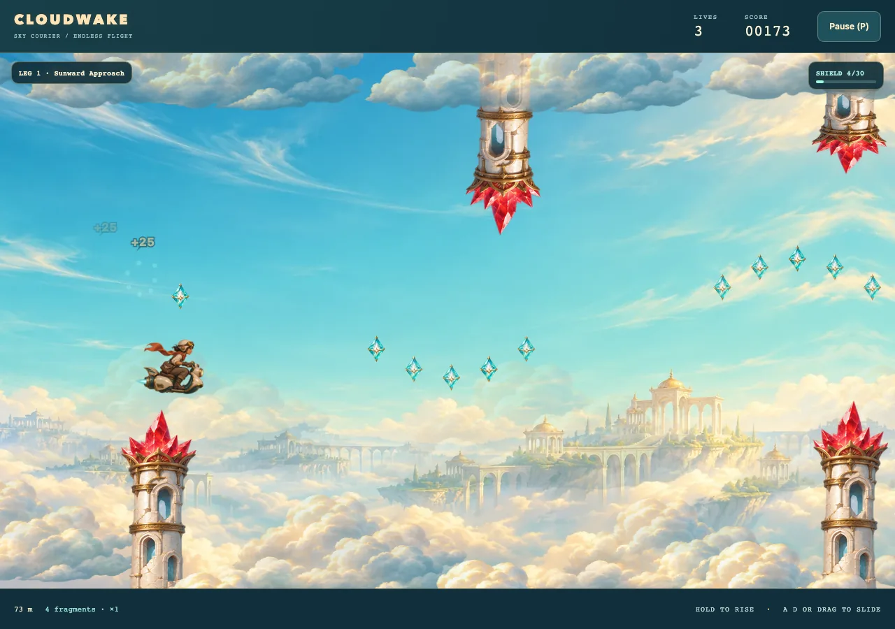

# Cloudwake

An endless flight through a sunlit sky civilization. Carry a satchel of lost light between ivory ruins on a little turbine scooter. Hold to rise, release to descend, slide across the view, dodge coral crystals and collect turquoise fragments. The game starts in **Arcade · The Sunward Route**. **Deluxe · Sunward Radiance** adds dimensional painted artwork through the same Canvas renderer.

## Flight and progression

Thrust is continuous acceleration with bounded ascent and descent speeds. Reversing the held state adds braking against existing velocity, making corrections quick without removing inertia. The same initial press that starts, continues or restarts a flight applies thrust. The cloud boundaries cushion contact; structures and storm mines cost a life. The courier's compact collision body excludes scarf and exhaust.

The route scrolls on its own clock. A and D, the arrow keys, the on-screen arrows, or a sideways drag slide the courier between a rear slot and a forward slot in that view. Releasing the slide leaves the courier where it is. Slide does not add to distance or score, and the camera does not follow it. The forward edge spends some of the warning time certified at the home slot; the rear edge gives a little more. That margin still covers the reaction allowance at top speed. This is the auto-scroll pattern used by side-view shooters: the world keeps moving, and the craft moves inside the frame.

A flight begins with the forgiving **Sunward Approach**. Lanterns mark the ends of increasingly long legs. **High / Low** introduces offset gates and sweeping mines, **Crystal Steps** mixes gradual height changes with reversals, **Shifting Ruins** introduces vertically moving openings, and **Storm Weave** and **Needle Thread** combine those demands with tighter clearance. Later legs cycle through remixed pattern families with progressively narrower openings and longer structures instead of repeating a single final pattern. Seeded sequence rotations, mirroring and height variation preserve each family's demands while changing the flight, with fresh motifs inside longer legs. Clear-air pockets surround lanterns so a harder leg still has a recovery beat.

The route's feasibility check integrates the actual flight physics from both edges and the center of the previous corridor, with extreme entry velocities and both possible holds during a reaction allowance. It checks clearance over the full next obstacle width at that leg's maximum speed, extending empty travel if necessary. Faster legs shorten the largest height reversals to respect narrow-screen warning time and ask for more precise alignment instead. Moving openings reserve a safe corridor through their full oscillation; mine sweeps threaten other lanes without entering that reserved corridor. The renderer and collision rules use the same moving opening and mine positions. Fragments trace arcs inside those corridors, flattening as clearance tightens.

Each flight starts with three lives. Passing a checkpoint's winged lantern opens its shutters, blooms once and stays lit, with a chime. The lantern is the save cue; the flight does not announce streaks, cleared passages or saved routes. The HUD keeps lives, score, distance, the fragment multiplier, the current leg and the shield meter. Pause and the crash screen still name the checkpoint, because that is when the retry decision happens. An unshielded crash stops play and offers **Continue** while lives remain; the third ends the flight. Continue restores the latest checkpoint's distance, score, fragment streak, shield charge and remaining shield time, cleared passages, seeded route, current speed and difficulty clock. It places the courier at rest in the home slot, centered in the pocket, with clear travel before the next hazard. Before the first checkpoint, Continue returns to launch. Lives never refill at checkpoints. Restart creates a fresh route with three lives. Checkpoints last only for this flight, with no browser persistence.

Speed rises at leg milestones rather than reaching its final pace on an elapsed-time clock. The first increase comes after two legs, then after three more, four more and so on, with a short acceleration into each pace. Hazard counts per leg grow through the opening legs and gain another passage at each speed increase, while travel spacing scales with speed. Faster flight therefore covers more ground between lanterns while retaining readable warning and recovery time. There is no time limit or speedometer. Distance and the current leg name are the progress readouts.

Distance contributes one point per displayed meter. Fragments start at 25 points each; every five consecutive pickups raises the value of subsequent fragments through ×2, ×3 and ×4. The multiplier stays with the fragment count. Collection sweeps the rider-and-scooter pickup silhouette against the visible diamond, including fast crossings and sideways drags. The pickup body excludes scarf/exhaust and is independent of the smaller, forgiving hazard-contact body. Points pop on the gem that was touched. Once a gem is beyond the rear body's reach at the rear slot, it resets the streak once. Its image keeps scrolling until it is fully clipped by the actual left viewport edge, including wide views; a gameplay miss never removes a gem in visible clear air.

Filling the fragment charge meter raises a **light shield** for a few seconds. The bubble around the courier is the live state, and the meter drains with the remaining time. The first collision costs no life and immediately breaks the shield, regardless of time remaining. That single contact can finish safely; another obstacle or renewed contact after separating costs a life. An unused shield still expires when its timer runs out. Filling the charge meter again raises another shield, including while one is already up, which restarts the window. Charge carries through missed fragments and cannot stockpile extra time. Replayed sections restore the checkpoint's charge and any shield time still running, so neither points nor charge can be farmed across lives.

Hold Space, W, ↑, mouse/touch on the playfield, or the mobile Rise button. Release to descend. Slide with A, D, ←, →, the on-screen arrows, or a sideways drag. See [shared menus, controls and lifecycle](../../../CATALOG.md) for pause, sound, fullscreen and navigation.

## Deluxe · Sunward Radiance

The same courier, ivory-and-teal scooter, coral-crystal ruins and winged lanterns receive a dimensional painted treatment: glazed ceramic, chased brass, translucent crystal and warm fabric. Complete authored flight cels carry the pilot and vehicle together. Glide/release and alternating thrust cels retain a stable vehicle anchor, while scarf and exhaust provide the motion accents.

A luminous cloud sea and distant ivory terraces occupy the lower scenery, with quiet blue air behind the flight corridors. Coral silhouettes identify danger; turquoise fragments and lantern cores identify rewards and safety. Background contrast stays below the foreground ruins, and decorative parallax never moves physical geometry. The title, HUD and menus use deep petrol surfaces with champagne and turquoise accents.

A lantern opens once on checkpoint passage, blooms and settles into its lit cel. The shield forms a restrained glass envelope around the courier; pickup points remain attached to the collected fragment. Trails and glints stay bounded and use active flight time. Pause freezes them, and reduced motion keeps still cels and essential state cues while suppressing decorative movement and flashes.

Deluxe loads its own courier, ruins, mine, fragment, cloud, lantern and horizon artwork only when selected. The working presentation stays visible during preparation. Failed preparation retains the current theme; a draw failure pauses the flight and recovers to Arcade with fresh Canvas state, following the shared [replacement contract](../../architecture.md#replacement-and-recovery).

## Local owners and adaptation

| Owner | Responsibility |
| --- | --- |
| `content.ts` | Physical geometry, pickup silhouette, acceleration, braking, slide limits and speed milestones |
| `collection.ts` | Swept pickup-body/diamond contact |
| `route.ts` | Seeded leg patterns, checkpoint spacing, corridor feasibility, moving openings and mine sweeps |
| `game.ts` | Mutable run, collision, lives, checkpoint snapshots, fragment streaks, timed shields, score and semantic events |
| `app.ts` | Browser composition, fresh runs, checkpoint continuation and readiness/recovery |
| `input.ts` | Shared button owner, playfield and launch-hold capture, and sideways drag in CSS pixels |
| `ui.ts`, `style.css` | HUD, results and shared menu composition |
| `themes.ts`, `deluxe-art.ts` | Available themes and lazy Deluxe artwork URLs/dimensions |
| `presentation.ts` | Whole-cel roles, checkpoint activation, uniform projection, image preparation, missed-gem clipping, stable world-indexed clouds and bounded effects |
| `sound.ts`, `sound-recipes.ts` | Quiet turbine pulses, glass pickups, multiplier/shield cues, checkpoint chime and hull impact |
| [Artwork guide](../../../src/games/cloudwake/art/README.md) | Asset roles, provenance and prompts |

To adapt the foundation, replace complete courier cels, object images and scenery, update local role dimensions/anchors, then tune the flight and route values. Geometry does not come from image dimensions. The renderer uses a single uniform transform; narrow screens retain a minimum look-ahead width and center the flight band in the available scenery. Reduced motion suppresses cosmetic parallax, trails, flashes and animation cycling while preserving flight and moving-hazard cues.

Shared lifecycle, preparation and AudioBits ownership follow the [architecture](../../architecture.md). No new engine or rendering framework is required. Focused mechanics tests live in `tests/unit/games/cloudwake/`; the catalog-driven startup smoke includes Cloudwake. Use the [local verification commands](../../architecture.md#local-verification).

## Design references

These references inform local decisions; no artwork or implementation code was copied.

- [Luke Muscat — Depth in Simplicity](https://gdcvault.com/play/1015316/Depth-in-Simplicity-The-Making), with [speaker slides](https://media.gdcvault.com/gdc2012/slides/Design%20Track/Muscat_Luke_DepthInSimplicity.pdf): one-button accessibility, interval fairness, alternating pressure and relief, and low retry friction.
- [Smith, Whitehead and Mateas — Tanagra](https://ojs.aaai.org/index.php/AIIDE/article/view/12379): combine authored geometric patterns with movement constraints. Cloudwake uses its own seeded flight motifs and physics-based clearance check, rather than a platformer planner.
- [Mike Booth — The AI Systems of Left 4 Dead](https://steamcdn-a.akamaihd.net/apps/valve/2009/ai_systems_of_l4d_mike_booth.pdf), slides 77–91: vary pressure and relief. Cloudwake applies that pacing idea through leg structure and clear-air pockets, without an adaptive director.
- [CS50 — Flappy Bird](https://cs50.harvard.edu/extension/games/2026/spring/notes/1/): scrolling layers, bounded procedural objects, collision and explicit game states. Cloudwake uses continuous thrust rather than tap impulses.
- [Glenn Fiedler — Fix Your Timestep!](https://gafferongames.com/post/fix_your_timestep/): stable physics through the existing fixed-step clock.
- Robert Nystrom's [Game Loop](https://gameprogrammingpatterns.com/game-loop.html) and [State](https://gameprogrammingpatterns.com/state.html), also available in the [author's source](https://github.com/munificent/game-programming-patterns/tree/master/book): keep simulation, rendering and screen transitions explicit within existing owners.
- MDN [Pointer Events](https://developer.mozilla.org/en-US/docs/Web/API/Pointer_events/Using_Pointer_Events) and [touch-action](https://developer.mozilla.org/en-US/docs/Web/CSS/touch-action): capture holds and clear cancellation without native panning on the game surface.
- [Halfbrick's Jetpack Joyride](https://www.halfbrick.com/games/jetpack-joyride-classic): mechanical and pacing inspiration. Helicopter Game and Flappy Bird also inform the hold/release genre; Cloudwake has its own setting, artwork and movement tuning.
- [Imangi's Temple Run](https://imangistudios.com/thegames/temple-run/): collection tied to power-ups and character unlocks. Cloudwake applies that reward connection within the current flight through fragment multipliers and a short-lived shield.
