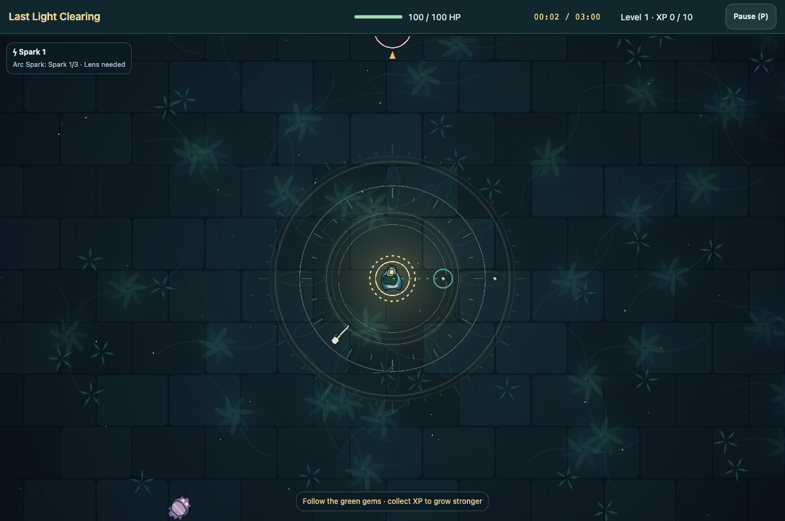

# Last Light Clearing

[Source](../../../src/games/last-light-clearing/) | [Controls](../../../CATALOG.md#last-light-clearing) | [Shared contracts](../../architecture.md)

The source of numerical tuning is [`src/games/last-light-clearing/content.ts`](../../../src/games/last-light-clearing/content.ts), including the Keeper, enemies, weapons, upgrades, evolution recipe, XP progression, and named round configurations. Until dawn is a three-minute round; Brief dusk supplies a shorter round through the same implementation. See the [artwork guide](../../../src/games/last-light-clearing/art/README.md) for the Ember Ruins pack contract.

## Gameplay semantics

- Movement normalizes diagonals and preserves proportional analog strength.
- Spark targets the nearest living enemy and gains faster cadence at higher ranks. Halo gains additional orbiting contact bodies and retains shared per-target hit windows across lights, upgrades and revolutions. Pulse gains radius but samples its circle once per activation, including enemy body radii. Shard starts with cardinal shots and adds evenly spaced directions at higher ranks. Fractional damage rounds up. Upgrade cards preview effective damage and coverage/cadence changes, including Power rounding.
- Each death drops one gem. Attraction persists after the Keeper moves away, and collection batches same-tick XP. Excess XP survives queued level choices. Choices stop gameplay, offer three distinct effective upgrades, and require releasing confirmation before continuing. Only offered IDs can apply.
- Every offer reserves a support choice alongside weapon acquisition/ranks. Support rotates through Power, Reach and Recovery, with Lens available during evolution progression. Low health prioritizes Recovery immediately. Recovery, Power and Reach remain repeatable. Unused recovery becomes shield; Reach survives acquiring Lens. The HUD groups equipped weapons and ranks with progress toward Arc Spark, and shows shield quantity; absorption and health loss have distinct feedback.
- Rank-three Spark plus Lens evolves automatically in either acquisition order. Arc Spark preserves weapon slot, rank, cadence, and other weapons, clears old Spark projectiles, and chains to distinct living targets within the shot's existing lifetime. Arc Spark is not a fourth manual choice.
- Ordinary spawns count pending entries toward their cap and discard capped slots. The elite is independent of that cap. Its entry warning is harmless, invulnerable, and excluded from targeting so projectiles are not wasted on it.
- Briar chargers join after the opening and become more frequent as pursuit pressure grows. Their forked crest identifies them across themes. A dashed lane locks when wind-up begins; the charger strikes along that fixed direction, then rests. The elite commits a marked ground slam to a fixed circle. Step sideways out of a lane or leave the slam ring, then use the harmless recovery window. Only one special attack can commit at a time. Killing its owner cancels an attack; attacks and contact share shield absorption and immunity.
- Shield and shared contact immunity apply before health. Lethal final-tick contact takes precedence over victory. Outcomes stop attacks, entries, and pickups, discard pending choices, and freeze results. Retry constructs a fresh run.

## Opening and upgrade flow

Starting positions and body geometry live in `content.ts`. A nearby opening gem, a restrained guide line and a contextual prompt introduce collection before the first upgrade. Entry selection samples safe world edges with a run-owned seed, varying approach angles while preserving separation.

Projectile-radius collision uses a swept intersection, with movement limited to remaining projectile lifetime. Death drops and gem collection resolve synchronously. Combat/outcome resolves before pickups so a terminal tick cannot open a stale upgrade panel.

Upgrade cards distinguish new weapons, rank changes and support effects, with a short purpose followed by the simulation’s exact stat preview. Equipped weapons and Arc Spark requirements stay beside the choices. The applied card is marked while confirmation is held; release returns to action or the next earned choice. This presentation lives in `ui.ts` and `style.css`, independently of progression rules.

A suspended upgrade choice requires deliberate Resume before confirmation can continue.

## Camera

The camera follows the Keeper without smoothing. Its uniform scale is the larger of the padded arena fit and a readable minimum, with separate framing targets for desktop and narrow surfaces. Larger fit scales remain intact.

Camera framing constants live in [`src/games/last-light-clearing/view.ts`](../../../src/games/last-light-clearing/view.ts), separately from artwork metadata and gameplay tuning. Each axis clamps within padded world bounds when cropped and centers when the visible span exceeds the padded world. Boundary padding leaves room for artwork at physical edges. The transform is recomputed from the current player, so retry/title reset position naturally and pausing leaves framing stable.

Visible entries keep their world-space warning rings. Offscreen pending entries get restrained inset screen-edge arrows. The elite keeps an arrow and ELITE label while offscreen, including its entry warning. These cues read existing run state; there is no second spawn machine, enemy radar, or minimap. All world content uses one transform, and the floating movement joystick stays in CSS coordinates after world drawing.

## Theme modes

**Normal**, the default, uses the existing procedural clearing, actor silhouettes and spell effects without fetching images. **Assets** uses bundled Ember Ruins in development and production. **Quality** uses Prism Garden's sculpted actors, illuminated scenery and Three.js lighting.

**Custom** uses Abyssal Bloom, an experimental WebGPU/vgpu presentation with a procedural living field, domain-warped luminous veins, drifting marine snow, reactive ripples and shader-rendered organisms, spells and dissolve particles. It includes matching Abyss HUD styling and requires WebGPU.

### Quality direction: Prism Garden

An overgrown moonlit sanctuary of jade stone, gold inlays and violet crystal blossoms. The warm, petal-caged lantern Keeper is the focal point. Rose-armored thorn creatures have articulated dark legs and bright paired eyes; the elite wears a crown, while chargers retain their forked crest. Mint gems remain small, angular and distinct from creatures.

Weathered paving, engraved circles and luminous botanical roots give the ground depth inside the following camera. Broad low-contrast forms leave combat readable. Raised crystal gardens stay outside traversable ground. Directional shadows, a moving lantern light pool and restrained bloom separate solid materials from luminous cores. Spell trails, contact glints and dissolving fragments carry the same crystal vocabulary. Glass UI uses warm gold accents against deep jade surfaces.

Movement drives petal sway and alternating creature legs. Reduced motion suppresses decorative drift, bobbing, spin and fragments. The final stretch warms toward dawn in every mode, with additional light changes in Garden and a short cosmetic victory ring.

Quality prepares Three.js geometry, a generated floor texture and a bounded bloom pipeline without an external image bundle.

[Combat cue preview](combat-feedback.png): a locked charger lane, shield readout and Arc Spark awakening in Prism Garden.

## Sound identity

`src/games/last-light-clearing/sound-recipes.ts` defines original AudioBits recipes: soft Spark glints, brighter Arc Spark partials, crystalline Shard transients, Halo contact rings, and a low Pulse bloom. Enemy impacts/dissolves stay subdued, clustered gems brighten a bounded pickup control, and health damage has a distinct low crack. Fully absorbed shield hits use a protective Halo chime. Harmonic chords and restrained delay mark upgrades, evolution and dawn; a low dissonant omen announces the elite. Defeat closes with a falling minor-colored tone.

Sound uses procedural cues without recordings or ambient music. `sound.ts` receives projectile weapon identity, Halo contact and elite-entry notifications from simulation.

## Implementation ownership

Paths below are relative to `src/games/last-light-clearing/`.

| Responsibility | Owner |
| --- | --- |
| Composition and session settings | `app.ts` |
| Simulation | `game.ts`, `game-state.ts`, `combat.ts`, `encounters.ts`, `progression.ts`, `weapon-stats.ts`, `weapons/` |
| Typed content and validation | `content.ts`, `content-validation.ts` |
| Physical input | `input.ts` |
| Camera transform, attack cues and CSS-space overlay | `view.ts`, `screen-overlay.ts` |
| Presentation contract and renderers | `world-presentation.ts`, `presentation.ts`, `three/garden.ts`, `vgpu/` |
| Artwork, appearances and animation | `art-pack.ts`, `assets.ts`, `themes.ts`, `animation.ts`, `art/` |
| UI and sound adapters | `ui.ts`, `style.css`, `sound.ts` |

## Renderer composition

`world-presentation.ts` defines canvas, resize, observe, reset, consume, draw and dispose. Normal starts synchronously on Canvas. Quality loads `three/garden.ts`; its orthographic mapping converts `(x, y)` to `(x, -y, elevation)` without perspective/parallax. Custom loads `vgpu/bloom.ts` and its WGSL field and organism shaders.

Garden batches immutable scenery by geometry, material and shadow settings. Detached actor pose trees animate independently, then copy visible parts into shared instance buffers so dense crowds do not add draw submissions per creature. Transient gems, shots, motes and effects reuse bounded instance buffers. `three/floor.ts` generates cached paving and botanical textures without touching run randomness. The render buffer caps its longest side at 1600 pixels and DPR at 1.5; bloom uses half that resolution.

The persistent overlay owns attack commitments, starter-gem guidance, protection cues and the dawn finish. Canvas uses the asset pack’s clip helpers; Garden and Bloom use procedural actor observations. Palettes live in `themes.ts`, while shader/effect budgets live with their renderer.

Bloom owns its device, surface, shader draws, effects, uniforms and storage buffers. Device acquisition cannot be interrupted, so a device arriving after cancellation is immediately released. The renderer/resource transaction follows the [shared replacement and recovery contract](../../architecture.md#replacement-and-recovery).

## Renderer verification

The [presentation invariants](../../../tests/unit/games/last-light-clearing/presentation.test.mjs) and [browser checks](../../../tests/browser/games/last-light-clearing/) cover uniform projection, renderer replacement and GPU loss. Normal startup requests neither image sheets nor graphics libraries. Gameplay checks in [the unit-test directory](../../../tests/unit/games/last-light-clearing/) cover weapons, evolution, upgrades and encounter limits. Use the [shared verification commands](../../architecture.md#local-verification).
