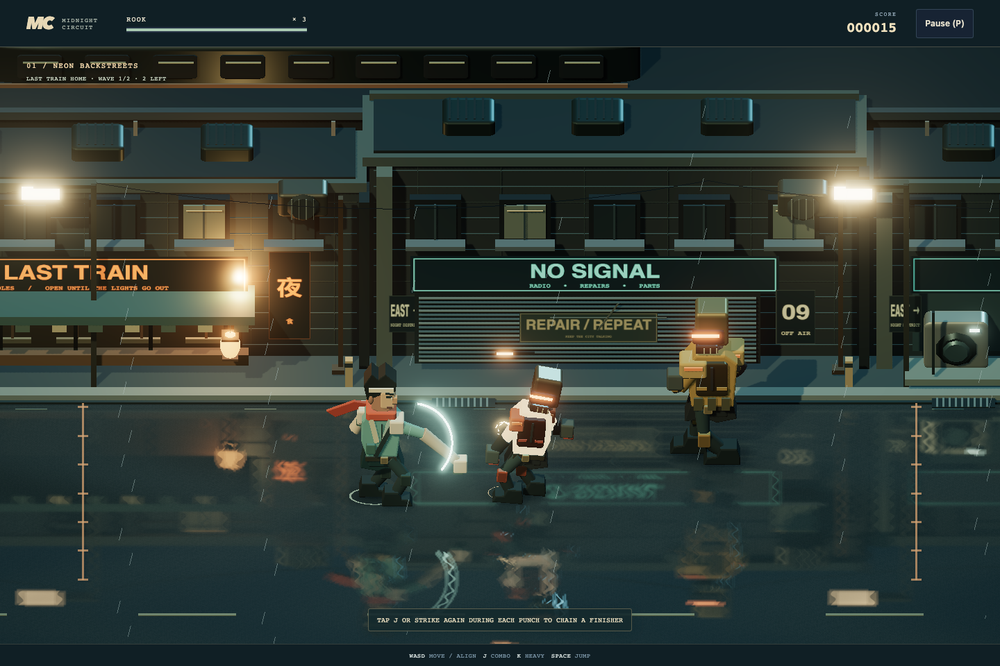
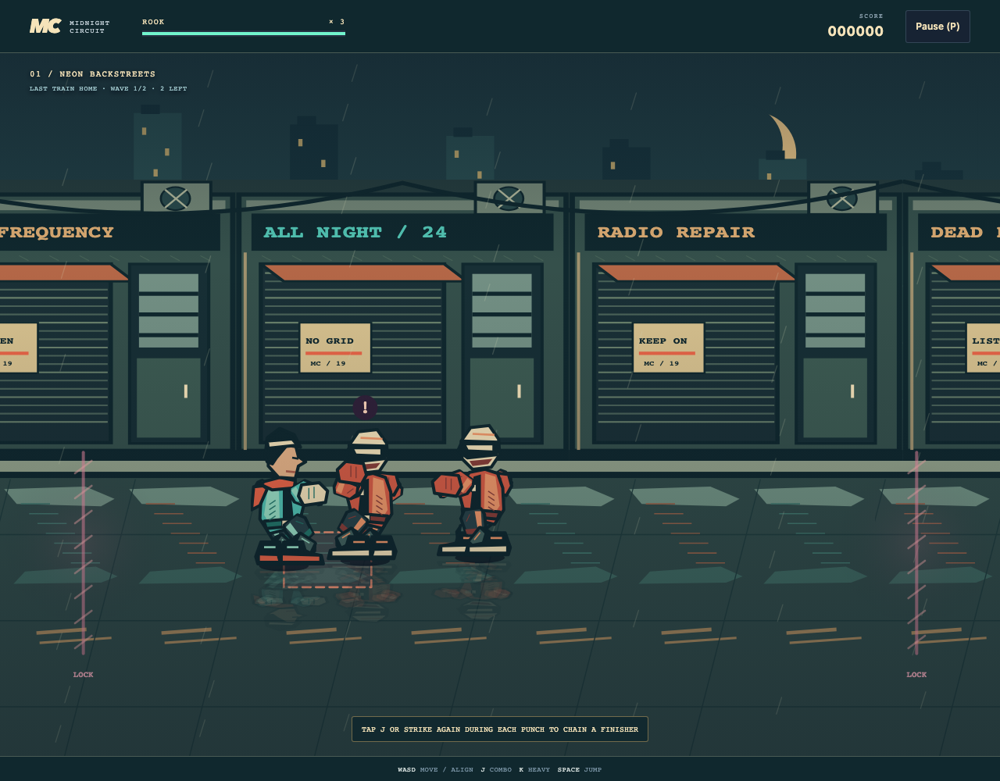
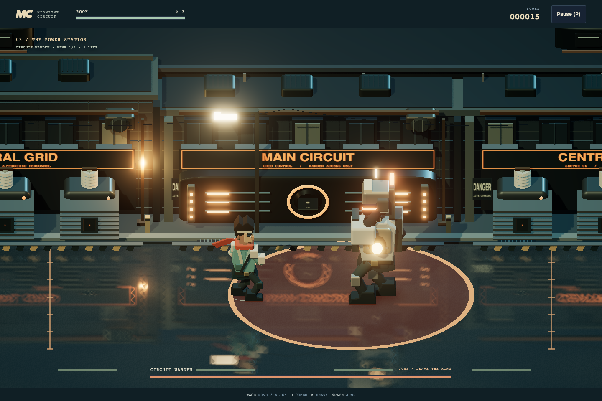

# Midnight Circuit

[Source](../../../src/games/midnight-circuit/) | [Catalog](../../../CATALOG.md)

An original street brawler with procedural and image-based Canvas appearances plus modeled Three.js scenes. Rook follows a blackout through **Neon Backstreets** and **The Power Station**, then takes on the **Circuit Warden** to restore the city grid. A first successful run is intended to take roughly 4–6 minutes, with faster runs possible. There is no time limit.

## Play

| Control | Action |
| --- | --- |
| WASD / arrows | Move horizontally and into/out of the ground-depth lane |
| J | Light attack; successive presses chain jab, cross and a crowd-clearing kick |
| K | Heavy strike: broad contact, strong stagger and committed recovery |
| Space | Jump |
| J or K while airborne | Flying kick |
| P / Pause | P pauses/resumes; Pause opens the menu |
| Touch arrows + Strike / Heavy / Jump | Independent captured controls support simultaneous touches |

Align your feet with an opponent's ground lane before attacking. Read the red attack telegraphs and step into another lane, move behind the attacker or jump. Aerial kicks work during the jump's useful height window. Jabs and crosses isolate the nearest eligible opponent; finishers, heavy strikes and flying kicks can hit a crowd. Holding an attack button does not repeat it. Tap again during each light strike to queue one follow-up; a short gap after the strike also preserves the next combo move. Ground attacks commit through startup and contact, then allow slower movement during recovery, with heavier strikes retaining more commitment. Contextual prompts introduce alignment and chaining, point toward a nearby opponent's lane and announce the next wave.

Three lives cover the whole run. Losing a life cancels enemy attacks, restores health after a short fall and grants safe recovery time. Green repair cells restore health and score once, including cells awarded after street encounters. They remain on the ground while health is full, so walking over one does not waste it. Entering the station restores health while preserving lives, elapsed time and scoring. Results show points, hits, best chain, time and remaining lives. Restart creates a fresh run; Game selection disposes the session.

## Theme modes

**Normal**, the default, keeps Illustrated arcade on Canvas without a graphics dependency. **Assets** uses Signal / Rain: original articulated image fighters, shuttered radio-shop facades, transformer bays, a parallax skyline, wet pavement and illustrated repair cases, all in charcoal, teal, vermilion and cream. Its committed SVG artwork is generated from an editable local source under the repository MIT license. See the [artwork guide](../../../src/games/midnight-circuit/art/README.md) for the creative brief, atlas layout, anchors and regeneration. **Quality** uses Afterglow: sculpted fighters in layered dispatch clothing, security armor and ceramic exoskeletons, under an elevated railway. Distinct noodle shops, electronics shutters and laundrettes give way to ribbed transformer banks. Wet asphalt reflects the actual scene, with soft contact shadows, warm practical lights, restrained bloom and matching ivory-and-graphite instruments. Select Theme directly in the menu.

Switching keeps the current stage, enemies, score, health and attack timing. Resume continues the paused run. Choices survive restarts for this session. An unavailable renderer retains the working appearance; graphics loss pauses play and restores Normal for explicit Resume. GPU code loads only when requested, and the shared host remains the sole frame-loop owner.

All appearances use distance-driven walking with a planted stance, lifted return step, bent knees and coordinated arm motion. Recovery movement blends attack poses back into stepping. Blocked input, jumps and hit pushes do not advance the gait. Presentation observes actor positions without modifying movement or combat rules.

## Quality art direction: Afterglow

A city running on its last circuit, seen beneath an elevated railway at blue hour. Petrol-blue masonry, smoked glass, oxidized copper and wet asphalt carry warm ivory shop lights and restrained signal-orange neon. Broad, dark road surfaces keep the fighting lane quiet. Rook reads first through a pale teal dispatch jacket, ivory sleeves and a vermilion scarf. Strikers wear narrow red security armor, Bruisers have heavy ochre utility gear, and the Warden has a broad ceramic exoskeleton with a hot orange core. Silhouettes, exposed faces and articulated clothing distinguish people from machinery.

The backstreets alternate a late-night noodle shop, shuttered electronics store and laundrette under weathered apartments and railway steel. The station replaces those storefronts with ribbed transformer banks, ceramic insulators, cable runs and a central control installation. Real ground reflections, soft contact shadows, restrained bloom and depth haze connect actors to the pavement. Signs and lamps illuminate scenery without outlining every object. Enemy attack footprints and repair markers remain clear above the road. Victory warms the city lighting and restores the station's indicators.

Fighters reuse the game's displacement-driven gait and combat poses, with tapered limbs, layered jackets, fitted gloves and boots, expressive heads and role-specific shoulder shapes. Contact produces brief starbursts, fragments and expanding ground rings; windups remain readable without those effects. Decorative rain, scarf drift and expanding impact effects respect reduced motion and freeze with the paused run. Matching graphite-and-ivory instruments and menus carry the same accent colors.

Quality uses a single lazily loaded Three.js presentation, including its bounded reflection and bloom targets. It requires no downloaded art or WebGPU finish. Failed preparation retains the working theme; context loss restores Normal and pauses the same run for explicit Resume.

## Encounters and combat

Each stage has three authored gated encounters. Streets introduce Strikers, add Bruisers, then combine them with flanking arrivals. The station adds heavier mixed waves before the solo Warden fight. Clearing every wave releases the gate. Actors are clamped to the same active arena and ground lane; no enemy can escape beyond the player's accessible geometry. Wave arrivals wait briefly after the last defeat, and populations stay bounded by authored groups.

Strikers close quickly and punch after a short warning. Bruisers move slowly, telegraph a committed smash and recover longer. A local attack token admits one startup/active attack at a time while other enemies reposition; a short gap prevents immediate crowd spam. Soft lane separation reduces stacking.

The Warden alternates a lane-locked forward charge and a broad ground impact. Step aside for the charge; jump or leave the elliptical ground-impact area. All presentations draw warnings from the combat footprint, including Rook's body margin. The charge warning contracts toward its committed endpoint as the Warden advances. The boss bar names the response to each pattern. Its armor resists damage and stagger during attack commitment. The visible **OPEN** recovery window takes bonus damage. Defeat starts a short city-light restoration sequence before the final results.

Every attack has simulation-owned startup, active and recovery durations. Each swing owns a unique identity and hit list, so an active window cannot damage the same target repeatedly. Facing, horizontal range, lane tolerance, target elevation and immunity determine eligibility. Hitstun interrupts regular enemies, knockback decays in the simulation, and player damage grants brief immunity. Cosmetic flashes, impact rings, sparks and camera shake observe semantic events; they never decide hits or advance rules.

## Source and tuning

| Owner | Responsibility |
| --- | --- |
| `src/games/midnight-circuit/content.ts` | Typed stages, arena geometry, waves, pickups, fighter/enemy tuning and attack definitions |
| `src/games/midnight-circuit/game.ts` | Explicit x/lane/elevation coordinates, combat timing, AI, gates, lives, score and outcomes |
| `src/games/midnight-circuit/input.ts` | Translate shared button snapshots into movement and one-shot combat actions |
| `src/games/midnight-circuit/presentation.ts` | Uniform projection, encounter-framed camera, depth sorting, vector artwork, parallax, weather and bounded effects |
| `src/games/midnight-circuit/assets.ts`, `asset-art.ts`, `art/signal-rain/` | Assets image preparation, layout validation, articulated drawing and original artwork sources |
| `src/games/midnight-circuit/animation.ts` | Displacement observations, planted gait, knee bending and attack poses shared across appearances |
| `src/games/midnight-circuit/graphics.ts`, `appearance.ts` | Renderer contract, lazy loading, atomic replacement, cancellation and recovery |
| `src/games/midnight-circuit/three/diorama.ts` | Quality composition, orthographic projection, reflected camera, lighting, bounded bloom, weather, combat warnings and event effects |
| `src/games/midnight-circuit/three/art.ts`, `scenery.ts`, `fighters.ts` | Owned original geometry/materials, batched street and station scenery, articulated fighter models |
| `src/games/midnight-circuit/ui.ts`, `style.css` | Scoped menus, HUD, boss bar, touch layout and user intents |
| `src/games/midnight-circuit/sound-recipes.ts`, `sound.ts` | Original AudioBits recipes, cue priorities, batch coalescing and throttling |
| `src/games/midnight-circuit/app.ts` | Composition, stepping, interruption, gesture audio activation and disposal |

Artwork dimensions never supply collision geometry. Shadows remain on the ground while elevation moves the painted body. Actors sort by ground lane independently of elevation. The camera frames the whole encounter with a uniform transform, including on narrow screens. Reduced motion suppresses rain, particles and shake. Artwork, cover illustrations and procedural sound recipes are authored within the game. Quality uses the installed Three.js dependency. Assets reuses the Canvas projection, gait, depth sorting and semantic feedback while replacing character, environment and pickup roles with prepared images.

## Architecture decisions

Lane-depth geometry, attack phases, hit ownership, combos, hitstun, crowd coordination, boss patterns and encounter progression belong to this game's simulation. Swept circles and platform solids have different contact rules. The projected camera and articulated animation stay local. The Three.js orthographic camera projects horizontal position, ground lane and elevation to the same uniform scale as Canvas. Model dimensions never feed back into gameplay. Static scenery is batched by material, internal resolution is bounded, and particle populations are capped. A reflected camera shares the asymmetric orthographic projection and clips underground backdrop geometry; the reflection target stays at a fixed resolution. Bloom and grading run inside the same host frame. Renderer replacement releases geometry, materials, sign textures, shadow maps, reflection and postprocessing targets and its graphics context. Stage changes rebuild only the scenery and snap the camera to the new arena; restarts release the previous fighter instances and event effects.

The input adapter translates shared captured-button holds and edges into movement and combat actions. Browser composition uses the shared host, clock, focus/lifetime bindings and AudioBits owner. Timed gameplay transitions stay in simulation; cosmetic tails stay in presentation.

## Verification

`tests/unit/games/midnight-circuit/game.test.mjs` checks timing and hit ownership, quick combo taps, recovery movement, nearest-target selection, lane/facing/height eligibility, crowd strikes, interruption, immunity and lives, gated waves, retained repairs, danger footprints, boss patterns and finale, pause, fresh runs and uniform projection. A deterministic controller completes both authored stages using actions alone and checks bounded crowds and attack coordination throughout.

`tests/unit/games/midnight-circuit/animation.test.mjs` checks displacement-driven gait, planted steps, recovery blending, pause, blocked movement, knockback, teleport handling and read-only observation.

`tests/unit/games/midnight-circuit/assets.test.mjs` checks the committed artwork layout and rejection of missing or mismatched images.

`tests/browser/games/midnight-circuit/game.spec.ts` checks appearance replacement, Assets decoding failures, cancellation and source release, retained run state, graphics-loss recovery, opening, keyboard and simultaneous touch actions, display/blur interruption, restart, boss-result composition, audio failure recovery and disposal. The shared construction-failure check includes this game. AudioBits recipes are validated, including JSON round trips, with the existing audio invariants.

Run `pnpm check` and `pnpm check:browser` as described in the [shared architecture](../../architecture.md).
