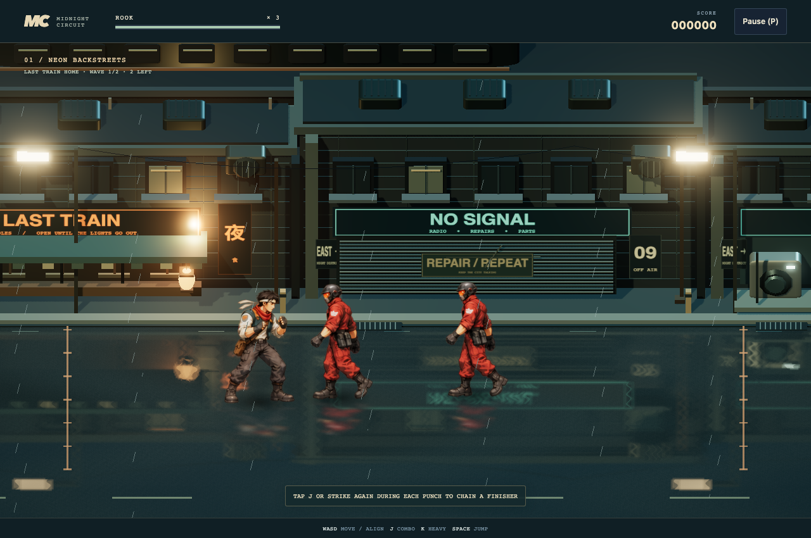
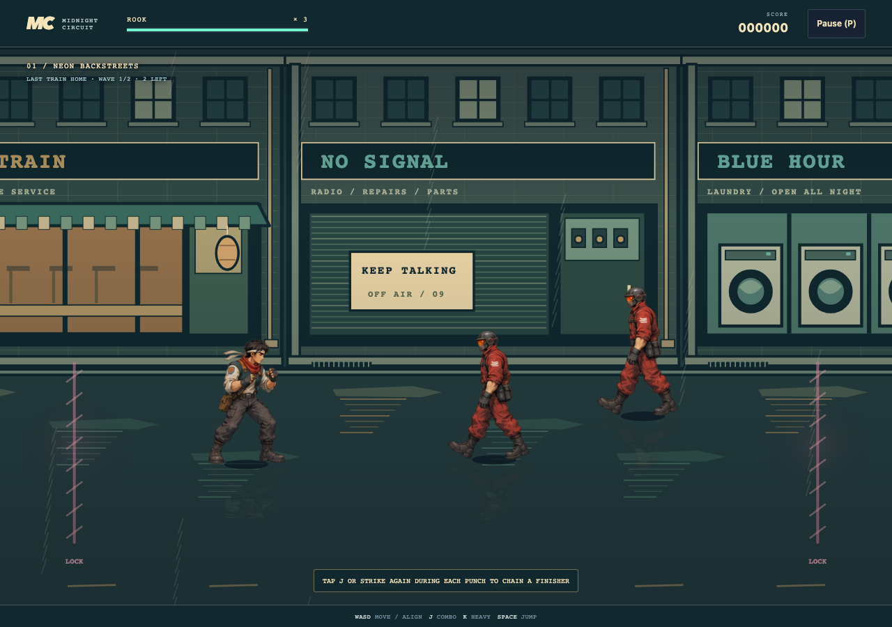
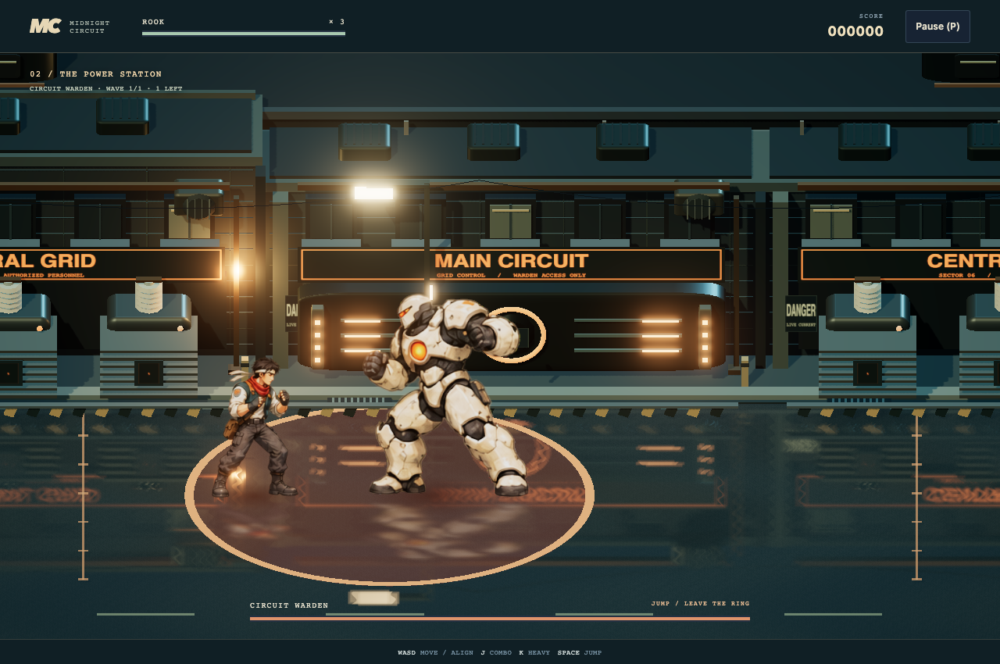

# Midnight Circuit

[Source](../../../src/games/midnight-circuit/) | [Controls](../../../CATALOG.md#midnight-circuit) | [Shared contracts](../../architecture.md)

An original street brawler with complete painted fighter sprites, Canvas appearances and a Three.js city scene. Rook follows a blackout through **Neon Backstreets** and **The Power Station**, then takes on the **Circuit Warden** to restore the city grid. A first successful run is intended to take roughly 4–6 minutes, with faster runs possible. There is no time limit.

## Play

Align your feet with an opponent's ground lane before attacking. Read the red attack telegraphs and step into another lane, move behind the attacker or jump. Aerial kicks work during the jump's useful height window. The light combo advances through jab, cross and a crowd-clearing kick. Jabs and crosses isolate the nearest eligible opponent; finishers, heavy strikes and flying kicks can hit a crowd. Heavy strikes add broad contact and strong stagger. Holding an attack button does not repeat it. Tap again during each light strike to queue one follow-up; a short gap after the strike also preserves the next combo move. Ground attacks commit through startup and contact, then allow slower movement during recovery, with heavier strikes retaining more commitment. Contextual prompts introduce alignment and chaining, point toward a nearby opponent's lane and announce the next wave.

Three lives cover the whole run. Losing a life cancels enemy attacks, restores health after a short fall and grants safe recovery time. Green repair cells restore health and score once, including cells awarded after street encounters. They remain on the ground while health is full, so walking over one does not waste it. Entering the station restores health while preserving lives, elapsed time and scoring. Results show points, hits, best chain, time and remaining lives.

## Theme modes

**Normal** uses Illustrated arcade on Canvas. **Assets · Signal / Rain** is an inked comic treatment; the [artwork guide](../../../src/games/midnight-circuit/art/README.md) owns its creative brief and complete-cel atlas contract. **Quality · Afterglow** uses a Three.js city diorama, described below.

All appearances share complete painted cels for idle, two walking steps, anticipation, punch, kick, hurt and defeat. Ground travel selects walking cels; startup, contact and recovery select action cels from simulation timing. Blocked input, jumps and hit pushes do not advance the gait. Rendering never reconstructs joints or stretches anatomy.

## Quality art direction: Afterglow

A city running on its last circuit, seen beneath an elevated railway at blue hour. Petrol-blue masonry, smoked glass, oxidized copper and wet asphalt carry warm ivory shop lights and restrained signal-orange neon. Broad, dark road surfaces keep the fighting lane quiet. Rook reads first through a pale teal dispatch jacket, ivory sleeves and a vermilion scarf. Strikers wear narrow red security armor, Bruisers have heavy ochre utility gear, and the Warden has a broad ceramic exoskeleton with a hot orange core. Silhouettes, exposed faces and continuous clothing silhouettes distinguish people from machinery.

The backstreets alternate a late-night noodle shop, shuttered electronics store and laundrette under weathered apartments and railway steel. The station replaces those storefronts with ribbed transformer banks, ceramic insulators, cable runs and a central control installation. Real ground reflections, soft contact shadows, restrained bloom and depth haze connect actors to the pavement. Signs and lamps illuminate scenery without outlining every object. Enemy attack footprints and repair markers remain clear above the road. Victory warms the city lighting and restores the station's indicators.

Fighters reuse the same complete painted drawings across modes. Camera-facing image planes integrate them into the city and its wet-road reflections, preserving stable foot pivots and role-specific silhouettes. Contact produces brief starbursts, fragments and expanding ground rings; windups remain readable without those effects. Reduced motion freezes decorative walking, rain, expanding impact effects, particles and shake while retaining combat cels. Matching graphite-and-ivory instruments and menus carry the same accent colors.

## Encounters and combat

Each stage has three authored gated encounters. Streets introduce Strikers, add Bruisers, then combine them with flanking arrivals. The station adds heavier mixed waves before the solo Warden fight. Clearing every wave releases the gate. Actors are clamped to the same active arena and ground lane; no enemy can escape beyond the player's accessible geometry. Wave arrivals wait briefly after the last defeat, and populations stay bounded by authored groups.

Strikers close quickly and punch after a short warning. Bruisers move slowly, telegraph a committed smash and recover longer. A local attack token admits one startup/active attack at a time while other enemies reposition; a short gap prevents immediate crowd spam. Soft lane separation reduces stacking.

The Warden alternates a lane-locked forward charge and a broad ground impact. Step aside for the charge; jump or leave the elliptical ground-impact area. All presentations draw warnings from the combat footprint, including Rook's body margin. The charge warning contracts toward its committed endpoint as the Warden advances. The boss bar names the response to each pattern. Its armor resists damage and stagger during attack commitment. The visible **OPEN** recovery window takes bonus damage. Defeat starts a short city-light restoration sequence before the final results.

Every attack has simulation-owned startup, active and recovery durations. Each swing owns a unique identity and hit list, so an active window cannot damage the same target repeatedly. Facing, horizontal range, lane tolerance, target elevation and immunity determine eligibility. Hitstun interrupts regular enemies, knockback decays in the simulation, and player damage grants brief immunity.

## Source and tuning

Paths below are relative to `src/games/midnight-circuit/`.

| Owner | Responsibility |
| --- | --- |
| `content.ts` | Typed stages, arena geometry, waves, pickups, fighter/enemy tuning and attack definitions |
| `game.ts` | Explicit x/lane/elevation coordinates, combat timing, AI, gates, lives, score and outcomes |
| `input.ts` | Translate shared button snapshots into movement and one-shot combat actions |
| `presentation.ts` | Uniform projection, encounter-framed camera, depth sorting, sprite composition, parallax, weather and bounded effects |
| `assets.ts`, `asset-art.ts`, `art/signal-rain/` | Assets image preparation, layout validation and original scenery sources |
| `animation.ts`, `sprite-art.ts`, `art/fighters/` | Displacement observations, semantic cel selection, role footprints, complete painted atlas, prompts and packing |
| `graphics.ts`, `appearance.ts` | Renderer contract, lazy loading, atomic replacement, cancellation and recovery |
| `three/diorama.ts` | Quality composition, orthographic projection, reflected camera, lighting, bounded bloom, weather, combat warnings and event effects |
| `three/art.ts`, `scenery.ts`, `fighters.ts` | Owned original geometry/materials, batched street and station scenery, complete fighter image planes |
| `ui.ts`, `style.css` | Scoped menus, HUD, boss bar, touch layout and user intents |
| `sound-recipes.ts`, `sound.ts` | Original AudioBits recipes, cue priorities, batch coalescing and throttling |
| `app.ts` | Composition, stepping, interruption, gesture audio activation and disposal |

Actors sort by ground lane independently of jump elevation; shadows remain on the ground. The camera frames the whole encounter, including on narrow screens. Assets reuses the Canvas projection, gait, depth sorting and semantic feedback.

## Architecture decisions

The projected camera and sprite animation stay local because they depend on horizontal position, ground lane and elevation. The Three.js orthographic camera maps these coordinates to the Canvas scale. Static scenery batches by material. The reflected camera shares the asymmetric projection and clips underground backdrop geometry; its target stays at a fixed resolution. Stage changes rebuild only scenery and snap the camera to the new arena; restarts release previous fighter instances and event effects.

## Verification

`tests/unit/games/midnight-circuit/game.test.mjs` checks timing and hit ownership, quick combo taps, recovery movement, nearest-target selection, lane/facing/height eligibility, crowd strikes, interruption, immunity and lives, gated waves, retained repairs, danger footprints, boss patterns and finale, pause, fresh runs and uniform projection. A deterministic controller completes both authored stages using actions alone and checks bounded crowds and attack coordination throughout.

`tests/unit/games/midnight-circuit/animation.test.mjs` checks displacement-driven gait, walking cel selection, recovery timing, pause, blocked movement, knockback, teleport handling and read-only observation.

`tests/unit/games/midnight-circuit/assets.test.mjs` checks the committed artwork layout and rejection of missing or mismatched images.

The [browser checks](../../../tests/browser/games/midnight-circuit/game.spec.ts) cover lane combat, simultaneous touch actions, boss-result composition and appearance replacement.

Use the [shared verification commands](../../architecture.md#local-verification).
