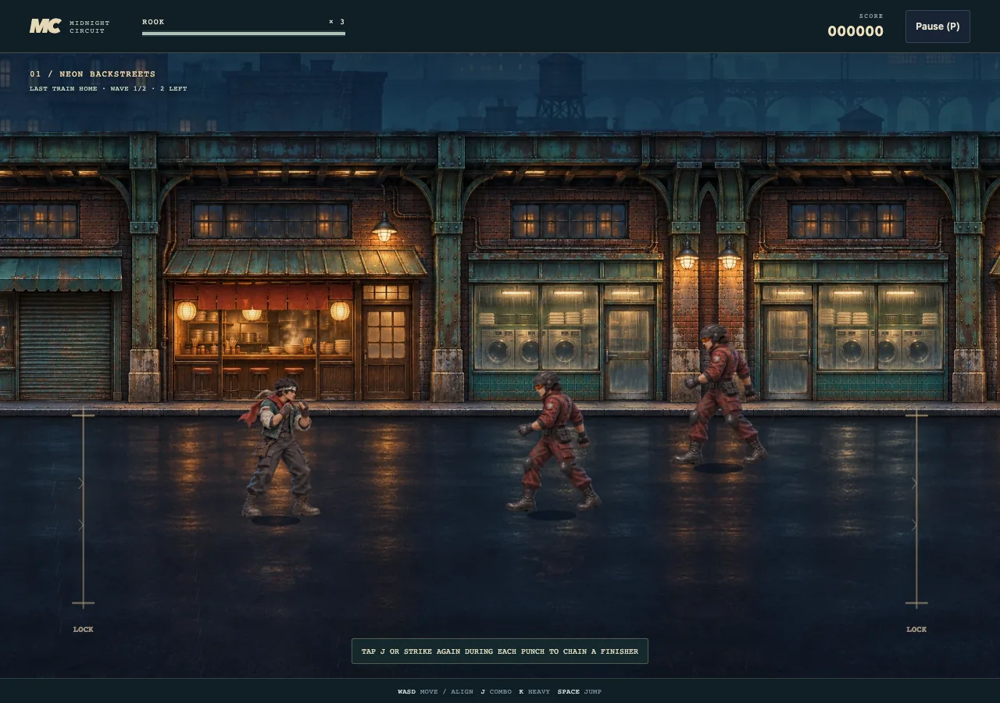

# Midnight Circuit

[Source](../../../src/games/midnight-circuit/) | [Controls](../../../CATALOG.md#midnight-circuit) | [Shared contracts](../../architecture.md)

An original street brawler with three coordinated Canvas presentations and complete fighter sprite cels. Rook follows a blackout through **Neon Backstreets** and **The Power Station**, then takes on the **Circuit Warden** to restore the city grid. A first successful run is intended to take roughly 4–6 minutes, with faster runs possible. There is no time limit.

## Play

Align your feet with an opponent's ground lane before attacking. Read the red attack telegraphs and step into another lane, move behind the attacker or jump. Aerial kicks work during the jump's useful height window. The light combo advances through jab, cross and a crowd-clearing kick. Jabs and crosses isolate the nearest eligible opponent; finishers, heavy strikes and flying kicks can hit a crowd. Heavy strikes add broad contact and strong stagger. Holding an attack button does not repeat it. Tap again during each light strike to queue one follow-up; a short gap after the strike also preserves the next combo move. Ground attacks commit through startup and contact, then allow slower movement during recovery, with heavier strikes retaining more commitment. Contextual prompts introduce alignment and chaining, point toward a nearby opponent's lane and announce the next wave.

Three lives cover the whole run. Losing a life cancels enemy attacks, restores health after a short fall and grants safe recovery time. Green repair cells restore health and score once, including cells awarded after street encounters. They remain on the ground while health is full, so walking over one does not waste it. Entering the station restores health while preserving lives, elapsed time and scoring. Results show points, hits, best chain, time and remaining lives.

## Theme modes

| Mode | Direction |
| --- | --- |
| **Normal · Street sketch** | Simple flat whole-character cels, silhouette buildings, broad windows and an open road. A lightweight, readable playable foundation. |
| **Assets · Signal / Rain** | The painted arcade cast against an original inked city: noodle bar, radio repair shop, laundrette, railway steel and distinct industrial control bays. Warm paper, oxidized teal and charcoal carry through the instruments. |
| **Quality · Afterglow** | A separately redrawn, more detailed cast inhabits richly illustrated masonry, copper, ceramic, glass and wet asphalt. Warm practical lights, quiet reflections and graphite-and-ivory instruments give the whole street and station a coherent modern finish. |

The [artwork guide](../../../src/games/midnight-circuit/art/README.md) owns all three briefs, source artwork, layout and maintenance contracts. The cast keeps its identity across modes: Rook's teal jacket and red scarf, red-uniformed Strikers, ochre Bruisers and the ivory Warden. Assets retains the classic painted combat cels with new locomotion artwork. Quality has its own newly drawn, higher-resolution fighter sheet with richer clothing, armor and materials. Normal uses a separate modest vector cel sheet.

Normal uses twelve cels per fighter. Assets and Quality each use sixteen: idle, eight walking contact, weight-transfer and passing poses, anticipation, punch, kick, neutral jump rise/fall, hurt and defeat. The painted walks keep the hands near a fighting guard, with restrained torso motion and separate near/far leg contacts. Ground travel selects walking cels; startup, contact and recovery select action cels from simulation timing. Blocked input, jumps and hit pushes do not advance the gait. Each drawing remains a complete figure with a stable foot pivot. A relaxed full stride follows 152 world units of observed travel, scaled for larger fighters, instead of wall time. Stopping against an encounter edge immediately returns to idle. An ordinary jump uses guarded rise and landing poses; only an actual aerial attack selects the kick contact.

Scenery has no physical obstacles in the traversable lane. Facades, transformers, gutter details and furniture stay behind its rear curb. Near scenery and pavement share world alignment; only distant skylines use parallax. The station control installation frames the final arena. Quality frames its lower foreground facades beneath a visible distant skyline on desktop and portrait displays; the station roof has transparent openings into that same city layer. Enemy attack footprints, repairs and the Warden's **OPEN** cue remain separate readable layers above the road. Reduced motion suppresses rain, flashes, shake and moving impact effects while preserving the locomotion cels that communicate actual travel, as well as combat poses. The finale restores indicators and warms the city above the retained battle scene.

## Encounters and combat

Each stage has three authored encounters that hold the camera and limit travel until the fight is cleared. Streets introduce Strikers, add Bruisers, then combine them with flanking arrivals. The station adds heavier mixed waves before the solo Warden fight. Clearing every wave releases the encounter and shows a quiet **GO →** prompt. The road stays visually continuous: there are no bars, force fields or LOCK labels. Actors are clamped to the same active arena and ground lane; no enemy can escape beyond the player's accessible geometry. Wave arrivals wait briefly after the last defeat, and populations stay bounded by authored groups.

Strikers close quickly and punch after a short warning. Bruisers move slowly, telegraph a committed smash and recover longer. A local attack token admits one startup/active attack at a time while waiting enemies hold separated flank positions outside the approach lane; a short gap prevents immediate crowd spam. Soft lane separation reduces stacking.

The Warden alternates a lane-locked forward charge and a broad ground impact. Step aside for the charge; jump or leave the elliptical ground-impact area. All presentations draw warnings from the combat footprint, including Rook's body margin. The charge warning contracts toward its committed endpoint as the Warden advances. The boss bar names the response to each pattern. Its armor resists damage and stagger during attack commitment. The visible **OPEN** recovery window takes bonus damage. Defeat starts a short city-light restoration sequence before the final results.

Every attack has simulation-owned startup, active and recovery durations. Each swing owns a unique identity and hit list, so an active window cannot damage the same target repeatedly. Facing, horizontal range, lane tolerance, target elevation and immunity determine eligibility. Hitstun interrupts regular enemies, knockback decays in the simulation, and player damage grants brief immunity.

## Combat design

Positioning, readable intent and responsive attacks guide the encounter design. Keep the small authored crowds, distinct Striker/Bruiser tempos, lane escapes, single-target jabs and crowd-clearing finishers. Waiting enemies stage to either side of the player and offset their lanes while one challenger approaches; their targets remain inside the same accessible arena. Attack commitment keeps facing and lane stable, leaving the telegraph useful throughout its warning. The Warden retains its distinct charge, area impact and punishable recovery.

The walk cadence and guard silhouette support those combat decisions without slowing action input. Additional movement cels never lengthen startup or contact. Passing feet stay low rather than marching, and retreating in guard plays the gait backward. Encounter bounds belong to simulation and camera framing rather than physical-looking scenery. Inspiration: the [Streets of Rage 4 developer interview](https://www.nintendolife.com/news/2020/12/feature_the_making_of_streets_of_rage_4_by_the_people_who_made_it_happen) discusses positioning, small crowds and animation responsiveness; the [Absolum developer interview](https://www.pcgamer.com/games/action/absolum-interview-how-the-beat-em-ups-developers-created-four-fabulous-characters/) discusses clear silhouettes and distinct anticipation/contact poses. [Signals and Light's enemy positioning essay](https://signalsandlight.substack.com/p/how-do-enemy-attacks-work-with-the) explains how attack visibility and enemy spacing relate to the camera.

## Source and tuning

Paths below are relative to `src/games/midnight-circuit/`.

| Owner | Responsibility |
| --- | --- |
| `content.ts` | Typed stages, arena geometry, waves, pickups, fighter/enemy tuning and attack definitions |
| `game.ts` | Explicit x/lane/elevation coordinates, combat timing, AI, gates, lives, score and outcomes |
| `input.ts` | Translate shared button snapshots into movement and one-shot combat actions |
| `presentation.ts` | Uniform projection, encounter-framed camera, depth sorting, sprite composition, parallax, weather and bounded effects |
| `assets.ts`, `asset-art.ts`, `art/signal-rain/` | Inked Assets scenery, image preparation and layout validation |
| `quality.ts`, `quality-art.ts`, `art/afterglow/` | Painted Quality scenery, inspected curb anchors, image preparation and validation |
| `animation.ts`, `sprite-art.ts`, `art/normal/`, `art/fighters/` | Displacement observations, semantic cel selection, role footprints, simple, classic painted and separate modern complete-cel atlases and sources |
| `graphics.ts`, `appearance.ts` | Renderer contract, lazy loading, atomic replacement, cancellation and recovery |
| `ui.ts`, `style.css` | Scoped menus, HUD, boss bar, touch layout and user intents |
| `sound-recipes.ts`, `sound.ts` | Original AudioBits recipes, cue priorities, batch coalescing and throttling |
| `app.ts` | Composition, stepping, interruption, gesture audio activation and disposal |

Actors sort by ground lane independently of jump elevation; shadows remain on the ground. The camera frames the whole encounter, including on narrow screens. All modes share the Canvas projection, gait, depth sorting and semantic feedback.

## Architecture decisions

The projected camera and sprite animation stay local because they depend on horizontal position, ground lane and elevation. A single Canvas owner composes every mode with the same world transform, semantic cues and bounded effects. Quality uses painted image plates instead of a separate 3D scene, keeping the people and architecture in the same illustrated perspective. Only the quiet asphalt portion stretches on tall displays; architectural proportions and the source curb anchor stay stable. Alternate Quality tiles mirror their matching edges. Sources contain no baked actors, combat effects or pickups.

Assets and Quality each own lazy, validated image bundles. The session retains its current presentation until the replacement is ready and successfully drawn, then releases the previous owner. Image or draw failure uses the shared recovery contract.

## Verification

`tests/unit/games/midnight-circuit/game.test.mjs` checks timing and hit ownership, quick combo taps, recovery movement, nearest-target selection, lane/facing/height eligibility, crowd strikes, interruption, immunity and lives, gated waves, retained repairs, danger footprints, boss patterns and finale, pause, fresh runs and uniform projection. A deterministic controller completes both authored stages using actions alone and checks bounded crowds and attack coordination throughout.

`tests/unit/games/midnight-circuit/animation.test.mjs` checks displacement-driven gait, walking cel selection, recovery timing, pause, blocked movement, knockback, teleport handling and read-only observation.

`tests/unit/games/midnight-circuit/assets.test.mjs` checks the committed sprite and environment layouts and rejection of missing or mismatched images.

The [browser checks](../../../tests/browser/games/midnight-circuit/game.spec.ts) cover rendered four-cel Normal and eight-cel painted walking under reduced motion, neutral jumps versus attack kicks, lane combat, simultaneous touch actions, boss-result composition, distinct appearances, paused frame stability, retained-run replacement, drawing recovery and failed/cancelled image preparation.

Use the [shared verification commands](../../architecture.md#local-verification).
