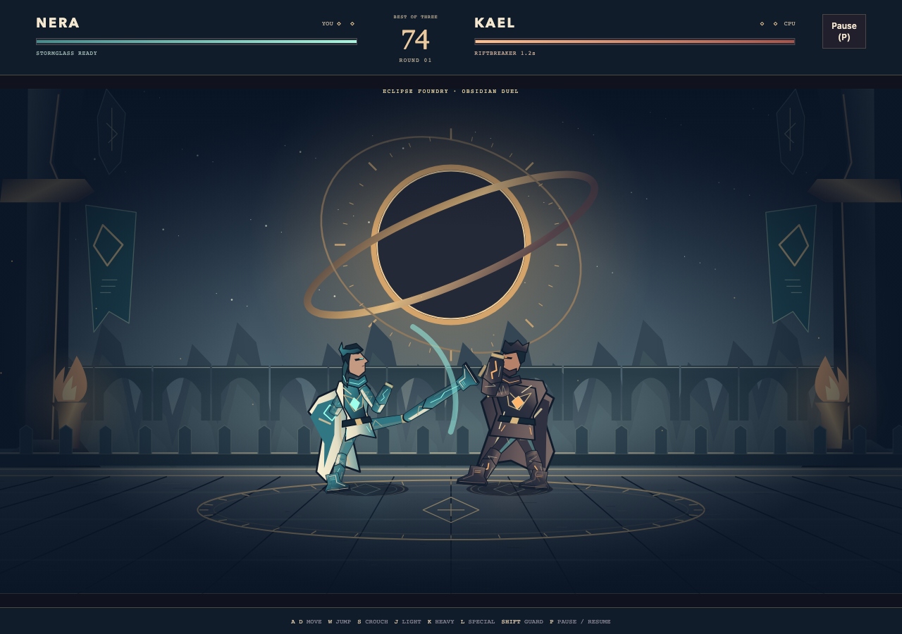

# Obsidian Duel

[Source](../../../src/games/obsidian-duel/) | [Catalog](../../../CATALOG.md)

An original one-on-one fighter set on a storm-lit terrace of the Tempest Citadel. Choose **Nera, the Stormweaver**, or **Kael, the Citadel Fist**, then face the other fighter as a CPU opponent. Win two rounds to take the match.

## Fighting

A/D or left/right moves. W/Up (also Space) jumps. S/Down crouches. J is light, K heavy, L special and Shift guards. Crouching J sweeps; airborne J or K attacks overhead. P pauses/resumes. Escape pauses when delivered by the browser. Touch buttons support independent held movement, crouch and guard alongside attack presses. Release controls during round transitions before pressing again.

Standing guard stops ordinary strikes and overheads. Crouching guard stops ordinary strikes and lows, but loses to overheads. Guard prevents damage and briefly locks movement in blockstun. You cannot guard in the air. A sweep catches standing opponents but passes below a jump. Attacks are commitments: wait for a heavy to miss, then approach during recovery. A short press buffer helps time your next action near the end of recovery.

Hold a direction at takeoff to commit to a forward or backward jump, or jump vertically without one. Attacking preserves that trajectory; taking a hit interrupts horizontal drift. Jump over an opponent to change sides. Fighters automatically face one another when free to act; a committed attack keeps its facing until it ends. Delay an aerial strike until after crossing to attack back toward the opponent. Jump plus light/heavy can be pressed together near the end of recovery to buffer a jumping overhead. Commands expire quickly, and pauses and round transitions discard them. A heavy buffered before landing remains a heavy once landing recovery ends.

Labels above the opponent distinguish low sweeps, overheads, heavy strikes and bolts during their actual startup and active windows. **RECOVERING** marks the committed recovery of a heavy, sweep or Riftbreaker, including a miss. Close distance to punish an opening; the label does not change attack reach or guarantee a hit.

Nera moves faster and recovers sooner. Her **Stormglass** bolt covers distance, can be guarded or jumped, and has a cooldown. Kael has longer, heavier strikes. **Riftbreaker** telegraphs a committed advancing punch with a long punishable recovery. Both fighters have a sweep and an airborne overhead. No move requires a directional combination.

The timer runs only during combat. A knockout ends the round immediately; time-out awards it to the healthier fighter. Equal health or simultaneous knockout is a draw, awarding neither fighter a win and starting another round. Each round restores health, spacing and cooldowns. A knockdown leads through a protected wake-up; short protection at the end of hitstun prevents corner loops. Grounded push bodies prevent walking through an opponent; sufficient vertical clearance permits a jump-over. Landing restores separation in the current left/right order. Guard uses the Guard button and height rather than a directional input, so holding the correct guard still protects after a side switch.

**Game setup** from pause or results returns to fighter selection. **Restart** begins a fresh match with the selected fighter.

## Theme modes

**Normal** keeps Tempest citadel, storm scenery and the original fighter costumes. **Assets · Eclipse Foundry** replaces the scenery, fighter costumes, Stormglass bolt and contact effects with bundled original SVG artwork. Nera wears ivory panels, turquoise stormglass and a crescent crest. Kael wears broad basalt plates, heavy gauntlets and ember seams. A copper eclipse hangs over the ruined observatory and its engraved dueling floor. **Quality** remains unavailable.

Choose Theme from setup or a paused match. Preparation keeps the working presentation visible, then replaces it on the same match. Resume continues the current attack, jump, health, cooldowns, timer and round. Restart retains the theme; leaving the game releases its images. See the [artwork guide](../../../src/games/obsidian-duel/art/README.md) for the creative brief, inspiration, part layout and regeneration.

## Source ownership

| Owner | Responsibility |
| --- | --- |
| `src/games/obsidian-duel/content.ts` | Typed roster, physical arena and move tuning |
| `src/games/obsidian-duel/game.ts` | Pure fighter states, attack instances, contact, guard, projectiles and match rounds |
| `src/games/obsidian-duel/cpu.ts` | Seeded decisions using delayed visible observations and ordinary action commands |
| `src/games/obsidian-duel/input.ts` | Shared captured-button snapshots translated into fighting actions |
| `src/games/obsidian-duel/themes.ts` | Theme names, stage palettes and fighter costume colors |
| `src/games/obsidian-duel/presentation.ts` | Uniform arena transform, shared articulated poses, presentation replacement and bounded contact effects |
| `src/games/obsidian-duel/asset-art.ts`, `assets.ts` | Game-local part layout, dimension validation and shared cancellable image preparation |
| `src/games/obsidian-duel/asset-presentation.ts` | Eclipse Foundry image parts attached to observed joints, bolts and contact artwork |
| `src/games/obsidian-duel/ui.ts`, `style.css` | Selection, menus, health, timer, round wins, special readiness and touch controls |
| `src/games/obsidian-duel/sound-recipes.ts`, `sound.ts` | Original AudioBits recipes, cue priorities and throttling |
| `src/games/obsidian-duel/app.ts` | Host, clock, focus, display changes, audio and session disposal |

Simulation records horizontal position, elevation, velocity and facing independently of poses. Startup, active and recovery windows belong to authored move data. Each swing retains its contacted opponent; projectiles own their own swept horizontal contact and expiration. Both attacks advance before contact collection, allowing simultaneous trades without player-index priority. Only the simulation decides hits.

The CPU samples visible spacing, telegraphs and incoming bolts, then receives those observations after a reaction delay. Decisions have their own cadence and seeded mistakes. The CPU cannot read player inputs or buffered commands and uses the same movement, guard, cooldown and combat restrictions as the player.

Normal uses procedural Canvas geometry; the selection cover is an editable SVG. The scarf, split coat, light wraps and fast kicks distinguish Nera from Kael's broad mantle, armored shoulder, greaves and committed punches. Assets attaches independent illustrated parts to those same observed joints. Poses read simulation states. Reduced motion removes shake, storm flourishes and Assets mantle flutter and embers, and reduces particles while retaining all combat information.

## Architecture decisions

Guard height, projectiles, bilateral trades, stun exits and best-of-three ownership are local fighting rules. Their contact and progression semantics differ from a scrolling brawler's lane geometry, crowd coordination and encounter gates.

Browser composition reuses the shared host, clock, input, focus/lifetime bindings, preparation scope, image loader and bounded AudioBits owner. Appearance changes update the existing renderer through `replaceTheme`, drawing the candidate against the retained match before releasing the previous image bundle. Failed preparation or drawing rolls back to the working theme. Resuming, a newer selection or disposal cancels pending preparation. Costume dimensions remain independent of move tuning and fighter collision bodies.

The session clears input and resets timing at round-phase, display and menu transitions.

## Local verification

Focused invariants cover attack timing and single-hit ownership, guards, interruption and wake-up, body bounds, specials, trades, timer decisions, complete CPU matches and artwork dimensions. Chromium verifies retained match identity across themes, restart selection, failed and cancelled preparation, image release, the session lifecycle and independent touch holds; the shared audio check also exercises every duel recipe's output, burst admission and adapter coalescing.

See the [shared commands](../../architecture.md#local-verification).
