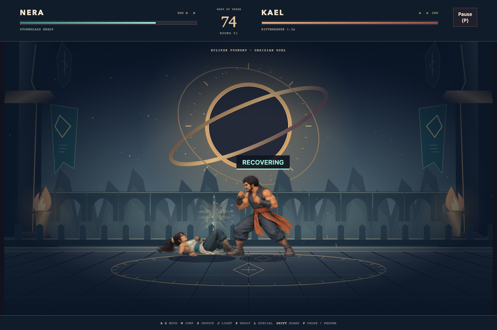
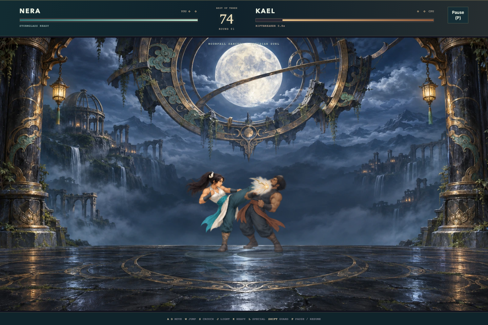

# Obsidian Duel

[Source](../../../src/games/obsidian-duel/) | [Controls](../../../CATALOG.md#obsidian-duel) | [Shared contracts](../../architecture.md)

An original one-on-one fighter set on a storm-lit terrace of the Tempest Citadel. Choose **Nera, the Stormweaver**, or **Kael, the Citadel Fist**, then face the other fighter as a CPU opponent. Win two rounds to take the match.

## Fighting

Crouching Light sweeps; airborne Light or Heavy attacks overhead. Touch movement, crouch and guard can be held alongside attack presses. Release controls during round transitions before pressing again.

Standing guard stops ordinary strikes and overheads. Crouching guard stops ordinary strikes and lows, but loses to overheads. Guard prevents damage and briefly locks movement in blockstun. You cannot guard in the air. A sweep catches standing opponents but passes below a jump. Attacks are commitments: wait for a heavy to miss, then approach during recovery. A short press buffer helps time your next action near the end of recovery.

Hold a direction at takeoff to commit to a forward or backward jump, or jump vertically without one. Attacking preserves that trajectory; taking a hit interrupts horizontal drift. Jump over an opponent to change sides. Fighters automatically face one another when free to act; a committed attack keeps its facing until it ends. Delay an aerial strike until after crossing to attack back toward the opponent. Jump plus light/heavy can be pressed together near the end of recovery to buffer a jumping overhead. Commands expire quickly, and pauses and round transitions discard them. A heavy buffered before landing remains a heavy once landing recovery ends.

Labels above the opponent distinguish low sweeps, overheads, heavy strikes and bolts during their actual startup and active windows. **RECOVERING** marks the committed recovery of a heavy, sweep or Riftbreaker, including a miss. Close distance to punish an opening; the label does not change attack reach or guarantee a hit.

Nera moves faster and recovers sooner. Her **Stormglass** bolt covers distance, can be guarded or jumped, and has a cooldown. Kael has longer, heavier strikes. **Riftbreaker** telegraphs a committed advancing punch with a long punishable recovery. Both fighters have a sweep and an airborne overhead. No move requires a directional combination.

The timer runs only during combat. A knockout ends the round immediately; time-out awards it to the healthier fighter. Equal health or simultaneous knockout is a draw, awarding neither fighter a win and starting another round. Each round restores health, spacing and cooldowns. A knockdown leads through a protected wake-up; short protection at the end of hitstun prevents corner loops. Grounded push bodies prevent walking through an opponent; sufficient vertical clearance permits a jump-over. Landing restores separation in the current left/right order. Guard uses the Guard button and height rather than a directional input, so holding the correct guard still protects after a side switch.

**Game setup** from pause or results returns to fighter selection. **Restart** begins a fresh match with the selected fighter.

## Theme modes

**Normal** uses Tempest citadel, storm scenery and the original fighter costumes. **Assets · Eclipse Foundry** supplies a ruined observatory, complete painted fighters and contact artwork; the [artwork guide](../../../src/games/obsidian-duel/art/README.md#eclipse-foundry-creative-brief) owns its brief and cel layout. **Quality · Moonfall Sanctum** uses an illustrated lunar sanctuary with the same fighter atlases, described below.

## Moonfall Sanctum art direction

Quality places the duel in a suspended obsidian sanctuary under a pearl moon. A custom illustrated arena supplies carved basalt, weathered bronze, jade ornament, ruined aqueducts, distant waterfalls and a monumental fractured lunar instrument. Quiet mist behind the fight lane separates the ivory-and-turquoise Nera from the broad charcoal-and-copper Kael. The floor remains unobstructed at the existing physical baseline.

Both fighters reuse Eclipse Foundry’s painted cels and semantic clip samples, preserving planted travel-driven steps, guards, jumping attacks, knockdown and wake-up.

A separate custom transparent effects atlas supplies the jade Stormglass bolt, warm ivory contact burst, blue guard seal and subtle ground aura. Contact anchors follow the artwork's bright points. A missed strike has no hit burst. Layered low mist, lantern glows, sparse moonlit motes and faint reflections connect the sprites to the wet platform. Reduced motion removes drifting mist, motes and light pulsing and keeps contact sizes steady while preserving action poses and warnings. Menus, HUD and round/match announcements use the same moon-and-bronze palette.

Quality uses Canvas with no separate graphics context. `quality-assets.ts` prepares the arena/effects and shared fighter atlases; `quality-art.ts` validates effect anchors. See the [artwork sources and prompts](../../../src/games/obsidian-duel/art/README.md#moonfall-sanctum).

## Source ownership

Paths below are relative to `src/games/obsidian-duel/`.

| Owner | Responsibility |
| --- | --- |
| `content.ts` | Typed roster, physical arena and move tuning |
| `game.ts` | Pure fighter states, attack instances, contact, guard, projectiles and match rounds |
| `cpu.ts` | Seeded decisions using delayed visible observations and ordinary action commands |
| `input.ts` | Shared captured-button snapshots translated into fighting actions |
| `themes.ts` | Theme names, stage palettes and fighter costume colors |
| `animation.ts` | Cosmetic action observations, authored pose keys, travel-driven gait and fixed-length limb solving |
| `presentation.ts` | Uniform arena transform, procedural Normal fighters, presentation replacement and bounded contact effects |
| `asset-art.ts`, `assets.ts` | Whole-body cel layout, dimension validation and shared cancellable image preparation |
| `quality-assets.ts`, `quality-art.ts`, `quality-presentation.ts` | Moonfall Sanctum image preparation, validated effect anchors, illustrated scene, mist, reflections and contact artwork |
| `asset-presentation.ts` | Complete painted Eclipse Foundry action cels, bolts and contact artwork |
| `ui.ts`, `style.css` | Selection, menus, health, timer, round wins, special readiness and touch controls |
| `sound-recipes.ts`, `sound.ts` | Original AudioBits recipes, cue priorities and throttling |
| `app.ts` | Host, clock, focus, display changes, audio and session disposal |

Simulation records horizontal position, elevation, velocity and facing. Startup, active and recovery windows belong to authored move data. Each swing retains its contacted opponent; projectiles own their own swept horizontal contact and expiration. Both attacks advance before contact collection, allowing simultaneous trades without player-index priority.

The CPU samples visible spacing, telegraphs and incoming bolts, then receives those observations after a reaction delay. Decisions have their own cadence and seeded mistakes. The CPU cannot read player inputs or buffered commands and uses the same movement, guard, cooldown and combat restrictions as the player.

Normal uses procedural Canvas geometry; the selection cover is an editable SVG. The scarf, split coat, light wraps and fast kicks distinguish Nera from Kael's broad mantle, armored shoulder, greaves and committed punches. Arms and legs retain their segment lengths through wind-up, contact, recoil, guard and falling. Pelvis and shoulder motion transfer weight without rotating a standing fighter away from its supporting feet. Walking follows signed distance travelled, so pressing into a wall does not march in place.

Assets has 16 action clips. The [artwork guide](../../../src/games/obsidian-duel/art/README.md#action-cels-and-animation-direction) owns source sheets, frame selection, pivot packing and pose requirements.

Attack drawings follow startup, active and recovery times; contact cels never appear during startup. Jump poses follow ascent, apex and descent. Landing, hit reactions, knockdown and wake-up have dedicated sequences. Reduced motion removes idle breathing, shake, storm flourishes and Assets embers, and reduces particles.

## Architecture decisions

Guard height, projectiles, bilateral trades, stun exits and best-of-three ownership are local fighting rules. Their contact and progression semantics differ from a scrolling brawler's lane geometry, crowd coordination and encounter gates.

`presentation.ts`’s `replaceTheme` updates the existing renderer while retaining its animation observations. It uses the [shared replacement and recovery contract](../../architecture.md#replacement-and-recovery), with Normal as its recovery presentation.

Round-phase changes clear held controls and buffered commands.

## Local verification

The [game invariants](../../../tests/unit/games/obsidian-duel/game.test.mjs) cover guards, wake-up, body bounds, bilateral trades, timer decisions and complete CPU matches. [Animation](../../../tests/unit/games/obsidian-duel/animation.test.mjs) and [asset](../../../tests/unit/games/obsidian-duel/assets.test.mjs) checks cover planted feet, constant limb lengths, cel coverage and attack timing. [Browser checks](../../../tests/browser/games/obsidian-duel/) cover the retained match, theme replacement, drawing-failure recovery and simultaneous touch actions.

See the [shared commands](../../architecture.md#local-verification).
