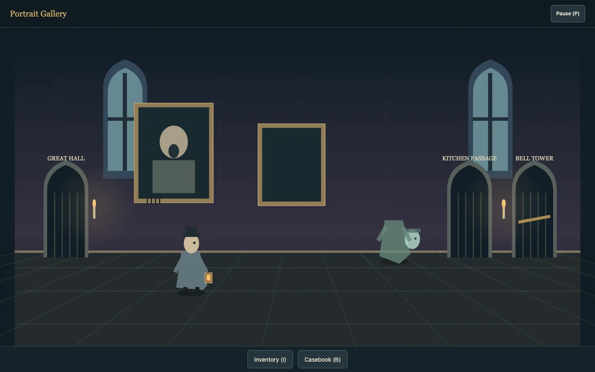

# The Thirteenth Guest

**Playable Prototype · collection ID `guest`.** A complete short point-and-click case with temporary Canvas artwork. Select **The Thirteenth Guest** in the collection and press **Play**, or **Continue saved adventure** to resume this browser’s saved case.

Blackthorn Castle, 1889. Percival Wren, Consulting Detective of Unnatural Affairs, has been hired to clear a troublesome haunting. Investigate physical clues, question an eccentric household, and work out why the ghosts seem more worried about your client than about you. The kit is brass, leather, glass and candlelight. No deaths, timed conversation choices or irretrievable essential items interrupt the investigation.

## Playing the case

Select a person or object in the scene or the **Room** list, then choose **Look**, its contextual action, or **Use** with a selected inventory item. Clicking the floor walks there. An interaction walks Wren to its approach point before executing; another command or Cancel replaces it. Look is immediate. The same room targets appear as native buttons, and **Show hotspots** outlines them in the scene.

| Control | Action |
| --- | --- |
| Pointer or touch | Select a target/tool or click the floor to walk |
| L / E / U while the scene is focused | Look / interact / use selected item |
| H / X while the scene is focused | Toggle hotspots / cancel an approach |
| Tab, Shift+Tab, Enter or Space | Navigate and activate native panels, inventory and conversation controls |
| Next / Continue | Advance a spoken line |
| Skip scene | Complete the current scene’s story result immediately |

Selecting an item reveals its description and applicable tool actions. **Combine with…** selects a second inventory item; unsuccessful combinations consume neither. The spirit lantern has one occupant and explicit open, drawn, closed and sealed states. Reveal a loose spirit or weaken a strong one, use the bellows, close the shutter, then sound the tuning fork. A premature note releases the spirit nearby so you can retry.

The **Casebook** records discovered evidence. Select the two supporting clues and propose a conclusion. Both independent investigation threads must support their conclusions before the confrontation becomes available. **Journal** retains the most recent 80 spoken lines actually displayed; skipping does not fill it with unread dialogue. **A little help** gives progressively clearer clues for an outstanding objective. Settings offers larger reading text and reduced decorative motion.

See the [shared controls and menus](../../../CATALOG.md) for pause, fullscreen, sound, restart and collection navigation. Focus can move between every investigation panel without pausing; leaving the game suspends the session.

## Progress and saves

Autosave runs after completed interactions, movement, conversations and scene endpoints. **Save adventure** requests the next stable boundary if an interaction is in progress. An in-flight approach or partially read scene is never written as a partial puzzle result. Skipping and normally completing a scene commit the same story effects.

This game is the collection’s local-persistence exception. A browser mount is still fresh; continuation is an explicit title-screen action. **Resume** continues the currently paused session. **Play** and **Restart** begin a new case. The save envelope holds the latest snapshot and one previous distinct snapshot, which subsequent progress replaces. **Restore previous save** is available on the title screen when that snapshot is valid. It is a rolling recovery point, not a permanent archive of the previous playthrough.

The local key is `arcade-lab:thirteenth-guest:v1`. The envelope validates schema, story identity, content revision, known IDs, inventory ownership, geometry and important puzzle invariants before installing state. It excludes input, queued commands, active dialogue, audio, presentation and DOM state. Unknown versions and unreadable data remain intact. A valid backup can still be loaded if the current snapshot is damaged; that visit does not overwrite the damaged envelope. Storage failure leaves the current visit playable and reports the failure. Writes compare against the value last observed by this session and refuse a detected change from another tab. There is no server, cloud sync or account requirement.

## Source ownership and adaptation

All adventure-specific code lives in [`src/games/point-and-click-adventure/`](../../../src/games/point-and-click-adventure). The mechanisms remain local to this foundation rather than expanding the shared engine into a narrative framework.

| Owner | Responsibility |
| --- | --- |
| [`content.ts`](../../../src/games/point-and-click-adventure/content.ts) | Typed room geometry, targets, inventory definitions, evidence, conclusions, facts and scene text |
| [`game.ts`](../../../src/games/point-and-click-adventure/game.ts) | Pure command dispatch, pending approaches, inventory transformations, conditional topics, story effects, hints and victory |
| [`navigation.ts`](../../../src/games/point-and-click-adventure/navigation.ts) | Routes through connected rectangular floor cells and projects floor clicks |
| [`content-validation.ts`](../../../src/games/point-and-click-adventure/content-validation.ts) | Named room/target diagnostics for invalid geometry and unreachable approaches |
| [`save.ts`](../../../src/games/point-and-click-adventure/save.ts) | Stable snapshots, validation and reconstruction of durable state |
| [`storage.ts`](../../../src/games/point-and-click-adventure/storage.ts) | Browser storage, rolling backup, conflict detection and failure feedback |
| [`ui.ts`](../../../src/games/point-and-click-adventure/ui.ts), [`style.css`](../../../src/games/point-and-click-adventure/style.css) | Readable DOM panels, selection, focus preservation, inventory, evidence and dialogue |
| [`input.ts`](../../../src/games/point-and-click-adventure/input.ts) | Shared action-button bindings plus local pointer targeting through the uniform world transform |
| [`presentation.ts`](../../../src/games/point-and-click-adventure/presentation.ts) | Temporary Canvas scenery, characters, target emphasis and decorative animation |
| [`sound.ts`](../../../src/games/point-and-click-adventure/sound.ts) | AudioBits recipes, cue admission and shared audio lifecycle composition |
| [`app.ts`](../../../src/games/point-and-click-adventure/app.ts) | Synchronous mounting, shared host/menu/focus owners, fixed stepping, saves and disposal |

To adapt the foundation, replace the typed room/cast/item/evidence definitions and authored scene text together with their story rules in `game.ts`. Update the validation dependencies and give a different adventure its own story identity and save namespace. Presentation palettes and drawing stay in `presentation.ts`; logical geometry stays in content. The current case uses clear rectangular floors, while the router also handles connected floor cells. In development, `?adventureDebug` draws the walkable cells; H reveals target bounds.

The pure rules accept semantic commands and emit semantic audio cues. No rule depends on DOM focus, animation completion, sound completion or frame rate. The browser session owns scheduling and storage, while decorative time belongs to presentation. Selecting a tool, a target, a journal view or evidence checkboxes is UI state, not story progression.

## Story and presentation

- [Story and puzzles](story.md) owns the mystery, cast, dependency graph, recovery rules and art direction. It describes the implemented case and contains spoilers.
- [Design references](research.md) records the sources and rationale relevant to maintaining or adapting this adventure.

The Prototype includes five connected rooms, four speaking NPCs, two investigation threads, evidence-backed deductions, an improvised inventory puzzle, ghost containment, a confrontation and a complete ending. It uses explicit story handlers rather than a scripting language.

For an Arcade pass, follow the [Arcade guide](../../arcade.md) and the [local art direction](story.md#art-and-sound-direction). The current renderer and preview use temporary Prototype artwork.

Follow the [shared verification policy](../../architecture.md#local-verification). Focused deterministic checks in `tests/unit/games/point-and-click-adventure/` protect navigation, cancellation, item conservation, deduction gates, skip equivalence, containment recovery, save validation and storage failures. The catalog supplies one startup smoke; `tests/browser/games/adventure-focus.spec.ts` protects focus when a submitted deduction disables its own control.
