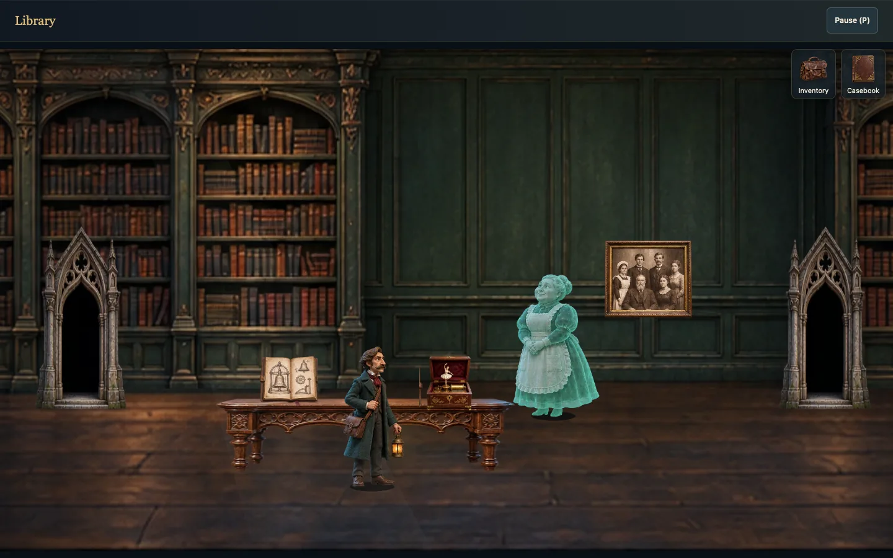

# The Thirteenth Guest

**Arcade: Blackthorn by Candlelight · collection ID `guest`.** A complete short point-and-click case with painted Gothic rooms, complete character cels and illustrated investigative tools. Select **The Thirteenth Guest** in the collection and press **Play**, or **Continue saved adventure** to resume this browser’s saved case.

Blackthorn Castle, 1889. Percival Wren, Consulting Detective of Unnatural Affairs, has been hired to clear a troublesome haunting. Investigate physical clues, question an eccentric household, and work out why the ghosts seem more worried about your client than about you. The kit is brass, leather, glass and candlelight. No deaths, timed conversation choices or irretrievable essential items interrupt the investigation.

## Playing the case

Click a person to talk, an object to investigate or collect it, or a doorway to enter. Hover or keyboard focus names the action before activation. Clicking the floor walks there. Examine, talk, pickup, item use and exits all wait for Wren to reach the authored approach point. Tools used on themselves and inventory combinations operate where Wren is standing. Clicking elsewhere replaces an approach; X cancels it without a status panel.

The scene stays visible across the viewport. **Inventory (I)** and **Casebook (B)** form the toolbar. Inventory and notes open as dismissible panels; dialogue and conversation choices share one place over the scene. How to play lives in the shared Settings screen. Close dismisses a panel; I / B also toggle their panels. Cancel (X) appears only while an inventory item is selected.

| Control | Action |
| --- | --- |
| Click or tap a scene target | Walk to it, then perform its named action |
| Inventory → item → Use in scene → target | Use an item once, then return to ordinary interaction |
| I / B during play | Open Inventory / Casebook |
| X during play | Put away an item and cancel an approach |
| Tab, Shift+Tab, Enter or Space | Navigate and activate native scene targets, inventory and conversation controls |
| Next / Continue | Advance a spoken line |
| Skip scene | Complete the current scene’s story result immediately |

Inventory shows each item’s description. Selecting an item keeps the panel open with **Use in scene** and **Combine with…** actions. Combination selection, cancellation and success or failure feedback stay inside Inventory. Unsuccessful combinations consume neither item, and successful recipes replace their inputs in the same list. Closing Inventory abandons an unfinished combination; only **Use in scene** equips a tool for a world target. The spirit lantern has one occupant and explicit open, drawn, closed and sealed states. Reveal a loose spirit or weaken a strong one, then use the bellows. **Close lantern shutter** and **Sound tuning fork** appear beside the feedback when those actions become relevant. A premature note still releases the spirit nearby so you can retry.

The **Casebook** opens as a readable evidence collection. Choose **Connect clues**, select two evidence cards, then **Make deduction**. Supported conclusions appear with their supporting pair; undiscovered conclusions are not offered as answers. Both independent investigation threads must support their conclusions before the confrontation becomes available. Selection and submission controls remain visible while evidence scrolls.

A new case opens Professor Vale’s letter requesting Wren’s visit. The complete letter is already in the Journal when **Begin investigation** dismisses it. It remains available for rereading, including when continuing an older case with a partial opening transcript.

The **Journal** lists titled conversations and scenes, newest first, with their locations. Expand an entry to read its dialogue in spoken order. Search matches people, locations, topics and dialogue words. Identical repeated conversations are kept once; changed answers remain separate entries. Only displayed spoken lines are recorded, so skipping a later scene never reveals unread dialogue. Received documents are recorded in full. History retains up to 128 distinct entries, preserving the introductory letter. Older saves preserve their flat transcript under “Earlier conversations” without inventing missing context.

Questions disappear after their current answer is completed. A parent question remains available while any follow-up is unexplored; reopening it goes straight to the remaining questions without repeating its answer. **Back to other questions** leaves a branch early, and exhausting a branch returns to its parent automatically. Changed circumstances can reopen a question with a new answer. When a character has nothing new to say, only the brief greeting and **End conversation** remain. Answer history survives saving independently of the journal’s retention limit. Older saves recover exhausted answers from their titled journal entries where available; a contextless legacy transcript is kept without guessing which questions were completed.

See the [shared controls and menus](../../../CATALOG.md) for pause, fullscreen, sound, restart and collection navigation. Focus can move between every investigation panel without pausing; leaving the game suspends the session.

## Interaction and feedback policy

Keep exploration in the scene. This case has no hint service, objective HUD, global instruction banner, reveal-all control, decorative room-entry captions, separate Help view or manual save button. Hover/focus labels describe the targeted action. Observations, dialogue and meaningful results supply clues; walking, approaching and cancelling do not narrate themselves or open a Cancel panel. Clear old feedback when a new world action starts. Evidence is stored in the Casebook without appending system acknowledgements to observations. Keep inventory results in Inventory and deduction results in the Casebook, next to the action that caused them. Keep controls documentation in Settings and equipment properties with the inventory items, without appending the next puzzle solution to each result.

The existing renderer respects the system reduced-motion preference without an extra settings checkbox. Arcade communicates walking, reaching, lantern operation and puzzle-object changes through authored images. Cosmetic motion freezes while paused, and reduced motion suppresses decorative drift, dust and light flicker. See the [artwork contract](../../../src/games/point-and-click-adventure/art/README.md). See the [point-and-click genre guidance](../../../.agents/skills/arcade-lab/references/genre-guidance.md#point-and-click-adventure) for reusable design considerations.

## Progress and saves

Autosave runs after completed interactions, movement, conversations and scene endpoints. An in-flight approach or partially read scene is never written as a partial puzzle result. Skipping and normally completing a scene commit the same story effects.

This game is the collection’s local-persistence exception. A browser mount is still fresh; continuation is an explicit title-screen action. **Resume** continues the currently paused session. **Play** and **Restart** begin a new case. The save envelope holds the latest snapshot and one previous distinct snapshot, which subsequent progress replaces. **Continue saved adventure** loads the latest valid state. **Recover backup adventure** appears only when the latest state is unreadable and the backup is valid. Normal startup never offers both. It is a rolling recovery point, not a permanent archive of the previous playthrough.

The local key is `arcade-lab:thirteenth-guest:v1`. The envelope validates schema, story identity, content revision, known IDs, inventory ownership, geometry and important puzzle invariants before installing state. It excludes input, queued commands, active dialogue, audio, presentation and DOM state. Unknown versions and unreadable data remain intact. A valid backup can still be loaded if the current snapshot is damaged; that visit does not overwrite the damaged envelope. Storage failure leaves the current visit playable and reports the failure. Writes compare against the value last observed by this session and refuse a detected change from another tab. There is no server, cloud sync or account requirement.

## Source ownership and adaptation

All adventure-specific code lives in [`src/games/point-and-click-adventure/`](../../../src/games/point-and-click-adventure). The mechanisms remain local to this foundation rather than expanding the shared engine into a narrative framework.

| Owner | Responsibility |
| --- | --- |
| [`content.ts`](../../../src/games/point-and-click-adventure/content.ts) | Typed room geometry, targets, inventory definitions, evidence, conclusions, facts and scene text |
| [`game.ts`](../../../src/games/point-and-click-adventure/game.ts) | Pure command dispatch, pending approaches, inventory transformations, spoken responses, story effects and victory |
| [`conversation.ts`](../../../src/games/point-and-click-adventure/conversation.ts) | Topic trees, conditional answer identities, exhaustion and return to available parent choices |
| [`navigation.ts`](../../../src/games/point-and-click-adventure/navigation.ts) | Routes through connected rectangular floor cells and projects floor clicks |
| [`content-validation.ts`](../../../src/games/point-and-click-adventure/content-validation.ts) | Named room/target diagnostics for invalid geometry and unreachable approaches |
| [`journal.ts`](../../../src/games/point-and-click-adventure/journal.ts) | Conversation entries, duplicate suppression, search and migration of older transcripts |
| [`save.ts`](../../../src/games/point-and-click-adventure/save.ts) | Stable snapshots, validation and reconstruction of durable state |
| [`storage.ts`](../../../src/games/point-and-click-adventure/storage.ts) | Browser storage, rolling backup, conflict detection and failure feedback |
| [`interaction.ts`](../../../src/games/point-and-click-adventure/interaction.ts) | Contextual action labels and their semantic commands, shared by mouse, touch and keyboard targets |
| [`ui.ts`](../../../src/games/point-and-click-adventure/ui.ts), [`style.css`](../../../src/games/point-and-click-adventure/style.css) | Native scene targets through the uniform world transform, contextual controls, dismissible panels and focus preservation |
| [`input.ts`](../../../src/games/point-and-click-adventure/input.ts) | Shared action-button bindings and floor-click translation through the uniform world transform |
| [`presentation.ts`](../../../src/games/point-and-click-adventure/presentation.ts) | Arcade Canvas composition, complete character cels, stateful props, cosmetic motion and the uniform world transform |
| [`sound.ts`](../../../src/games/point-and-click-adventure/sound.ts) | AudioBits recipes, cue admission and shared audio lifecycle composition |
| [`app.ts`](../../../src/games/point-and-click-adventure/app.ts) | Synchronous mounting, shared host/menu/focus owners, fixed stepping, saves and disposal |

To adapt the foundation, replace the typed room/cast/item/evidence definitions and authored scene text together with their story rules in `game.ts`. Update the validation dependencies and give a different adventure its own story identity and save namespace. Presentation roles, crops, anchors and validation live in `art.ts`, with drawing in `presentation.ts`; logical geometry stays in content. The current case uses clear rectangular floors, while the router also handles connected floor cells. In development, `?adventureDebug` draws the walkable cells.

The pure rules accept semantic commands and emit semantic audio cues. No rule depends on DOM focus, animation completion, sound completion or frame rate. The browser session owns scheduling and storage, while decorative time belongs to presentation. Selecting a tool, a journal view or evidence cards is UI state, not story progression.

## Story and presentation

- [Story and puzzles](story.md) owns the mystery, cast, dependency graph, recovery rules and art direction. It describes the implemented case and contains spoilers.
- [Design references](research.md) records the sources and rationale relevant to maintaining or adapting this adventure.

The case includes five connected rooms, four speaking NPCs, two investigation threads, evidence-backed deductions, an improvised inventory puzzle, ghost containment, a confrontation and a complete ending. It uses explicit story handlers rather than a scripting language.

Arcade replaces the temporary Prototype. The single implemented presentation has no theme selector. Its required artwork gates Play and saved-case continuation, with retry and collection navigation available on failure. A runtime graphics failure pauses the retained case and offers a fresh Arcade preparation through Retry artwork. See the [artwork guide](../../../src/games/point-and-click-adventure/art/README.md) for the brief, source illustrations, exports and role contracts.

Follow the [shared verification policy](../../architecture.md#local-verification). Focused deterministic checks in `tests/unit/games/point-and-click-adventure/` protect navigation, cancellation, item conservation, deduction gates, skip equivalence, containment recovery, save validation, durable question exhaustion, unfinished branches, changed answers, retained introductions and storage failures. The catalog supplies one startup smoke; `tests/browser/games/adventure-focus.spec.ts` protects direct touch activation, return from item use to ordinary interaction, reading-panel focus, disabled deduction controls, replaced choices, journal text input, panel dismissal and inventory-local combination feedback.
