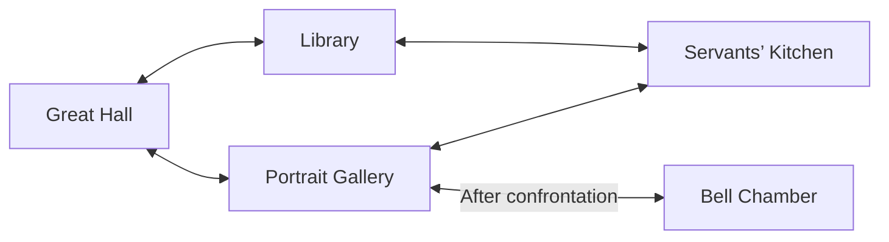
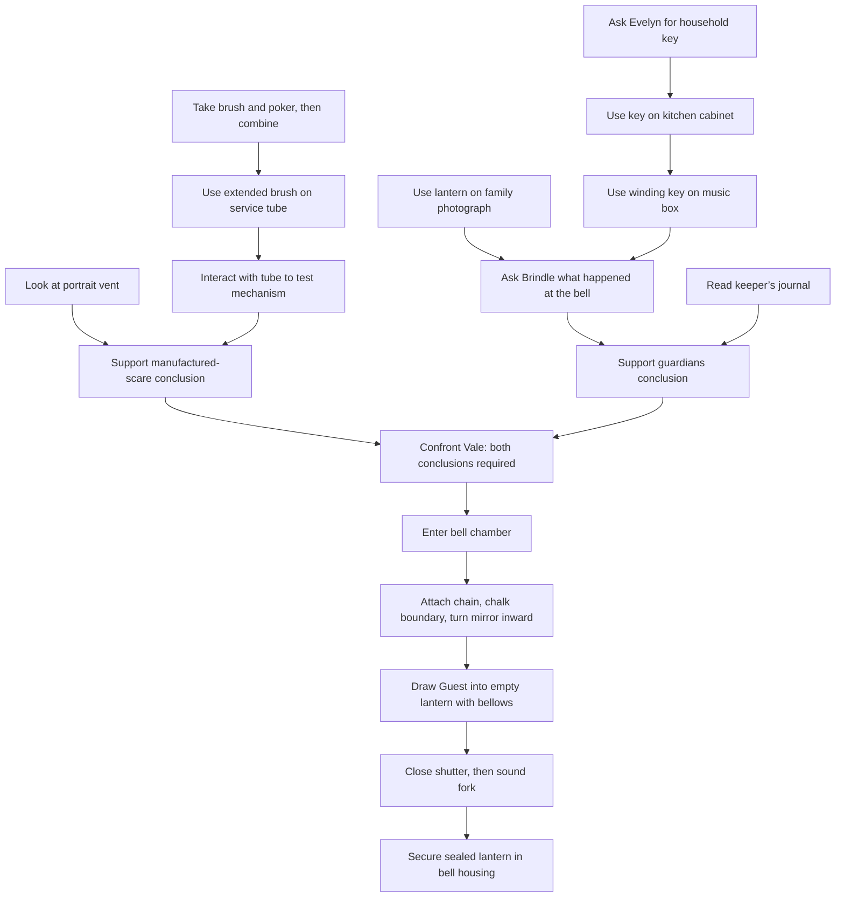

# The Thirteenth Guest: story and puzzles

[Game guide](README.md) · [Design references](research.md)

Author-facing spoilers for the playable Prototype. [`content.ts`](../../../src/games/point-and-click-adventure/content.ts) owns the room definitions, evidence and scene text; [`game.ts`](../../../src/games/point-and-click-adventure/game.ts) owns their rules. Keep this reference aligned when changing either. Controls, saves and source ownership live in the game guide.

## Mystery and cast

Blackthorn Castle, 1889. Professor Lucien Vale hires **Percival Wren, Consulting Detective of Unnatural Affairs**, to remove the household ghosts before the great bell strikes thirteen. Wren investigates with ordinary observation and improvised brass, leather and glass apparatus. The supernatural rules are invented historical fantasy.

The household ghosts are the guards of a prison. Vale damaged the ward around the bell, then staged screaming portraits with a service-tube mechanism to persuade the owner that the ghosts must go. He believes the imprisoned **Thirteenth Guest** will give him command of the dead. It is actually rehearsing his voice so it can leave wearing his identity.

Wren establishes the fraud and the ward’s purpose independently, confronts Vale, then repairs the ward and contains the Guest. The bell stops at twelve, the household stays, and Wren invoices for “One haunting investigated. One haunting preserved. One guest removed.” The apprentice joke appears only if the opening whisper has moved into its portrait.

| Character | Role and voice |
| --- | --- |
| **Percival Wren** | Precise, overconfident detective whose improvised equipment and honest corrections supply the comedy |
| **Lady Evelyn Blackthorn** | Practical living owner who supplies family context and freely lends the household key |
| **Professor Lucien Vale** | Polished antiquarian concealing the staged scares; becomes frightened when the Guest’s intentions emerge |
| **Sir Oswald** | Headless ghost knight guarding the bell door; his chain restrains the Guest rather than threatening the household |
| **Mrs. Brindle** | Ghost housekeeper whose familiar music and photograph help her recall the original containment |
| **The Guest** | A predatory impersonator whose repeated reassurance cannot answer a fresh question |

The tone combines atmospheric Gothic rooms, professional embarrassment and sincere concern for the household. The thirteenth stroke creates dramatic pressure; there is no countdown, death or irreversible penalty for experimenting.

## Room map

The hall introduces Evelyn, Vale, the marked restoration crate and the loose whisper. The gallery holds the portrait vent, Oswald and the empty portrait. The library holds Brindle, her music box, the family photograph and the keeper’s account. The kitchen supplies the brush, poker, service-tube mechanism and locked cabinet. The bell chamber contains the three ward components, Guest and bell housing. Earlier rooms remain accessible during the finale.

## Puzzle dependencies

Arrows show required progress. The two investigations can proceed in either order; optional evidence and the opening containment practice are separate from their gates.

### The manufactured scream

Looking at the portrait records its physical draft and disturbed soot. The kitchen brush is too short and the poker cannot sweep; their threaded fittings justify combining them. Using the extended brush clears the service tube. Interacting with it tests the new bellows and reed, reproducing the scream upstairs. A later interaction disconnects the clock linkage without removing evidence.

The Casebook requires exactly the draft and manufactured-scream evidence to support the fraud conclusion. Vale’s restoration mark and borrowed voice add context but are optional evidence. Wrong item combinations consume nothing; the successful brush recipe replaces both inputs with one extended brush.

### The household guards

Evelyn’s conversation supplies the household key. Using it on the kitchen cabinet retrieves the winding key. Wind the music box and illuminate the photograph with the lantern, in either order, then ask Brindle what happened at the bell. Completing her scene records testimony. The keeper’s journal can be read independently.

The Casebook requires exactly the keeper’s account and Brindle’s testimony to support the guardians conclusion. The tune and illuminated photograph remain effective; there is no timed conversation window or repeated winding requirement.

### Confrontation

Both supported conclusions expose Vale’s accusation topic. Completing or skipping that scene records the confrontation and the borrowed voice, and opens the bell chamber. There is no separate requirement to submit evidence to Oswald. Unsupported deductions explain the missing relationship and can be retried.

### Containment and recovery

The loose whisper offers optional equipment practice: reveal it with lantern light, use bellows, close the lantern shutter through its inventory action, then sound the fork. Use the sealed lantern on the gallery’s empty portrait to release it and free the vessel. Practice and release are not required if the lantern is already empty.

In the bell chamber, attach the chain, repair the boundary with chalk and turn the mirror inward. These discrete actions work in any order. All three are required before the bellows can draw in the Guest. The lantern holds one presence, so an occupied whisper must first be sealed and released into its portrait.

Sounding the fork before closing a filled lantern releases the spirit nearby. It can be captured again; the repaired ward and evidence remain intact. A sealed Guest must be secured in the bell housing to begin the ending. Chalk does not run out, and wrong uses do not consume essential tools. Skipping a story scene commits the same puzzle result as reading it.

## Art and sound direction

This is the creative direction for adapting the temporary presentation, not an asset specification. Follow the shared [Arcade workflow](../../arcade.md) for production and integration.

Use a storybook Gothic castle: a towering rain-dark hall, crooked portrait gallery, amber library, copper-and-soot kitchen and moonlit bell chamber. Midnight blue, bottle green, tarnished brass and candle amber frame restrained spectral turquoise. Preserve readable clues and target silhouettes against the scenery.

Wren’s long travelling coat and overstuffed case should have an original silhouette. Ghosts need complete expressive shapes that remain legible when translucent. Prioritize authored walking, examining, reaching, lantern operation and reaction poses. Oswald holding his head is a complete character pose. Room art must preserve the authored floor and approach geometry.

Use restrained wind, bellows, metallic resonances, music-box phrases and supernatural cues. The false scream should suggest an air-driven mechanism; the Guest can echo borrowed motifs. Keep essential clue information in text and visuals, with no requirement to identify a pitch by ear. Recipes and cue policy belong in `sound.ts`.
