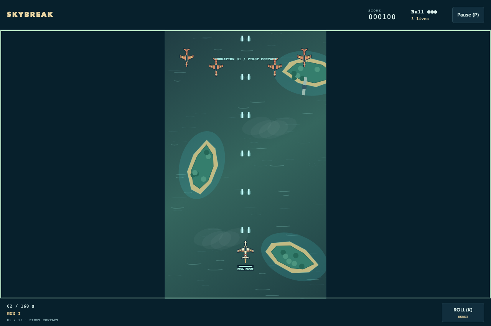
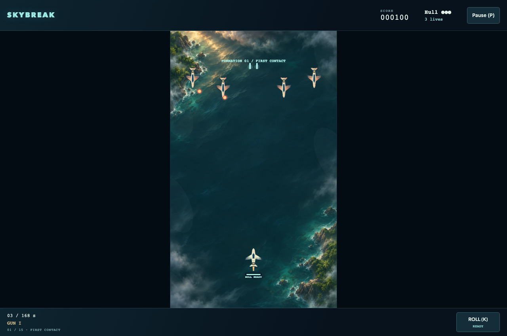

# Skybreak

[Source](../../../src/games/skybreak/) | [Controls](../../../CATALOG.md#skybreak) | [Shared contracts](../../architecture.md)

A vertical arcade shooter with three image-based Canvas 2D appearances. The [artwork guide](../../../src/games/skybreak/art/README.md) owns the Aurora Fleet sheets and Tempest Coast background contract.

## Theme modes

**Normal** uses Pacific Run's simple aircraft sprites and procedural ocean. **Assets · Aurora Fleet** gives that same coastal sortie rounded retro aircraft, painted wing roundels and a muted teal sea. **Quality · Tempest Coast** combines shaded complete aircraft cels with an illustrated storm sea and atmospheric coastal scenery. Every mode keeps the game's aircraft, coast and tactical identity.

## Tempest Coast art direction

A dark petrol-blue storm sea, turquoise shoals and subtropical rocky headlands frame an earthly aerial operation. A quiet central corridor separates ivory aircraft, warm hostile wings and bright rounds from subdued wave detail. An AI-generated aerial plate supplies atmospheric sea texture, edge mist and broken sunlight. Shaded metal artwork gives the aircraft volume through complete images.

Banking and evasive rolls transform whole cels. The flagship's complete nacelle images follow actual moving weak points. A short flight trail and bounded event shockwaves complement impacts and fire blooms. Canvas combines the detailed coastal plate, restrained edge mist, complete aircraft, supply images, protection rings and attack warnings through the same `flightView` projection. The HUD and menus carry matching dark coastal surfaces and pale accents.

Reduced motion freezes scenery, exhaust variation and banking and removes trails, shockwaves and decorative flashes. Quality prepares the background and aircraft bundle before activation. Drawing failure restores the sprite-based Normal presentation while preserving the sortie. None of the modes needs a graphics library.

## Operation Iron Tempest

A complete flight lasts about 2–3 active minutes, with a hard 168-second limit. Fifteen formations arrive between 1 and 100 seconds. Straight wings fire aimed singles, diagonal crossings close from alternating sides, swooping bombers fire slow tridents, and narrow interceptors fire faster aimed pairs. Bombers and interceptors show amber muzzle cells filling before their volleys: three for the trident and two for the pair. Aim tracks the player until release. Their preparation window is preserved when they enter or regain firing space, so an expired offscreen timer cannot cause an immediate volley. After 65 seconds enemy firing intervals shorten by 15%. Escaping aircraft give no score. Defeating them awards 100 / 150 / 200 / 300 points by type.

Supply drops arrive on fixed deadlines, independent of kills or chance. They drift downward at 80 world units/second. Each collection awards 100 points:

| Pickup | Appearance | Effect |
| --- | --- | --- |
| Power | Gold double chevron | Gun II adds a center shot; Gun III also shortens cadence from 0.14 to 0.105 seconds. Further power pickups award 250 extra points. |
| Spread | Violet branching arrows | Adds two diagonal shots for 24 active seconds. Collecting another refreshes the duration. |
| Repair | Green cross | Repairs one of the current aircraft's three hull points. At full hull, awards 250 extra points. |

The player starts with three aircraft. Losing hull grants 1.15 seconds of immunity. Losing an aircraft restores hull at the starting position, clears hostile rounds, restores roll readiness, lowers forward fire by one level, removes spread, and grants 2.5 seconds of immunity. Lives do not increase. A fresh roll press grants 0.65 seconds of immunity and recharges in 5.5 active seconds. Holding its key never queues another roll. A compact bar beside the aircraft fills during recharge and reads **ROLL READY** when available, with a brief outline when readiness returns. Near the lower boundary it moves above the aircraft. The cockpit dot marks the physical player position. Blinking and a cyan ring show protection; a short edge flash and a separate damage sound distinguish player damage from enemy impacts.

Movement is immediate at 300 world units/second, with normalized diagonals and proportional drag strength. The physical world is 480×800. Small authored collision circles remain independent of decorative wings and glow. Shared relative swept-circle math accounts for movement of both endpoints. Each projectile resolves its nearest living target once.

## Iron Tempest

The armored flying fortress arrives at 112 seconds. Its three-second entrance protects it from damage and suppresses firing. Its broad armor is decorative; the glowing central reactor and two moving engine nacelles are the hittable circles. All three reduce one 420-point hull, displayed with phase and attack warnings. After entry they remain vulnerable during both preparation and recovery; **Keep firing · Aim for the lights** reinforces this between attack warnings.

It cycles three readable patterns:

1. **Fan volley:** seven slow rounds spread downward with gaps. Dashed rays show the spread before release.
2. **Target lock:** both engines fire three aimed rounds toward the player's position captured at charge start. Dashed lines and a target ring mark that fixed position. Moving after the warning avoids the lock.
3. **Lane barrage:** three marked vertical lanes receive four rounds each. The next barrage alternates the lanes, leaving broad safe corridors.

At half hull, fans widen to nine rounds, aimed rounds accelerate, charge shortens from 1.1 to 0.9 seconds, and recovery shortens from 1.7 to 1.1 seconds. The fortress continues its slow lateral movement. Contact with its weak points damages the player; decorative armor does not.

Destroying it awards 5,000 points and clears hostile objects. A 2.8-second destruction state in the simulation drives the bounded explosion sequence. Movement remains available during destruction. Victory then awards 1,000 per remaining aircraft plus 250 per hull point. Results show score, flight time, kills, supplies, and the survival bonus. Losing all aircraft or reaching the time limit with the fortress alive ends in defeat. Damage on the kill step resolves before victory.

## Presentation and source ownership

The HUD emphasizes hull above remaining lives, with a warm warning at critical hull. The portrait field stays centered; relative drag displacement uses CSS pixels. Holding a movement pointer fires, and a second touch can roll.

Deep reef ribbons, currents, island shelves and clouds are procedural Canvas scenery. Actors, supplies and weak-point housings are committed images; nacelle rings remain semantic overlays. Particles are capped at 180; fortress destruction adds nine analytic fire blooms. The tactical Canvas layer supplies firing preparation and roll readiness across all modes. Reduced motion also suppresses ocean drift, roll spin, particles, the roll-ready outline and damage flashes; attack lanes, muzzle cells, recharge and immunity cues remain visible.

Dry gun transients leave room for metal impacts, enemy blasts, hull fractures and slipstream rolls. Armor hits, charge warnings, cannon releases and core destruction have distinct recipes. Supply and outcome tones use a brighter arcade palette. The sound adapter coalesces each cue per frame, caps voices at 12 and uses restrained world-space stereo placement.

| Responsibility | Owner in `src/games/skybreak/` |
| --- | --- |
| Balance, supply deadlines, collision sizes and formations | `content.ts` |
| Sortie, weapons, roll, boss patterns and scoring | `game.ts` |
| Appearance definitions and sheet validation | `themes.ts`, `assets.ts`, `art-pack.ts`, `art/` |
| Canvas sprite drawing, ocean scenery and bounded effects | `presentation.ts` |
| Layered coastal drawing and renderer contract | `presentation.ts`, `flight-presentation.ts` |
| Recipes and cue policy | `sound-recipes.ts`, `sound.ts` |
| Menus, HUD and styles | `ui.ts`, `style.css` |
| Action translation and session composition | `input.ts`, `app.ts` |

## Local verification

The [game invariants](../../../tests/unit/games/skybreak/game.test.mjs) cover pickups, respawn, boss patterns and scoring; [art checks](../../../tests/unit/games/skybreak/art.test.mjs) cover sheet contracts. [Browser checks](../../../tests/browser/games/skybreak/) cover flight controls, appearance replacement and Tempest Coast recovery. Use the [shared verification commands](../../architecture.md#local-verification).
