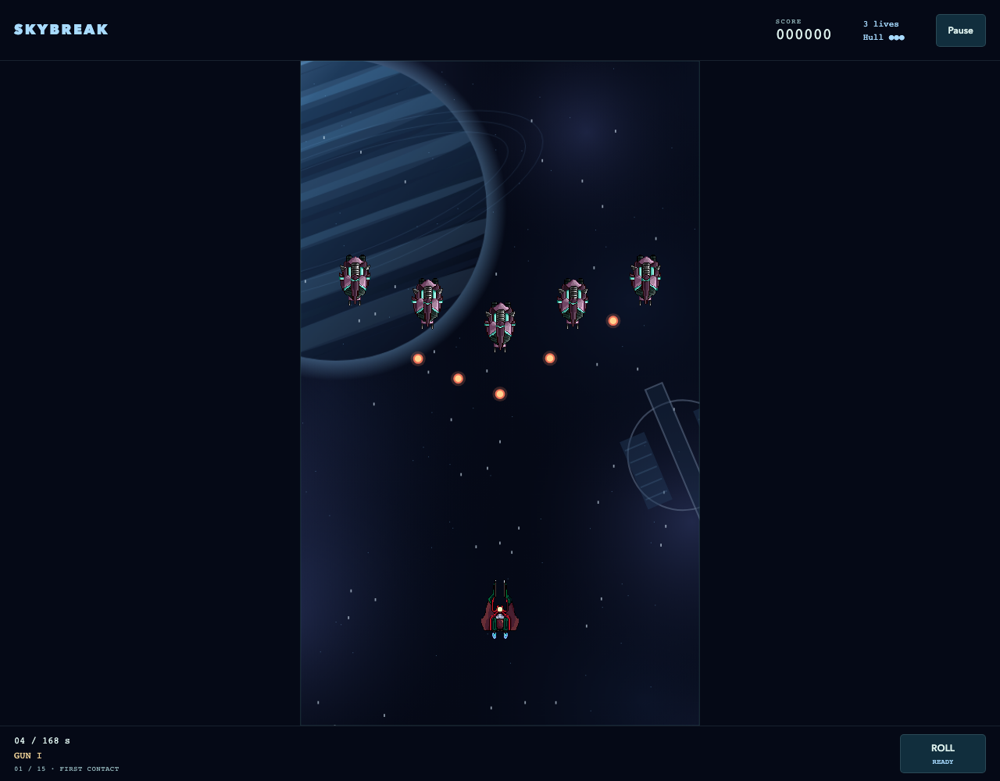

# Skybreak

[Source](../../../src/games/skybreak/) | [Controls](../../../CATALOG.md#skybreak) | [Shared contracts](../../architecture.md)

A vertical arcade shooter with Canvas 2D and Three.js appearances. The [artwork guide](../../../src/games/skybreak/art/README.md) owns the Aurora Fleet sheets and Orbital Foundry background contract.

## Theme modes

**Normal** uses Pacific Run’s procedural aircraft and ocean. **Assets · Aurora Fleet** combines six animated SVG sheets with orbital scenery. **Quality · Orbital Foundry** uses sculpted Three.js ships and an illustrated deep-space background. Pacific Run’s aerial sortie and ocean are the starting setting for future art direction; the orbital treatments describe the current adaptations.

## Orbital Foundry art direction

Quality places the sortie above an icy planet and a vast orbital shipyard. A dark navy combat corridor separates the ivory fighter, gunmetal hostile fleet and warm hostile rounds from the cyan planetary rim. An AI-generated background supplies distant atmospheric detail; editable geometry supplies the moving station fragments and all six ship roles. The models preserve the fleet's authored proportions.

Beveled armor, inset canopies, gold trim, vents, emissive drives and role-specific wings give the fleet a cohesive material language. Banking and evasive rolls reveal decorative depth. The flagship adds segmented armor, engine housings that follow the actual moving weak points, and a shrinking wreck during destruction. Cyan drive plumes, a short flight trail and event-driven expanding shockwaves complement existing impacts and fire blooms. Restrained bloom touches bright propulsion and impacts; crisp Canvas projectiles, supply symbols, protection rings and attack warnings remain above it. The HUD and menus use matching dark metal surfaces and pale cyan accents.

The orthographic camera shares `flightView` with the Canvas tactical layer. Reduced motion freezes scenery, exhaust variation and banking, and removes trails, shockwaves and flashes.

Quality imports `quality/foundry.ts` and a validated background. Models share geometry/materials, ship parts batch by material, actors are pooled, and bloom resolution is capped. Normal and Assets load no graphics library.

## Operation Iron Tempest

A complete flight lasts about 2–3 active minutes, with a hard 168-second limit. Fifteen formations arrive between 1 and 100 seconds. Straight wings fire aimed singles, diagonal crossings close from alternating sides, swooping bombers fire slow tridents, and narrow interceptors fire faster aimed pairs. Bombers and interceptors show amber muzzle cells filling before their volleys: three for the trident and two for the pair. Aim tracks the player until release. Their preparation window is preserved when they enter or regain firing space, so an expired offscreen timer cannot cause an immediate volley. After 65 seconds enemy firing intervals shorten by 15%. Escaping aircraft give no score. Defeating them awards 100 / 150 / 200 / 300 points by type.

Supply drops arrive on fixed deadlines, independent of kills or chance. They drift downward at 80 world units/second. Each collection awards 100 points:

| Pickup | Appearance | Effect |
| --- | --- | --- |
| Power | Gold double chevron | Gun II adds a center shot; Gun III also shortens cadence from 0.14 to 0.105 seconds. Further power pickups award 250 extra points. |
| Spread | Violet branching arrows | Adds two diagonal shots for 24 active seconds. Collecting another refreshes the duration. |
| Repair | Green cross | Repairs one of the current aircraft's three hull points. At full hull, awards 250 extra points. |

The player starts with three aircraft. Losing hull grants 1.15 seconds of immunity. Losing an aircraft restores hull at the starting position, clears hostile rounds, restores roll readiness, lowers forward fire by one level, removes spread, and grants 2.5 seconds of immunity. Lives do not increase. A fresh roll press grants 0.65 seconds of immunity and recharges in 5.5 active seconds. Holding its key never queues another roll. A compact bar beside the aircraft fills during recharge and reads **ROLL READY** when available, with a brief outline when readiness returns. Near the lower boundary it moves above the aircraft. The cockpit dot marks the physical player position. Blinking and a cyan ring show protection; a short edge flash and a separate damage sound distinguish player damage from enemy impacts.

Movement is immediate at 300 world units/second, with normalized diagonals and proportional drag strength. The physical world is 480×800. Small authored collision circles remain independent of decorative wings and glow. Shared relative swept-circle math accounts for movement of both endpoints. Each projectile resolves its nearest living target once.

## Iron Tempest

The armored flying fortress arrives at 112 seconds. Its three-second entrance protects it from damage and suppresses firing. Its broad armor is decorative; the glowing central reactor and two moving engine nacelles are the hittable circles. All three reduce one 420-point hull, displayed with phase and attack warnings. After entry they remain vulnerable during both preparation and recovery; **Keep firing · Aim for the lights** reinforces this between attack warnings.

It cycles three readable patterns:

1. **Fan volley:** seven slow rounds spread downward with gaps. Dashed rays show the spread before release.
2. **Target lock:** both engines fire three aimed rounds toward the player's position captured at charge start. Dashed lines and a target ring mark that fixed position. Moving after the warning avoids the lock.
3. **Lane barrage:** three marked vertical lanes receive four rounds each. The next barrage alternates the lanes, leaving broad safe corridors.

At half hull, fans widen to nine rounds, aimed rounds accelerate, charge shortens from 1.1 to 0.9 seconds, and recovery shortens from 1.7 to 1.1 seconds. The fortress continues its slow lateral movement. Contact with its weak points damages the player; decorative armor does not.

Destroying it awards 5,000 points and clears hostile objects. A 2.8-second destruction state in the simulation drives the bounded explosion sequence. Movement remains available during destruction. Victory then awards 1,000 per remaining aircraft plus 250 per hull point. Results show score, flight time, kills, supplies, and the survival bonus. Losing all aircraft or reaching the time limit with the fortress alive ends in defeat. Damage on the kill step resolves before victory.

## Presentation and source ownership

The HUD emphasizes hull above remaining lives, with a warm warning at critical hull. The portrait field stays centered; relative drag displacement uses CSS pixels. Holding a movement pointer fires, and a second touch can roll.

Deep reef ribbons, currents, island shelves, clouds, aircraft shadows and rotating nacelle rings are procedural Canvas scenery. Particles are capped at 180; fortress destruction adds nine analytic fire blooms. The tactical Canvas layer supplies firing preparation and roll readiness across all modes. Reduced motion also suppresses ocean drift, roll spin, particles, the roll-ready outline and damage flashes; attack lanes, muzzle cells, recharge and immunity cues remain visible.

Dry gun transients leave room for metal impacts, enemy blasts, hull fractures and slipstream rolls. Armor hits, charge warnings, cannon releases and core destruction have distinct recipes. Supply and outcome tones use a brighter arcade palette. The sound adapter coalesces each cue per frame, caps voices at 12 and uses restrained world-space stereo placement.

| Responsibility | Owner in `src/games/skybreak/` |
| --- | --- |
| Balance, supply deadlines, collision sizes and formations | `content.ts` |
| Sortie, weapons, roll, boss patterns and scoring | `game.ts` |
| Appearance definitions and sheet validation | `themes.ts`, `assets.ts`, `art-pack.ts`, `art/` |
| Canvas drawing/effects and cached orbital scenery | `presentation.ts`, `space-scene.ts` |
| Quality rendering/models and renderer contract | `quality/`, `flight-presentation.ts` |
| Recipes and cue policy | `sound-recipes.ts`, `sound.ts` |
| Menus, HUD and styles | `ui.ts`, `style.css` |
| Action translation and session composition | `input.ts`, `app.ts` |

## Local verification

The [game invariants](../../../tests/unit/games/skybreak/game.test.mjs) cover pickups, respawn, boss patterns and scoring; [art checks](../../../tests/unit/games/skybreak/art.test.mjs) cover sheet contracts. [Browser checks](../../../tests/browser/games/skybreak/) cover flight controls, appearance replacement and Orbital Foundry recovery. Use the [shared verification commands](../../architecture.md#local-verification).
